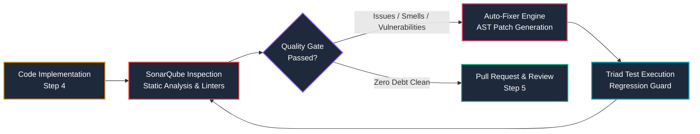

# AI-Native SDLC Engine

> **The Universal, Model-Agnostic Zero-Debt SDLC Automation Framework**
> *Automate the entire software engineering lifecycle — from task planning to merged PR — with continuous technical debt auto-remediation across any AI model, IDE, terminal, or CI/CD pipeline.*

**Version:** 2.1.1 | **Last Updated:** 2026-11-14

[](CHANGELOG.md)
[](https://python.org)
[](https://github.com/langchain-ai/langgraph)
[](https://github.com/techdeveloper-org/ai-native-sdlc-engine/actions/workflows/ci.yml)
[](LICENSE)
[](#the-zero-debt-architecture)
[](#multi-model--multi-platform-execution)
[](#quick-start)

---

## What Is AI-Native SDLC Engine?

**AI-Native SDLC Engine** is an extensible, model-agnostic software development lifecycle automation framework built on LangGraph. Rather than functioning as a narrow conversational assistant or a single-vendor tool, it acts as an **autonomous engineering team in a box** that eliminates technical debt continuously on every single pull request.

Traditional AI coding assistants (Copilot, Cursor) operate line-by-line or function-by-function — they generate code and stop, leaving test suites, impact analysis, PR creation, reviews, documentation, and technical debt accumulation entirely to humans.

The **AI-Native SDLC Engine** automates the entire lifecycle end-to-end:
1. **Pre-Flight Guard**: Validates Unicode, UTF-8 encodings, and environment paths.
2. **Codebase Archaeology & Call Graph Scan**: Scans ASTs across 4 languages (Python, Java, TypeScript, Kotlin) to discover blast radiuses, hot nodes, and danger zones *before* changing code.
3. **Adaptive Planning & Prompt Assembly**: Scores complexity on a 1–25 scale, detects fast-paths, and builds grounded multi-agent execution bundles.
4. **Issue Lifecycle**: Opens tracked GitHub and Jira issues automatically.
5. **Isolated Workspace**: Provisions feature branches (`feature/ISSUE-KEY`).
6. **Strict Standards Enforcement**: Enforces clean architecture, design tokens, and Level 2.2 contract docstrings (zero noisy inline narration).
7. **Triad Test Generation**: Generates positive, negative, and edge-case test suites (JUnit5, Mockito, Pytest).
8. **Continuous Zero-Debt Remediation**: Triggers integrated SonarQube static analysis with an automated multi-turn fix loop (`auto_fixer.py`) before opening a PR.
9. **Autonomous PR & Code Review**: Opens the PR with automated call-graph impact diffs, runs multi-agent peer reviews, and enforces 4 quality gates.
10. **Living Documentation & Diagrams**: Generates 13 UML diagram types (Mermaid + Draw.io) and updates OpenAPI specs and SRS documentation.
11. **Telemetry & Audit Release**: Logs Prometheus metrics, OpenTelemetry distributed traces, append-only JSON audit logs, and closes the ticket.

---

## Capability Comparison Matrix

| Capability | AI-Native SDLC Engine | GitHub Copilot | Cursor | Devin |
|---|:---:|:---:|:---:|:---:|
| **Universal Model Support** | **Claude · OpenAI · Gemini · Ollama** | OpenAI only | Anthropic / OpenAI | Proprietary |
| **Zero-Debt Auto-Remediation Loop** | **Yes (SonarQube + AST Auto-Fixer)** | — | — | — |
| **Pre-Change Call Graph Impact Analysis** | **Yes (Python, Java, TS, Kotlin)** | — | — | — |
| **Breaking Change Detection (Graph Diff)** | **Yes** | — | — | — |
| **Autonomous Issue Lifecycle (GitHub + Jira)** | **Yes (Create → Sync → Close)** | — | — | — |
| **Triad Test Suite Generation (Pos/Neg/Edge)** | **Yes** | — | Partial | — |
| **Automated PR & Multi-Agent Peer Review** | **Yes** | — | — | Partial |
| **13 UML Diagram Types (Mermaid + Draw.io)** | **Yes** | — | — | — |
| **Living Documentation Updates (Step 7)** | **Yes** | — | — | — |
| **SonarQube Quality Gate Auto-Heal Loop** | **Yes** | — | — | — |
| **Extensible Quality Adapter Surface** | **Yes (SonarQube, Snyk, Semgrep)** | — | — | — |
| **Headless CI/CD Automation (Actions/Jenkins)** | **Yes** | — | — | — |
| **Docker & Kubernetes Microservice Ready** | **Yes** | — | — | — |
| **Token Optimization Layer** | **Yes (60–85% Context Savings)** | — | — | — |

---

## The Zero-Debt Architecture



### Why "Zero-Debt by Construction"?
In typical projects, developers write features under time pressure, promising to "clean up technical debt later." The debt never gets resolved until system architecture degrades.

The AI-Native SDLC Engine enforces **Zero-Debt by Construction**:
- **Continuous Remediation on Every PR**: As code is implemented, the SonarQube orchestrator (`sdlc_engine/sonarqube/orchestrator.py`) runs static analysis directly against the modified files.
- **Automated AST-Level Patching**: If cognitive complexity, code duplication, security hotspots, or bugs are flagged, `auto_fixer.py` generates an AST-level refactoring patch, applies it, and re-validates against test suites.
- **Dead Code Pruning**: Step 0 Call Graph scanner identifies unreachable classes, unused exports, and orphan functions, ensuring obsolete code is excised before merge.
- **Extensible Quality Tooling Adapter**: Standardized `QualityGate` interfaces allow plugging in additional linters, security tools, and vulnerability scanners (SonarQube, Semgrep, Snyk, Trivy, CodeQL) without modifying core graph topology.

---

## End-to-End Workflow: Chronological Policy Execution Order

The AI-Native SDLC Engine operates an autonomous, deterministic, policy-governed execution pipeline. Unlike ad-hoc AI coding tools that jump straight into writing unverified code, this engine executes tasks through a strict chronological progression of **3 Structural Execution Levels** (Level 0, Level 1, Level 2) partitioned into **11 Sequential Stages** (Stage 0 to Stage 10), governed by **47 specialized policies**.

Every incoming request passes through this exact chronological sequence to guarantee zero technical debt, complete AST verification, cryptographic secret safety, and total traceability.

---

### Chronological Master Pipeline Architecture

```mermaid
flowchart LR
    IN(["Task / Issue Intake"]) --> P1

    subgraph P1["PHASE 1: Foundation & Context Sync (Levels 0-1)"]
        direction TB
        S0["<b>Stage 0: Pre-Flight Guard</b><br/>Paths · UTF-8 · Unicode · Locks<br/><i>(Policies 1-6)</i>"]
        S1["<b>Stage 1: Context & State Sync</b><br/>Session UUID · Spend Caps · Token Budget<br/><i>(Policies 7-9)</i>"]
        S0 --> S1
    end

    subgraph P2["PHASE 2: Architecture & Construction (Level 2)"]
        direction TB
        S2["<b>Stage 2: AST CallGraph Scan</b><br/>Blast Radius · Coupling · Patterns<br/><i>(Policies 10-14)</i>"]
        S3["<b>Stage 3: Planning & Models</b><br/>[BLOCKING] Plan Mode · Flash/Sonnet/Opus<br/><i>(Policies 15-20)</i>"]
        S4["<b>Stage 4: Workspace & Issues</b><br/>[BLOCKING] Issue #N · MCP · Sandbox<br/><i>(Policies 21-25)</i>"]
        S5["<b>Stage 5: Implementation & DB</b><br/>Clean Arch · Level 2.2 Docstrings · Expand-Contract<br/><i>(Policies 26-32)</i>"]
        S2 --> S3 --> S4 --> S5
    end

    subgraph P3["PHASE 3: Quality, Security & Release (Level 2)"]
        direction TB
        S6["<b>Stage 6: Triad Tests</b><br/>[BLOCKING] Positive · Negative · Edge<br/><i>(Policies 33-34)</i>"]
        S7["<b>Stage 7: Zero-Debt Healing</b><br/>SonarQube + Auto-Fixer (Iter ≤ 3)<br/><i>(Policy 35)</i>"]
        S8["<b>Stage 8: Security & Commits</b><br/>[BLOCKING] TruffleHog · Entropy · SemVer<br/><i>(Policies 36-39)</i>"]
        S9["<b>Stage 9: PR Review & HITL</b><br/>CallGraph Diff · GACS ≥ 0.85 · p95 SLA<br/><i>(Policies 40-43)</i>"]
        S10["<b>Stage 10: Living Docs & Metrics</b><br/>OpenAPI · 13 UML · Prometheus :9090<br/><i>(Policies 44-47)</i>"]
        S6 --> S7 --> S8 --> S9 --> S10
    end

    P1 --> P2
    P2 --> P3
    S7 -- "Quality Smells (Iter ≤ 3)" --> S5
    S9 -- "Review Feedback" --> S5
    S10 --> OUT(["Zero-Debt Shipped PR & Release"])

    style IN fill:#0f172a,stroke:#64748b,stroke-width:2px,color:#ffffff
    style OUT fill:#0f172a,stroke:#10b981,stroke-width:2px,color:#ffffff
    style P1 fill:#0f172a,stroke:#38bdf8,stroke-width:2px,color:#ffffff
    style P2 fill:#0f172a,stroke:#f59e0b,stroke-width:2px,color:#ffffff
    style P3 fill:#0f172a,stroke:#10b981,stroke-width:2px,color:#ffffff
    style S0 fill:#1e293b,stroke:#38bdf8,stroke-width:1px,color:#ffffff
    style S1 fill:#1e293b,stroke:#38bdf8,stroke-width:1px,color:#ffffff
    style S2 fill:#1e293b,stroke:#f59e0b,stroke-width:1px,color:#ffffff
    style S3 fill:#1e293b,stroke:#f59e0b,stroke-width:1px,color:#ffffff
    style S4 fill:#1e293b,stroke:#f59e0b,stroke-width:1px,color:#ffffff
    style S5 fill:#1e293b,stroke:#f59e0b,stroke-width:1px,color:#ffffff
    style S6 fill:#1e293b,stroke:#06b6d4,stroke-width:1px,color:#ffffff
    style S7 fill:#1e293b,stroke:#ef4444,stroke-width:2px,color:#ffffff
    style S8 fill:#1e293b,stroke:#ec4899,stroke-width:1px,color:#ffffff
    style S9 fill:#1e293b,stroke:#f59e0b,stroke-width:1px,color:#ffffff
    style S10 fill:#1e293b,stroke:#a855f7,stroke-width:1px,color:#ffffff
```



---

### Executive 11-Stage Workflow Matrix

The table below provides a high-level summary of the 11 execution stages, their phase alignment, and the critical quality gates that protect each milestone.

| Stage & Level | Phase Scope | Governing Policies | Enforced Gates & Exit Invariants |
|:---|:---|:---|:---|
| **Stage 0 (Level 0)** | Pre-Flight Sanitization | Policies 1–6 (Path, UTF-8, Unicode, Recovery, Preferences, Context) | Clean workspace, normalized POSIX paths, strict UTF-8 non-BOM, docs read <= 800 lines. |
| **Stage 1 (Level 1)** | Context & State Sync | Policies 7–9 (Session, Budget, Compaction) | Unique session UUID, $2/task budget ceiling armed, context headroom sized. |
| **Stage 2 (Level 2, Step 0)** | AST CallGraph Pre-Analysis | Policies 10–14 (CallGraph, CodeGraph, Patterns, Scripts, Decision Engine) | Complete blast radius mapped, circular dependencies flagged, risk score [1–25]. |
| **Stage 3 (Level 2, Step 1)** | Planning & Model Routing | Policies 15–20 (Plan Mode, Breakdown, Models, Anti-Hallucination, Consultation, Prompt) | **BLOCKING**: Plan approved first, atomic subtasks in `task.md`, zero hallucinated APIs. |
| **Stage 4 (Level 2, Steps 2-3)** | Workspace & Issue Lifecycle | Policies 21–25 (GitHub Issue, MCP, File Sandboxing, Progress, Failure KB) | **BLOCKING**: GitHub Issue `#N` linked, MCP servers verified, protected files locked. |
| **Stage 5 (Level 2, Step 4)** | Implementation & DB Evolution | Policies 26–32 (Clean Arch, Tool Opt, Parallel, Docstrings, Standards, DB, Error Recovery) | Clean Architecture/SRP, Level 2.2 Docstrings, zero inline narration, expand-contract DB. |
| **Stage 6 (Level 2, Step 4b)** | Triad Test Generation | Policies 33–34 (Test Case Policy, Test Generation) | **BLOCKING**: Positive, Negative, and Edge-Case parameterized test suites passing. |
| **Stage 7 (Level 2, Step 4c)** | Zero-Debt Healing Loop | Policy 35 (Quality Gate Policy) | SonarQube static analysis; auto-remediation patch loop (capped at 3 iterations). |
| **Stage 8 (Level 2, Step 4d)** | Security, Secrets & Commits | Policies 36–39 (Secrets, License, Conventional Commit, SemVer) | **BLOCKING**: Shannon entropy < 4.5, zero credentials, viral copyleft banned, atomic commit `#N`. |
| **Stage 9 (Level 2, Steps 5-6)** | PR Review, Benchmarks & HITL | Policies 40–43 (PR Review, HITL Escalation, Benchmark, Issue Closure) | Call-graph diff review, GACS >= 0.85 escalation, p95 latency <= 1.05x, issue closed with SHA. |
| **Stage 10 (Level 2, Steps 7-8)** | Living Docs & Telemetry Release | Policies 44–47 (Documentation, Metrics, Hooks, Final Summary) | OpenAPI synced, Prometheus metrics on `:9090`, health probes on `:8080`, human audit summary. |
---

### Detailed Chronological Stage-by-Stage Walkthrough

The following sections explain the exact chronological execution order across each stage, describing why the stage runs at its specific point, the causal chain of policy invocations, and the exit/loopback criteria.

#### Stage 0: Pre-Flight Guard & Environment Sanitization (Level 0, Steps 1–6)
* **Chronological Position**: **First Step (T = 0)**. Executes immediately upon receiving any command or task prompt, before any context is hydrated or files are touched.
* **Why this order?**: If file paths have Windows backslash issues, file encodings contain hidden BOM marks, or previous runs left dangling lockfiles, downstream AST parsers and Python/Java runtimes will crash silently. Sanitization must precede all processing.

| Step # | Policy Specification | Execution Class | Enforced Rule & Invariant | Downstream Output / Handoff |
|:---:|:---|:---:|:---|:---|
| **1** | [`policies/windows-path-policy.md`](policies/windows-path-policy.md) | Transformative | Normalizes all paths to POSIX forward slashes (`/`) and strips drive letter ambiguities. | Sanitized file path strings |
| **2** | [`policies/encoding-validation-policy.md`](policies/encoding-validation-policy.md) | Blocking Gate | Validates strict UTF-8 without Byte Order Mark (BOM); rejects hidden `\xef\xbb\xbf` and smart quotes. | Validated UTF-8 files |
| **3** | [`policies/unicode-fix-policy.md`](policies/unicode-fix-policy.md) | Transformative | Strips unprintable Unicode characters, zero-width spaces (`\u200b`), and emojis from CLI commands. | Sanitized command strings |
| **4** | [`policies/recovery-policy.md`](policies/recovery-policy.md) | Recovery Ladder | Scans for dangling `.lock` files or crashed runs from prior sessions; auto-recovers clean state. | Clean workspace & lock flags |
| **5** | [`policies/user-preferences-policy.md`](policies/user-preferences-policy.md) | Transformative | Loads developer persona, language preferences (Hinglish/English), and output formatting styles. | User preference profile |
| **6** | [`policies/context-reading-policy.md`](policies/context-reading-policy.md) | Guardrail | Mandates reading `README.md`, `SRS.md`, and `AGENTS.md` before coding, capped at 800 lines budget. | Project baseline context |

* **Gate Exit Criterion**: Environment verified 100% clean, paths normalized, and project baseline understood.

#### Stage 1: Context & State Synchronization (Level 1, Steps 7–9)
* **Chronological Position**: **Step 2 (T = 1)**. Runs after environment sanitization to provision session boundaries and spend caps.
* **Why this order?**: Multi-terminal safety and spend caps must be active before invoking LLM calls to prevent runaway loops.

| Step # | Policy Specification | Execution Class | Enforced Rule & Invariant | Downstream Output / Handoff |
|:---:|:---|:---:|:---|:---|
| **7** | [`policies/session-management-policy.md`](policies/session-management-policy.md) | Transformative | Provisions unique UUID session ID, establishes isolated memory partition, and initializes SQLite ledger. | `_SESSION_ID`, session ledger |
| **8** | [`policies/cost-and-token-budget-policy.md`](policies/cost-and-token-budget-policy.md) | Blocking Guard | Sets hard spend ceilings ($2/task, $10/session), initializes token tracking, and caps auto-fix loops at 3. | Budget limits & token monitors |
| **9** | [`policies/context-management-policy.md`](policies/context-management-policy.md) | Guardrail | Allocates token headroom across 4 tiers; arms auto-compaction and AST deduplication at 75% capacity. | Context budget window |

* **Gate Exit Criterion**: Session ledger active, spending caps armed, and context budget allocated.

#### Stage 2: AST CallGraph Scan & Pre-Analysis (Level 2 Step 0, Steps 10–14)
* **Chronological Position**: **Step 3 (T = 2)**. Pre-code archaeology phase.
* **Why this order?**: Understanding callers, callees, and coupling metrics is prerequisite to formulating a sound implementation plan.

| Step # | Policy Specification | Execution Class | Enforced Rule & Invariant | Downstream Output / Handoff |
|:---:|:---|:---:|:---|:---|
| **10** | [`policies/callgraph-analysis-policy.md`](policies/callgraph-analysis-policy.md) | Transformative | Scans multi-language ASTs (Python, Java, TS, Go) to map callers, callees, and complete blast radius. | Call-graph impact matrix |
| **11** | [`policies/code-graph-analysis-policy.md`](policies/code-graph-analysis-policy.md) | Guardrail | Computes afferent/efferent coupling metrics and flags circular dependencies before code is touched. | Structural dependency graph |
| **12** | [`policies/cross-project-patterns-policy.md`](policies/cross-project-patterns-policy.md) | Transformative | Scans sibling repositories for approved organizational patterns (JWT auth, error wrappers, DTO patterns). | Proven pattern snippets |
| **13** | [`policies/architecture-script-mapping-policy.md`](policies/architecture-script-mapping-policy.md) | Transformative | Maps architectural intent deterministically to vetted automation scripts (Flyway, Liquibase, OpenAPI gen). | Resolved executable scripts |
| **14** | [`policies/intelligent-decision-engine-policy.md`](policies/intelligent-decision-engine-policy.md) | Decision Router | Evaluates task risk and complexity [1–25] to select fast-path vs full 10-stage governance pipeline. | Pipeline execution route |

* **Gate Exit Criterion**: Blast radius quantified, structural coupling calculated, and pattern alignment established.

#### Stage 3: Task Planning, Model Routing & Prompt Assembly (Level 2 Step 1, Steps 15–20)
* **Chronological Position**: **Step 4 (T = 3)**. Formal planning, model assignment, and prompt generation.
* **Why this order?**: Prevents premature coding, enforces Plan Mode approval, and eliminates hallucinated libraries before execution.

| Step # | Policy Specification | Execution Class | Enforced Rule & Invariant | Downstream Output / Handoff |
|:---:|:---|:---:|:---|:---|
| **15** | [`policies/task-phase-enforcement-policy.md`](policies/task-phase-enforcement-policy.md) | **BLOCKING GATE** | **STRICT PLAN MODE**: Forbids all write actions, file edits, or commits until explicit plan approval. | Plan Mode active flag |
| **16** | [`policies/automatic-task-breakdown-policy.md`](policies/automatic-task-breakdown-policy.md) | Transformative | Deconstructs incoming objectives into sequential, atomic sub-phases with verifiable acceptance criteria. | `task.md` / `task-breakdown.json` |
| **17** | [`policies/intelligent-model-selection-policy.md`](policies/intelligent-model-selection-policy.md) | Optimization | Routes subtasks to the optimal model tier: Haiku/Flash (fast parsing), Sonnet (coding), Opus (architecture). | Model-to-subtask mapping |
| **18** | [`policies/anti-hallucination-enforcement.md`](policies/anti-hallucination-enforcement.md) | Blocking Guard | Verifies that all referenced packages, classes, and APIs exist in the repository AST or declared dependencies. | AST grounding verification |
| **19** | [`policies/proactive-consultation-policy.md`](policies/proactive-consultation-policy.md) | Decision Matrix | Scores ambiguity [1–10]: applies conservative defaults for Low [1–3], consults rules for Med [4–7], escalates High [8–10]. | Risk resolution ledger |
| **20** | [`policies/prompt-generation-policy.md`](policies/prompt-generation-policy.md) | Transformative | Constructs master system prompts with anti-drift rules, tool schemas, and domain skills; isolates prompt budget. | Master execution prompt |

* **Gate Exit Criterion**: Approved implementation plan in place, zero hallucinated imports, and master prompt compiled.

#### Stage 4: Workspace Provisioning & Issue Tracking (Level 2 Steps 2–3, Steps 21–25)
* **Chronological Position**: **Step 5 (T = 4)**. Workspace sandboxing and ticket provisioning.
* **Why this order?**: Issue-First governance requires a tracked issue and isolated feature branch before touching source files.

| Step # | Policy Specification | Execution Class | Enforced Rule & Invariant | Downstream Output / Handoff |
|:---:|:---|:---:|:---|:---|
| **21** | [`policies/github-issues-integration-policy.md`](policies/github-issues-integration-policy.md) | **BLOCKING GATE** | **ISSUE-FIRST MANDATE**: Automatically provisions or links a GitHub/Jira issue `#N` before touching any code. | GitHub Issue `#N` & tracking URL |
| **22** | [`policies/mcp-plugin-discovery-policy.md`](policies/mcp-plugin-discovery-policy.md) | Pre-Flight Guard | Discovers and verifies health and permissions of required MCP servers (`git-ops`, `github-api`, `uml-diagram`). | Verified MCP connection pool |
| **23** | [`policies/file-management-policy.md`](policies/file-management-policy.md) | Guardrail | Protects `.git`, `.env`, and credential stores; mandates atomic staging via swap files to prevent corruption. | File sandbox boundary |
| **24** | [`policies/task-progress-tracking-policy.md`](policies/task-progress-tracking-policy.md) | Telemetry | Initializes granular milestone checkpoints in `task-progress.json` and updates live checkboxes in `task.md`. | `task-progress.json` baseline |
| **25** | [`policies/common-failures-prevention.md`](policies/common-failures-prevention.md) | Guardrail | Pre-screens CLI commands against a failure knowledge base (e.g., PowerShell `;` vs Bash `&&`, line prefixes). | Validated command pipeline |

* **Gate Exit Criterion**: GitHub issue linked, isolated feature branch created (`feature/ISSUE-N`), and protected files locked.

#### Stage 5: Implementation, Clean Architecture & Database Migrations (Level 2 Step 4, Steps 26–32)
* **Chronological Position**: **Step 6 (T = 5)**. Core code construction and schema evolution.
* **Why this order?**: Only after requirements, architecture, issue tracking, and tooling are established does coding begin.

| Step # | Policy Specification | Execution Class | Enforced Rule & Invariant | Downstream Output / Handoff |
|:---:|:---|:---:|:---|:---|
| **26** | [`policies/implementation-execution-policy.md`](policies/implementation-execution-policy.md) | Architectural Guard | Enforces Hexagonal / Clean Architecture, Single Responsibility Principle, and code modifications in isolated branch. | Decoupled business logic |
| **27** | [`policies/tool-optimization-policy.md`](policies/tool-optimization-policy.md) | Optimization | Enforces chunked reads (max 800 lines/45KB), AST symbol jumps, and 50-item grep caps to save 60-85% token waste. | Optimized tool invocation |
| **28** | [`policies/parallel-execution-policy.md`](policies/parallel-execution-policy.md) | Orchestration | Dispatches independent sub-agent tasks concurrently across isolated branch sandboxes and merges results cleanly. | Concurrently created components |
| **29** | [`policies/coding-standards-enforcement-policy.md`](policies/coding-standards-enforcement-policy.md) | Code Quality | Enforces strict Level 2.2 Docstrings (JavaDoc/JSDoc/Docstrings); strictly bans line-by-line narration comments. | Clean, contract-documented code |
| **30** | [`policies/common-standards-policy.md`](policies/common-standards-policy.md) | Code Quality | Enforces uniform naming conventions, centralized error hierarchy, and `ApiResponse<T>` / `Result<T>` wrappers. | Standardized interfaces & DTOs |
| **31** | [`policies/database-migration-policy.md`](policies/database-migration-policy.md) | Safety Guard | Enforces Expand-Contract zero-downtime evolution, batch-throttled backfills (<= 1,000 rows), and rollback scripts. | Non-locking migration scripts |
| **32** | [`policies/error-recovery-policy.md`](policies/error-recovery-policy.md) | Recovery Guard | Catches transient syntax errors and compilation failures; applies exponential backoff and localized fixes. | Self-healed syntax patches |

* **Gate Exit Criterion**: Clean code compiled, contract docstrings present, and zero-downtime database schemas validated.

#### Stage 6: Triad Test Generation & Regression Verification (Level 2 Step 4b, Steps 33–34)
* **Chronological Position**: **Step 7 (T = 6)**. Automated test generation and blast-radius verification.
* **Why this order?**: Code without verification is debt. Triad testing must execute immediately after implementation to guarantee correctness.

| Step # | Policy Specification | Execution Class | Enforced Rule & Invariant | Downstream Output / Handoff |
|:---:|:---|:---:|:---|:---|
| **33** | [`policies/test-case-policy.md`](policies/test-case-policy.md) | **BLOCKING GATE** | **MANDATORY TRIAD TESTING**: Enforces comprehensive coverage: Positive (happy path), Negative (errors), Edge-cases. | Triad test requirements |
| **34** | [`policies/test-generation-policy.md`](policies/test-generation-policy.md) | Transformative | Generates parameterized, mock-isolated unit and integration tests (JUnit 5, PyTest, Jasmine/Karma). | Verified test suite execution |

* **Gate Exit Criterion**: 100% of Triad tests passing with zero regressions across the call-graph blast radius.

#### Stage 7: Zero-Debt Healing & Convergence Guard (Level 2 Step 4c, Step 35)
* **Chronological Position**: **Step 8 (T = 7)**. Static analysis and automated AST refactoring loop.
* **Why this order?**: Static analysis runs after unit tests pass to eliminate complexity spikes, maintainability smells, and duplication before commits are staged.

| Step # | Policy Specification | Execution Class | Enforced Rule & Invariant | Downstream Output / Handoff |
|:---:|:---|:---:|:---|:---|
| **35** | [`policies/quality-gate-policy.md`](policies/quality-gate-policy.md) | **REMEDIATION LOOP** | Scans code via SonarQube. If smells/bugs exist, triggers `auto_fixer.py` (loops back to Stage 5, max 3 iterations). | Zero-debt verified code |

* **Gate Exit Criterion**: SonarQube Quality Gate Status: **PASSED** (Zero technical debt by construction).

#### Stage 8: Security, Secret Scanning & Pre-Commit Gates (Level 2, Step 4d)
* **Chronological Position**: **Step 9 (T = 8)**. Pre-commit security verification and git staging.
* **Why this order?**: Code that passes tests and static analysis must still undergo deep cryptographic secret scanning and license audits before it is committed to git history.
* **Execution Sequence**:
  1. [`policies/security-and-secrets-policy.md`](policies/security-and-secrets-policy.md) **BLOCKS** commit if TruffleHog/Gitleaks regex finds keys, Shannon entropy $H(X) \ge 4.5$, or CVSS $\ge 7.0$ CVEs exist in dependencies.
  2. [`policies/license-compliance-policy.md`](policies/license-compliance-policy.md) checks all transitive dependencies, bans viral copyleft Category C licenses (GPL-3.0/AGPL), and builds the SBOM.
  3. [`policies/git-auto-commit-policy.md`](policies/git-auto-commit-policy.md) creates an atomic Conventional Commit referencing the GitHub Issue (`feat(auth): add token rotation (#335)`).
  4. [`policies/version-release-policy.md`](policies/version-release-policy.md) checks SemVer bump criteria and updates `CHANGELOG.md` under `[Unreleased]`.
* **Gate Exit Criterion**: Zero credentials leaked, licenses compliant, and atomic git commit recorded.

#### Stage 9: PR Review, Performance Benchmarking & HITL Escalation (Level 2, Steps 5-6)
* **Chronological Position**: **Step 10 (T = 9)**. Pull Request creation, peer review, and performance verification.
* **Why this order?**: Once code is safely committed on the feature branch, it must be validated under automated PR review, latency SLA benchmarking, and human escalation gates prior to merge.
* **Execution Sequence**:
  1. [`policies/pr-code-review-policy.md`](policies/pr-code-review-policy.md) pushes the branch, opens a GitHub PR, attaches AST call-graph diffs, and runs automated multi-agent code review. If review comments require modifications, the engine loops back to Stage 5.
  2. [`policies/human-in-the-loop-escalation-policy.md`](policies/human-in-the-loop-escalation-policy.md) computes GACS confidence ($\ge 0.85$); halts for explicit human approval on destructive DDL or production deployment.
  3. [`policies/performance-benchmark-policy.md`](policies/performance-benchmark-policy.md) runs latency benchmark (p95 degradation $\le 1.05\times$), 10-minute memory soak tests, and time complexity checks.
  4. [`policies/issue-closure-policy.md`](policies/issue-closure-policy.md) verifies the merge commit SHA, checks acceptance criteria against AST, and transitions the GitHub issue and Jira ticket to Closed.
* **Gate Exit Criterion**: PR approved, performance SLA met, PR merged, and tracking ticket closed.

#### Stage 10: Living Documentation, Diagrams & Telemetry Release (Level 2 Steps 7–8, Steps 44–47)
* **Chronological Position**: **Step 11 (T = 10)**. Release synchronization, diagram generation, and observability export.
* **Why this order?**: Living architecture documents, OpenAPI specs, and system telemetry must reflect the final merged state of the system, finalized in the release commit.

| Step # | Policy Specification | Execution Class | Enforced Rule & Invariant | Downstream Output / Handoff |
|:---:|:---|:---:|:---|:---|
| **44** | [`policies/documentation-update-policy.md`](policies/documentation-update-policy.md) | Transformative | Updates OpenAPI 3.0 specs, architecture documentation, and `README.md` to match newly merged code in release commit. | Synchronized living docs |
| **45** | [`policies/metrics-monitoring-policy.md`](policies/metrics-monitoring-policy.md) | Telemetry | Exports pipeline execution metrics to Prometheus on port `9090` (`GET /metrics`) and exposes health probes on port `8080`. | Prometheus & health endpoints |
| **46** | [`policies/hook-system-policy.md`](policies/hook-system-policy.md) | Lifecycle | Dispatches post-pipeline lifecycle hooks, closes OpenTelemetry trace spans, and executes safe session shutdown. | Clean process termination |
| **47** | [`policies/final-summary-policy.md`](policies/final-summary-policy.md) | Telemetry | Generates a comprehensive, human-readable execution summary with audit proofs, commit SHAs, and test metrics. | User-facing completion summary |

* **Gate Exit Criterion**: Living documentation synchronized, telemetry active, and pipeline safely finalized.

---

## Multi-Model & Multi-Platform Execution

The engine is built to run everywhere — with any model, in any environment:

```
                      ┌────────────────────────────────────────┐
                      │          AI-Native SDLC Engine         │
                      └───────────────────┬────────────────────┘
                                          │
        ┌───────────────────┬─────────────┴───────┬───────────────────┐
        ▼                   ▼                     ▼                   ▼
┌───────────────┐   ┌───────────────┐     ┌───────────────┐   ┌───────────────┐
│ Direct CLI    │   │ Docker / K8s  │     │ CI/CD Runner  │   │ Claude Plugin │
│ Terminal Tool │   │ Microservice  │     │ Headless Auto │   │ & IDE Surface │
└───────┬───────┘   └───────┬───────┘     └───────┬───────┘   └───────┬───────┘
        │                   │                     │                   │
        └───────────────────┼─────────────────────┴───────────────────┘
                            ▼
              ┌───────────────────────────┐
              │ Dynamic LLM Provider Mesh │
              └─────────────┬─────────────┘
                            │
       ┌──────────────┬─────┴────────┬──────────────┐
       ▼              ▼              ▼              ▼
┌─────────────┐┌─────────────┐┌─────────────┐┌─────────────┐
│  Anthropic  ││   OpenAI    ││   Google    ││ Local GPU / │
│   Claude    ││    GPT-4o   ││ Gemini 2.5  ││   Ollama    │
└─────────────┘└─────────────┘└─────────────┘└─────────────┘
```

---

## Quick Start

### 1. Prerequisites
- **Python**: 3.10+
- **Git**: 2.30+
- **LLM API Key** (choose any provider):
  - Anthropic: `ANTHROPIC_API_KEY`
  - OpenAI: `OPENAI_API_KEY`
  - Gemini: `GEMINI_API_KEY`
  - Local: [Ollama](https://ollama.ai) running locally (zero API key needed)
- **GitHub Token** (optional, for automated issue & PR tracking): `GITHUB_TOKEN`

### 2. Installation
```bash
git clone https://github.com/techdeveloper-org/ai-native-sdlc-engine.git
cd ai-native-sdlc-engine
pip install -r requirements.txt
cp .env.example .env
# Configure your preferred LLM provider key in .env
```

---

### 3. Execution Modalities

#### Modality A: Universal CLI Framework (Local Workstation)
Run tasks directly from your terminal using either the high-level `sdlc` CLI or the direct pipeline runner:

```bash
# 1. High-level CLI: Run an autonomous SDLC task
python scripts/cli.py run "Fix authentication timeout bug in token validator"

# 2. Direct Pipeline Runner: Full autonomous mode (all 9 active steps)
python scripts/3-level-flow.py --invoked-by=run-pipeline \
  --message="Implement tenant isolation middleware"

# 3. Plan & Decompose only (read-only planning, changes nothing)
python scripts/3-level-flow.py --invoked-by=plan \
  --message="Design payment reconciliation service"

# 4. Template Fast-Path (~0s instant planning skip)
python scripts/3-level-flow.py --invoked-by=run-pipeline \
  --message="Add user audit export" \
  --orchestration-template=orchestration_template.example.json
```

#### Modality B: Containerized Microservice (Docker & Kubernetes)
Run the engine inside isolated containers for team or server environments:

```bash
# Docker Compose
docker compose -f docker/docker-compose.yml up

# Single Docker run
docker build -t ai-native-sdlc-engine -f docker/Dockerfile .
docker run --env-file .env ai-native-sdlc-engine \
  python scripts/3-level-flow.py --invoked-by=run-pipeline --message="Your task description"

# Kubernetes Deployment
kubectl apply -f k8s/
```

#### Modality C: Headless CI/CD Automation (GitHub Actions / Jenkins)
Run the engine as an autonomous QA/review agent on every push or pull request:

```yaml
# .github/workflows/ai-sdlc.yml
name: AI-Native SDLC Review & Debt Guard
on: [pull_request]
jobs:
  review:
    runs-on: ubuntu-latest
    steps:
      - uses: actions/checkout@v4
      - uses: actions/setup-python@v5
        with: { python-version: "3.11" }
      - run: pip install -r requirements.txt
      - env:
          ANTHROPIC_API_KEY: ${{ secrets.ANTHROPIC_API_KEY }}
          GITHUB_TOKEN: ${{ secrets.GITHUB_TOKEN }}
        run: |
          python scripts/3-level-flow.py --invoked-by=review --message="Automated PR Review and Debt Guard"
```

#### Modality D: Claude Code Plugin Integration
If using the Claude Code CLI, install the plugin package for native slash commands:

```bash
/plugin marketplace add techdeveloper-org/ai-native-sdlc-engine
/plugin install ai-native-sdlc-engine@techdeveloper-org

# Available slash commands:
/ai-native-sdlc-engine:plan          # Steps 0-1  — Analyse and decompose, change nothing
/ai-native-sdlc-engine:implement     # Steps 2-4  — Issue, branch, code
/ai-native-sdlc-engine:review        # Steps 5-6  — PR, automated review, close issue
/ai-native-sdlc-engine:document      # Step 7     — Docs and 13 UML diagrams
/ai-native-sdlc-engine:release       # Step 8     — Telemetry, audit log, release
/ai-native-sdlc-engine:run-pipeline  # Steps 0-8  — Full autonomous SDLC end-to-end
/ai-native-sdlc-engine:doctor        # Environment & MCP diagnostic health check
```

---

## Autonomous SDLC Governance Policies (47 Policies)

The engine operates under **47 autonomous governance policies** housed in [`policies/`](policies/). Rather than relying on fuzzy model intuition, every engineering action — from pre-flight safety checks, secret scans, and AST call-graph impact scans to SonarQube zero-debt quality gates, database migrations, and atomic git commits — is bound by deterministic, enforceable policy contracts across 7 functional domains:

> [!TIP]
> **Looking for the chronological execution order?** See [End-to-End Workflow: Chronological Policy Execution Order](#end-to-end-workflow-chronological-policy-execution-order) and the [Master Chronological Execution Table](#master-chronological-execution-table-step-1-to-step-47) above for the exact sequential progression (Step 1 to Step 47) from task intake to production release. The reference tables below categorize the 47 policies by functional engineering domain.

### 1. Pre-Flight & Execution Safety (7 Policies)

| Policy & Specification | Core Behavioral Rule | Practical Real-World Example |
|---|---|---|
| [`policies/security-and-secrets-policy.md`](policies/security-and-secrets-policy.md) | Enforces zero-tolerance credential hygiene (TruffleHog/Gitleaks regex, Shannon entropy $H(X) \ge 4.5$, Bayesian score $\ge 0.85$, CVSS $\ge 7.0$ CVE blocker). | Pre-commit gate detects a hardcoded Stripe live key or high-risk CVE in `pom.xml`, blocks git staging, and demands environment variables. |
| [`policies/anti-hallucination-enforcement.md`](policies/anti-hallucination-enforcement.md) | Enforces strict grounding and verification against hallucinated packages, APIs, and paths. | If an LLM attempts to import `org.company.auth.SuperSecurity`, the AST grounding gate blocks execution and requires a package declared in `pom.xml` / `requirements.txt`. |
| [`policies/encoding-validation-policy.md`](policies/encoding-validation-policy.md) | Validates source files against invisible non-ASCII bytes and UTF-8 BOM corruptions. | Prevents hidden byte-order marks (`\xef\xbb\xbf`) or Windows smart quotes (`“`, `”`) from breaking Java compilers or Python AST parsers. |
| [`policies/windows-path-policy.md`](policies/windows-path-policy.md) | Enforces normalized forward slashes (`/`) and sanitizes drive letters on Windows workstations. | Automatically normalizes `C:\Users\app\src\main.py` to `C:/Users/app/src/main.py` so cross-platform tools, shell scripts, and Docker containers don't fail on unescaped backslashes. |
| [`policies/context-reading-policy.md`](policies/context-reading-policy.md) | Mandatory pre-flight mandate requiring the agent to read `README.md`, `SRS.md`, and `CLAUDE.md` before coding. | Prevents an agent from rewriting a working authentication module simply because it didn't read the existing architecture spec first. |
| [`policies/recovery-policy.md`](policies/recovery-policy.md) | Emergency Level -1 recovery ladder that executes when environment or pre-flight checks fail. | If a corrupted temporary cache or broken lockfile is detected during startup, auto-recovers the workspace to a clean state before restarting the pipeline. |
| [`policies/error-recovery-policy.md`](policies/error-recovery-policy.md) | Operational error-recovery protocol with retry budgets, fallback ladders, and exponential backoff. | If a rate-limit error (HTTP 429) occurs during an API call, applies an exponential jittered backoff rather than crashing the pipeline. |

### 2. Architecture, Graph & Pattern Intelligence (6 Policies)

| Policy & Specification | Core Behavioral Rule | Practical Real-World Example |
|---|---|---|
| [`policies/database-migration-policy.md`](policies/database-migration-policy.md) | Mandates zero-downtime expand-contract schema evolution, throttled backfills ($\le 1,000$ rows/batch), and companion rollback scripts. | Rejects direct `DROP COLUMN` in production migrations; requires adding new columns as nullable, dual-writing, and dropping old structures in release $N+1$. |
| [`policies/callgraph-analysis-policy.md`](policies/callgraph-analysis-policy.md) | Scans codebase ASTs across 4 languages to compute blast radius before touching code. | When modifying `UserService.authenticate()`, the call graph detects that 14 controllers and 3 batch jobs depend on it, automatically flagging them for regression testing. |
| [`policies/code-graph-analysis-policy.md`](policies/code-graph-analysis-policy.md) | Generates structural knowledge graph nodes, edges, and coupling metrics at Step 3.0.1. | Analyzes coupling metrics (Afferent/Efferent coupling) and identifies circular package dependencies before new classes are committed. |
| [`policies/architecture-script-mapping-policy.md`](policies/architecture-script-mapping-policy.md) | Maps high-level architecture decisions deterministically to runnable scripts. | Ensures that when a task requires a database schema migration, the engine invokes `flyway_migrate.py` rather than improvising manual SQL executions. |
| [`policies/cross-project-patterns-policy.md`](policies/cross-project-patterns-policy.md) | Scans proven architectural patterns across sibling repositories. | Automatically applies the organization's approved JWT + Refresh Token rotation pattern rather than inventing a custom, untested token approach. |
| [`policies/intelligent-decision-engine-policy.md`](policies/intelligent-decision-engine-policy.md) | Automated decision tree traversal for technology and framework choices. | Given an incoming task for a REST API, evaluates language, throughput, and existing repo stack to select Spring Boot vs FastAPI. |

### 3. Planning, Task Breakdown & Model Routing (7 Policies)

| Policy & Specification | Core Behavioral Rule | Practical Real-World Example |
|---|---|---|
| [`policies/cost-and-token-budget-policy.md`](policies/cost-and-token-budget-policy.md) | Enforces hard spend ceilings ($2/task, $10/session), 3-iteration auto-fix convergence limit, and output token discipline. | Terminates runaway recursive loops if auto-fix fails to converge after 3 attempts, preventing hundreds of dollars in wasted API spend. |
| [`policies/automatic-task-breakdown-policy.md`](policies/automatic-task-breakdown-policy.md) | Mandates structured task decomposition into numbered sub-tasks with status tracking. | A request like "build payment webhook" is decomposed into 4 discrete tasks (DTO validation, HMAC verification, DB persistence, audit event) before any coding starts. |
| [`policies/task-phase-enforcement-policy.md`](policies/task-phase-enforcement-policy.md) | Mandatory blocking policy enforcing phase transitions and stop conditions. | Blocks the engine from advancing to "Step 5: PR Review" if "Step 4: Implementation" has failing tests or unaddressed compilation errors. |
| [`policies/task-progress-tracking-policy.md`](policies/task-progress-tracking-policy.md) | Mandates real-time tracking of tasks and status updates in `task.md`. | Updates `task.md` with checkboxes `[x]` as each sub-task finishes, giving developers live visibility into execution progress. |
| [`policies/prompt-generation-policy.md`](policies/prompt-generation-policy.md) | Enforces strict prompt composition, role constraints, and context isolation. | Packages task instructions with exact file paths, constraints, and acceptance criteria while excluding noisy conversational chat history. |
| [`policies/intelligent-model-selection-policy.md`](policies/intelligent-model-selection-policy.md) | Dynamically routes tasks to the optimal model (Claude, GPT, Gemini, Ollama) based on complexity and cost. | Routes trivial typo fixes to Haiku/Flash to minimize cost and latency, while routing complex multi-file architectural refactoring to Claude Opus or GPT-4o. |
| [`policies/proactive-consultation-policy.md`](policies/proactive-consultation-policy.md) | Automated risk evaluation matrix [1-10] and fallback ladders replacing non-interactive prompts. | Replaces headless CI blocking prompts with automated risk-based routing: Low [1-3] auto-executes, Medium [4-7] queries rules, High [8-10] triggers escalation. |

### 4. Clean Architecture, Quality Gates & Coding Standards (7 Policies)

| Policy & Specification | Core Behavioral Rule | Practical Real-World Example |
|---|---|---|
| [`policies/performance-benchmark-policy.md`](policies/performance-benchmark-policy.md) | Enforces SLA regression gates ($p95 \le \text{baseline} \times 1.05$, error rate $\le 0.1\%$, 10-min memory soak stability). | Blocks a PR that replaces an in-memory index with unindexed DB queries, detecting a 400% latency regression before merge. |
| [`policies/coding-standards-enforcement-policy.md`](policies/coding-standards-enforcement-policy.md) | Enforces Level 2.2 microservices standards (clean architecture, strict DTO/Entity separation, docstrings). | Rejects code where a controller directly returns a JPA Entity instead of an immutable Response DTO, preventing accidental schema leakage. |
| [`policies/common-standards-policy.md`](policies/common-standards-policy.md) | Enforces common interface patterns, error wrappers, and result containers across services. | Ensures all API endpoints return `ApiResponse<T>` with standardized timestamp, status, and payload fields across microservices. |
| [`policies/quality-gate-policy.md`](policies/quality-gate-policy.md) | Evaluates SonarQube static analysis, code coverage, and cyclomatic complexity gates. | Fails the build if test coverage drops below 80% or if new security vulnerabilities (e.g., SQL injection risk) are flagged. |
| [`policies/test-case-policy.md`](policies/test-case-policy.md) | Mandates Triad testing (Positive, Negative, Edge-case) for all implementations. | For an email validator, requires tests for valid email (positive), missing `@` (negative), and 255-character length boundary (edge case). |
| [`policies/test-generation-policy.md`](policies/test-generation-policy.md) | Governs automated test suite generation and mocking strategies. | Detects JUnit5 + Mockito in Java projects and generates parameterized tests with isolated mocks and assertions. |
| [`policies/common-failures-prevention.md`](policies/common-failures-prevention.md) | Pre-checks commands and tools against a knowledge base of known failure patterns. | Automatically converts Bash chained `&&` commands to PowerShell `;` chains on Windows to prevent runtime command failures. |
| [`policies/unicode-fix-policy.md`](policies/unicode-fix-policy.md) | Automatically strips non-ASCII corruptions, BOM marks, and invalid unicode encodings. | Replaces corrupted characters like `\u200b` (zero-width space) with valid ASCII before compiling code. |

### 5. Issue Lifecycle, PR & Git Governance (6 Policies)

| Policy & Specification | Core Behavioral Rule | Practical Real-World Example |
|---|---|---|
| [`policies/license-compliance-policy.md`](policies/license-compliance-policy.md) | Governs open-source license compatibility (permissive whitelist vs copyleft ban) and automated SBOM generation. | Detects and blocks dependencies licensed under viral GPL-3.0 in commercial/MIT repositories, proposing Apache 2.0 alternatives. |
| [`policies/github-issues-integration-policy.md`](policies/github-issues-integration-policy.md) | Mandates Issue-First workflow: a tracked issue must exist before touching code. | Automatically creates GitHub issue `#335` with task description, acceptance criteria, and labels before creating a git branch. |
| [`policies/pr-code-review-policy.md`](policies/pr-code-review-policy.md) | Governs branch management, PR creation, and automated multi-agent peer review. | Automatically provisions branch `feature/335-auth`, opens a PR, attaches call graph diffs, and runs automated code review. |
| [`policies/issue-closure-policy.md`](policies/issue-closure-policy.md) | Mandates verification checklist and commit linkage before closing issues. | Prevents closing an issue until the merge commit hash is verified and all acceptance criteria pass validation. |
| [`policies/git-auto-commit-policy.md`](policies/git-auto-commit-policy.md) | Enforces atomic commits at each completed milestone with descriptive messages. | Auto-commits after unit test generation with message `test: add triad test coverage for auth service (#335)`. |
| [`policies/version-release-policy.md`](policies/version-release-policy.md) | Governs semantic versioning (SemVer) and release notes generation. | Bumps `2.1.1` to `2.1.2` for bug fixes or `2.2.0` for features, and updates `CHANGELOG.md` under `[Unreleased]`. |

### 6. Execution Engine, Tool Optimization & Concurrency (7 Policies)

| Policy & Specification | Core Behavioral Rule | Practical Real-World Example |
|---|---|---|
| [`policies/human-in-the-loop-escalation-policy.md`](policies/human-in-the-loop-escalation-policy.md) | GACS confidence calibration ($GACS \ge 0.85$), hard escalation triggers for destructive DDL/deploys, and headless CI deterministic abort. | Freezes execution and demands human confirmation before dropping tables; in headless CI, fails safely with exit code 1 after timeout. |
| [`policies/implementation-execution-policy.md`](policies/implementation-execution-policy.md) | Governs safe code execution in isolated workspaces and branches. | Ensures code modifications occur in a separate feature branch or sandbox without corrupting the main working branch. |
| [`policies/parallel-execution-policy.md`](policies/parallel-execution-policy.md) | Governs parallel execution of independent sub-tasks using parallel subagents. | Concurrently runs frontend UI layout and backend DTO creation across two isolated subagents, merging results cleanly. |
| [`policies/tool-optimization-policy.md`](policies/tool-optimization-policy.md) | Unified tool execution limits (max 800 lines/45KB read cap, 50 grep matches, AST symbol lookup prioritization). | Enforces chunked reads and AST symbol jumps, reducing overall context token waste by 60% to 85%. |
| [`policies/mcp-plugin-discovery-policy.md`](policies/mcp-plugin-discovery-policy.md) | Governs discovery, health checks, and permissions for MCP servers and tools. | Verifies that `git-ops` or `figma-api` MCP server is alive and authenticated before dispatching tool calls. |
| [`policies/hook-system-policy.md`](policies/hook-system-policy.md) | Universal Pipeline Execution Lifecycle governing LangGraph state graph transitions, node interceptors, and error boundaries. | Defines how state nodes validate preflight constraints, mediate tools, and verify zero-debt gates across CLI, Docker, and CI/CD. |
| [`policies/file-management-policy.md`](policies/file-management-policy.md) | Enforces atomic file writes, temporary file placement, and protected file paths. | Prevents overwriting `.git`, `.env`, or credential files, and requires atomic writes using temporary swap files. |

### 7. Session, Context & Telemetry Governance (6 Policies)

| Policy & Specification | Core Behavioral Rule | Practical Real-World Example |
|---|---|---|
| [`policies/session-management-policy.md`](policies/session-management-policy.md) | Multi-window session isolation, session ID tracking, and state persistence. | Isolates session states between multiple terminal tabs using unique session IDs (`SESSION-20261113-...`). |
| [`policies/context-management-policy.md`](policies/context-management-policy.md) | Context budgeting, token limits, and compaction triggers. | Automatically triggers context summarization when token usage reaches 75% of model capacity. |
| [`policies/metrics-monitoring-policy.md`](policies/metrics-monitoring-policy.md) | Telemetry, Prometheus metric exports, and execution latency tracking. | Exports `pipeline_runs_total` and `step_duration_seconds` to Prometheus on port 9090 for observability dashboards. |
| [`policies/documentation-update-policy.md`](policies/documentation-update-policy.md) | Step 13 policy mandating synchronized documentation updates after any code modification. | If an API parameter is added to a controller, Step 13 updates OpenAPI specs and `README.md` in the same commit. |
| [`policies/final-summary-policy.md`](policies/final-summary-policy.md) | Step 14 policy for delivering structured final summaries upon completion. | Prints a structured summary of files changed, tests passed, PR links, and open items at task close. |
| [`policies/user-preferences-policy.md`](policies/user-preferences-policy.md) | Global user communication preferences governance (Hinglish tone, detail level, verification). | Adapts output language to Hinglish and respects user's preference for detailed explanations with concrete examples. |

---

## 13 Automated UML Diagram Types

Every execution of Step 7 automatically regenerates living architectural diagrams from AST scans into both **Mermaid** and editable **Draw.io (`.drawio`)** formats:

| Category | Diagram Types Generated | Output Formats |
|---|---|---|
| **Structural** | Class Diagram, Package Diagram, Component Diagram, Object Diagram, Deployment Diagram, Composite Structure | `.md` (Mermaid) + `.drawio` |
| **Behavioral** | Activity Diagram, State Diagram, Use Case Diagram | `.md` (Mermaid) + `.drawio` |
| **Interaction** | Sequence Diagram, Communication Diagram, Interaction Overview, Call Graph Diagram | `.md` (Mermaid) + `.drawio` |

---

## Extensible MCP Tool Ecosystem

The engine coordinates with 13 modular Model Context Protocol (MCP) servers providing 295+ specialized engineering tools:

| MCP Server | Domain / Capabilities |
|---|---|
| **`git-ops`** | Local Git operations (commit, branch, rebase, diff, stash, log) |
| **`github-api`** | GitHub platform operations (issues, PRs, code reviews, labels, milestones) |
| **`jira-api`** | Enterprise issue tracking, sprint planning, backlog refinement |
| **`uml-diagram`** | Multi-language AST-to-Mermaid diagram synthesis |
| **`drawio-diagram`** | Headless conversion of Mermaid diagrams into native `.drawio` XML |
| **`token-optimizer`** | Intelligent context budgeting, AST navigation, and deduplication (60–85% token reduction) |
| **`session-mgr`** | Persistent cross-session memory, accumulators, and tag search |
| **`policy-enforcement`**| Compliance verification, system health, and rule enforcement |
| **`figma-api` / `figma`**| Design token extraction, component mapping, and accessibility scanning |
| **`jenkins-ci`** | Build triggering, log watching, and CI pipeline validation |
| **`llm-router` / `provider`** | Dynamic multi-model routing across Anthropic, OpenAI, Gemini, and Ollama |

---

## Production Observability & Health

- **Liveness & Readiness**: `GET /health` and `GET /readiness` on port `8080` (OpenAPI 3.0 specification in `docs/api/OPENAPI_SPEC.yaml`).
- **Prometheus Metrics**: `GET /metrics` on port `9090` exposes 9 core telemetry metrics:
  - `pipeline_runs_total` (labels: `mode`, `status`)
  - `step_duration_seconds` (histogram across steps 0–8)
  - `verification_violations_total` (labels: `level`, `node`)
  - `active_sessions_count`
- **OpenTelemetry Tracing**: Distributed spans covering `@verify_node`, pipeline steps, and tool dispatches.
- **Audit Ledger**: Append-only JSON audit logs with daily rotation for regulatory compliance.

---

## Directory Structure

```
ai-native-sdlc-engine/
├── sdlc_engine/                  # Core Engine & Pipeline StateGraph (unified package)
│   ├── pipeline/                 # Main pipeline orchestrator, builder, runner, checkpoints
│   ├── nodes/                    # SDLC Step execution nodes (0-8)
│   ├── routing/                  # StateGraph routing, FlowState, step keys, reducers
│   ├── agents/                   # Agent & skill selection, catalogue, loader, explainability
│   ├── analysis/                 # Call graph, complexity, coverage, AST parsers
│   ├── quality/                  # Quality gates, test generator, contracts, review criteria
│   ├── sonarqube/                # SonarQube Scanner, auto-fixer, orchestrator
│   ├── integrations/             # Vendor adapters: GitHub, Jira, Figma, Jenkins, Claude
│   ├── mcp/                      # FastMCP servers, session hooks, push gate
│   ├── security/                 # Pre-flight guard, secrets manager, audit logger
│   ├── diagrams/                 # UML diagram generators + draw.io converter
│   ├── metrics/                  # Observability, Prometheus exporter, tracing, liveness
│   ├── context/                  # Session & context sync, cache, dedup, complexity
│   ├── llm/                      # Hybrid LLM provider calls, model fallback, tokens
│   ├── standards/                # Standards integration, selector, library adapter
│   ├── session/                  # Session manager, backup, cache, git operations
│   ├── adapters/                 # CLI entry points (main, cli_handler, pipeline_invocation)
│   └── shared/                   # Cross-cutting logging, config, utils, errors, decorators
├── docker/                       # Dedicated Containerization Package
│   ├── Dockerfile                # Multi-stage lean build
│   ├── docker-compose.yml        # Multi-container orchestration
│   └── .dockerignore             # Container build exclusion rules
├── policies/                     # 47 Autonomous SDLC Governance Policy Specifications
├── uml/                          # 19 Architectural UML Diagram Specifications (Mermaid)
├── k8s/                          # Kubernetes Manifests (Deployment, Service, ConfigMap, HPA)
├── plugin/                       # Claude Code & IDE Extension Packaging
│   ├── .claude-plugin/           # Plugin manifest & identity
│   ├── commands/                 # Slash command implementations
│   └── scripts/                  # MCP registration & pipeline bridges
├── scripts/                      # Framework CLI & Operational Utilities
│   ├── 3-level-flow.py           # Direct pipeline entry point
│   ├── cli.py                    # Unified framework CLI
│   └── bin/                      # Background daemon scripts
├── src/                          # Supporting services & shared utilities
└── tests/                        # Comprehensive Triad Test Suites (Unit, Integration, E2E)
```

---

## Contributing & Community

- **Contribution Guide**: [`docs/contributing/contributing-guide.md`](docs/contributing/contributing-guide.md)
- **Code of Conduct**: [`docs/contributing/code-of-conduct.md`](docs/contributing/code-of-conduct.md)
- **Documentation Index**: [`docs/README.md`](docs/README.md)
- **Issues & Defects**: [GitHub Issues](https://github.com/techdeveloper-org/ai-native-sdlc-engine/issues)
- **Discussions & Architecture Ideas**: [GitHub Discussions](https://github.com/techdeveloper-org/ai-native-sdlc-engine/discussions)
- **Security Disclosures**: Open a private advisory under the Security tab.

---

## Acknowledgments & Open Source Ecosystem Credits

> *"If I have seen further it is by standing on the shoulders of Giants."* — Isaac Newton

The **AI-Native SDLC Engine** is built with immense gratitude for the global open-source software community. This project would not be possible without the remarkable tools, libraries, protocols, and foundational models built by selfless maintainers, research laboratories, and open-source engineers worldwide.

---

### 1. The techdeveloper Open-Source MCP Tool Ecosystem

We extend our sincere thanks to **[Piyush Makhija (@techdeveloper-org)](https://github.com/techdeveloper-org)** and the techdeveloper community for authoring, open-sourcing, and maintaining the suite of specialized **Model Context Protocol (MCP)** servers and knowledge libraries that power the engine's external tool integration and agent orchestration:

| Open-Source MCP Server & Repository | Core Mission & Role in SDLC Engine | Creator & Maintainer |
|:---|:---|:---|
| [`techdeveloper-org/mcp-git-ops`](https://github.com/techdeveloper-org/mcp-git-ops) | Low-level deterministic Git operations (commits, branch sandboxing, atomic diffs, stash, logs) | [Piyush Makhija](https://github.com/techdeveloper-org) |
| [`techdeveloper-org/mcp-github-api`](https://github.com/techdeveloper-org/mcp-github-api) | GitHub v3 automation for Issue-First workflows, PR review gates, label transitions, and releases | [Piyush Makhija](https://github.com/techdeveloper-org) |
| [`techdeveloper-org/mcp-jira-api`](https://github.com/techdeveloper-org/mcp-jira-api) | Enterprise agile project management, sprint planning, JQL search, and issue transitions | [Piyush Makhija](https://github.com/techdeveloper-org) |
| [`techdeveloper-org/mcp-jenkins-ci`](https://github.com/techdeveloper-org/mcp-jenkins-ci) | CI/CD build automation, console log stream inspection, and pipeline health checks | [Piyush Makhija](https://github.com/techdeveloper-org) |
| [`techdeveloper-org/mcp-figma`](https://github.com/techdeveloper-org/mcp-figma) | Figma design token extraction, layout inspection, and design-to-code alignment | [Piyush Makhija](https://github.com/techdeveloper-org) |
| [`techdeveloper-org/mcp-uml-diagram`](https://github.com/techdeveloper-org/mcp-uml-diagram) | Automated generation of 13+ UML diagram types directly from codebase ASTs | [Piyush Makhija](https://github.com/techdeveloper-org) |
| [`techdeveloper-org/mcp-drawio-diagram`](https://github.com/techdeveloper-org/mcp-drawio-diagram) | Visual XML `.drawio` diagram generation and shareable diagram URL conversion | [Piyush Makhija](https://github.com/techdeveloper-org) |
| [`techdeveloper-org/mcp-token-optimizer`](https://github.com/techdeveloper-org/mcp-token-optimizer) | Dynamic token budgeting, AST symbol lookup jumps, and context deduplication | [Piyush Makhija](https://github.com/techdeveloper-org) |
| [`techdeveloper-org/mcp-standards-loader`](https://github.com/techdeveloper-org/mcp-standards-loader) | Automated tech stack detection and dynamic coding standards loader (`~/.claude/rules/`) | [Piyush Makhija](https://github.com/techdeveloper-org) |
| [`techdeveloper-org/mcp-policy-enforcement`](https://github.com/techdeveloper-org/mcp-policy-enforcement) | Autonomous 47-policy compliance monitoring and pipeline health verification | [Piyush Makhija](https://github.com/techdeveloper-org) |
| [`techdeveloper-org/mcp-pre-tool-gate`](https://github.com/techdeveloper-org/mcp-pre-tool-gate) | Pre-execution safety validation, command sanitization, and failure KB screening | [Piyush Makhija](https://github.com/techdeveloper-org) |
| [`techdeveloper-org/mcp-post-tool-tracker`](https://github.com/techdeveloper-org/mcp-post-tool-tracker) | Post-execution milestone tracking, telemetry logging, and commit readiness checks | [Piyush Makhija](https://github.com/techdeveloper-org) |
| [`techdeveloper-org/mcp-session-mgr`](https://github.com/techdeveloper-org/mcp-session-mgr) | Multi-terminal isolated session persistence, conversation tagging, and SQLite ledgers | [Piyush Makhija](https://github.com/techdeveloper-org) |
| [`techdeveloper-org/mcp-vector-db`](https://github.com/techdeveloper-org/mcp-vector-db) | Semantic RAG indexing, call-trace embedding storage, and similarity search | [Piyush Makhija](https://github.com/techdeveloper-org) |
| [`techdeveloper-org/mcp-llm-router`](https://github.com/techdeveloper-org/mcp-llm-router) | Complexity-based model tier classification and dynamic multi-provider routing | [Piyush Makhija](https://github.com/techdeveloper-org) |
| [`techdeveloper-org/mcp-llm-provider`](https://github.com/techdeveloper-org/mcp-llm-provider) | Unified generation gateway across Gemini, Claude, OpenAI, and Ollama | [Piyush Makhija](https://github.com/techdeveloper-org) |
| [`techdeveloper-org/mcp-anthropic-provider`](https://github.com/techdeveloper-org/mcp-anthropic-provider) | Direct Anthropic Claude SDK integration with token usage and cost accounting | [Piyush Makhija](https://github.com/techdeveloper-org) |
| [`techdeveloper-org/mcp-openai-provider`](https://github.com/techdeveloper-org/mcp-openai-provider) | Direct OpenAI API integration with model discovery and token cost estimation | [Piyush Makhija](https://github.com/techdeveloper-org) |
| [`techdeveloper-org/mcp-ollama-provider`](https://github.com/techdeveloper-org/mcp-ollama-provider) | Local GPU inference integration for open-weights models (Llama, Qwen, DeepSeek) | [Piyush Makhija](https://github.com/techdeveloper-org) |
| [`techdeveloper-org/mcp-server-ga4`](https://github.com/techdeveloper-org/mcp-server-ga4) | Google Analytics 4 telemetry, traffic metrics, and conversion event monitoring | [Piyush Makhija](https://github.com/techdeveloper-org) |
| [`techdeveloper-org/mcp-gsc`](https://github.com/techdeveloper-org/mcp-gsc) | Google Search Console indexing checks, search analytics, and sitemap auditing | [Piyush Makhija](https://github.com/techdeveloper-org) |
| [`techdeveloper-org/mcp-gtm`](https://github.com/techdeveloper-org/mcp-gtm) | Google Tag Manager workspace management, trigger validation, and container release | [Piyush Makhija](https://github.com/techdeveloper-org) |
| [`techdeveloper-org/claude-global-library`](https://github.com/techdeveloper-org/claude-global-library) | Universal SDLC library containing ~1,035 specialized skills, ~529 agents, and 102 domain KGs | [Piyush Makhija](https://github.com/techdeveloper-org) |
| [`techdeveloper-org/claude-visual-learner`](https://github.com/techdeveloper-org/claude-visual-learner) | Multi-modal video transcription, learning report extraction, and code pattern discovery | [Piyush Makhija](https://github.com/techdeveloper-org) |

---

### 2. Foundational Open-Source Frameworks, Libraries & Creators

Heartfelt thanks to the creators, maintainers, and foundations behind the foundational software libraries upon which this framework is constructed:

| Open-Source Project | Original Creators & Core Maintainers | How It Powers AI-Native SDLC Engine |
|:---|:---|:---|
| **[LangGraph](https://github.com/langchain-ai/langgraph)** | Harrison Chase & [LangChain, Inc.](https://langchain.com) | The core cyclic state-machine engine orchestrating our 10-stage execution pipeline and human-in-the-loop nodes. |
| **[Model Context Protocol (MCP)](https://modelcontextprotocol.io/)** | [Anthropic Team](https://anthropic.com) | The open protocol standard enabling client-server decoupling for tools, resources, and external integrations. |
| **[NetworkX](https://networkx.org/)** | Aric Hagberg, Dan Schult, Pieter Swart & [NetworkX Developers](https://github.com/networkx/networkx) | Multi-language in-memory AST call-graph construction, PageRank, cycle detection, and blast radius calculation. |
| **[Lizard](https://github.com/terryyin/lizard)** | Terry Yin & [Lizard Community](https://github.com/terryyin/lizard/graphs/contributors) | Polyglot cyclomatic and cognitive complexity analysis across Python, Java, JavaScript, TypeScript, Go, and C++. |
| **[GitPython](https://github.com/gitpython-developers/GitPython)** | Sebastian Thiel & [GitPython Developers](https://github.com/gitpython-developers/GitPython) | Low-level programmatic Git plumbing, branch checkout isolation, and commit hash verification. |
| **[PyGithub](https://github.com/PyGithub/PyGithub)** | Vincent Jacques & [PyGithub Community](https://github.com/PyGithub/PyGithub) | Programmatic GitHub v3 REST API wrapper powering our Issue-First policy and automated PR reviews. |
| **[SonarQube Community](https://www.sonarsource.com/products/sonarqube/)** | Olivier Gaudin, Freddy Mallet & [SonarSource](https://www.sonarsource.com) | Static analysis rules, code smell taxonomy, and zero-debt quality gate standards governing auto-healing. |
| **[TruffleHog](https://github.com/trufflesecurity/trufflehog)** | Dustin Sisney & [Truffle Security](https://trufflesecurity.com) | Deep cryptographic entropy calculation and high-confidence secret leak detection in pre-commit gates. |
| **[Gitleaks](https://github.com/gitleaks/gitleaks)** | Zachary Rice & [Gitleaks Contributors](https://github.com/gitleaks/gitleaks) | Ultra-fast regex secret scanning patterns protecting staging areas against accidental token commits. |
| **[Prometheus](https://prometheus.io/)** | Matt Proud, Julius Volz & [Cloud Native Computing Foundation (CNCF)](https://www.cncf.io/) | Production metrics exposition format, histograms, and counter endpoints on `:9090/metrics`. |
| **[OpenTelemetry](https://opentelemetry.io/)** | [CNCF OpenTelemetry Project](https://github.com/open-telemetry) | Vendor-neutral distributed tracing standards, span instrumentation, and lifecycle observability. |
| **[Pydantic](https://docs.pydantic.dev/)** | Samuel Colvin & [Pydantic Community](https://github.com/pydantic/pydantic) | Strict runtime data validation, TypedDict schemas, and FastMCP model serialization. |
| **[Rich](https://github.com/Textualize/rich)** | Will McGugan & [Textualize](https://textualize.io) | High-resolution terminal formatting, beautiful colored progress bars, tracebacks, and live checkpoint tables. |
| **[Loguru](https://github.com/Delgan/loguru)** | Delgan & [Loguru Contributors](https://github.com/Delgan/loguru) | Elegant, zero-configuration structured logging with automatic daily log file rotation and filtering. |
| **[Mermaid.js](https://mermaid.js.org/)** | Knut Sveidqvist & [Mermaid Community](https://github.com/mermaid-js/mermaid) | Markdown-native diagram generation powering our architecture diagrams, sequence flows, and living docs. |
| **[PyTest](https://docs.pytest.org/)** | Holger Krekel & [pytest-dev Team](https://github.com/pytest-dev/pytest) | Parameterized unit testing, mock fixtures, and automated test execution across Python modules. |
| **[Ruff](https://astral.sh/ruff)** | Charlie Marsh & [Astral Software](https://astral.sh) | Blazing-fast Python linter and code formatter ensuring clean AST standards on every git commit. |
| **[Ollama](https://ollama.com/)** | Jeffrey Morgan & [Ollama Community](https://github.com/ollama/ollama) | Fast, local open-weights LLM inference engine supporting Llama 3, Qwen 2.5 Coder, and DeepSeek-R1. |
| **[SQLite](https://www.sqlite.org/)** | D. Richard Hipp & [SQLite Development Team](https://www.sqlite.org/crew.html) | Zero-configuration, battle-tested embedded relational database powering session checkpoint state persistence. |
| **[psutil](https://github.com/giampaolo/psutil)** | Giampaolo Rodola & [psutil Contributors](https://github.com/giampaolo/psutil) | Cross-platform process and system monitoring utilities for CPU, memory, and thread utilization tracking. |
| **[Watchdog](https://github.com/gorakhargosh/watchdog)** | Yesudeep Mangalapilly & [Gorakhargosh Team](https://github.com/gorakhargosh/watchdog) | Filesystem event monitoring library enabling real-time hot-reloading of coding standards and rules. |

---

### 3. Frontier AI Research & Model Providers

We also acknowledge and express gratitude to the pioneering research teams pushing the boundaries of autonomous software engineering:
- **[Google DeepMind & Gemini Team](https://ai.google.dev/)** — For groundbreaking multi-modal reasoning models (`gemini-2.5-pro`, `gemini-2.5-flash`), extensive context windows, and the Antigravity agent platform.
- **[Anthropic PBC](https://anthropic.com/)** — For the Claude 3.5 & 3.7 families (Haiku, Sonnet, Opus), extended reasoning capabilities, and open-sourcing the Model Context Protocol (MCP).
- **[OpenAI](https://openai.com/)** — For GPT-4o, o-series reasoning models (`o1`, `o3-mini`), and foundational research in AI code generation.
- **The Open-Weights Community** — Including Meta AI (Llama 3), Alibaba Cloud (Qwen 2.5 Coder), and DeepSeek AI for democratizing high-performance local coding models.

---

---

## License

Distributed under the **MIT License**. See [`LICENSE`](LICENSE) for details.
