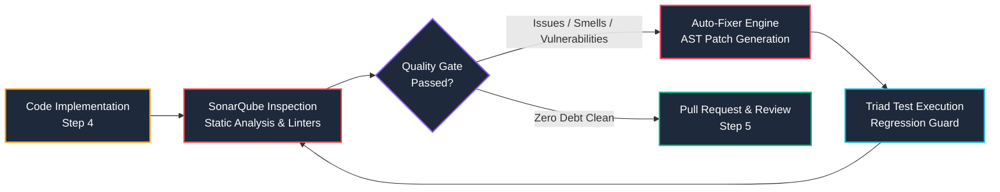
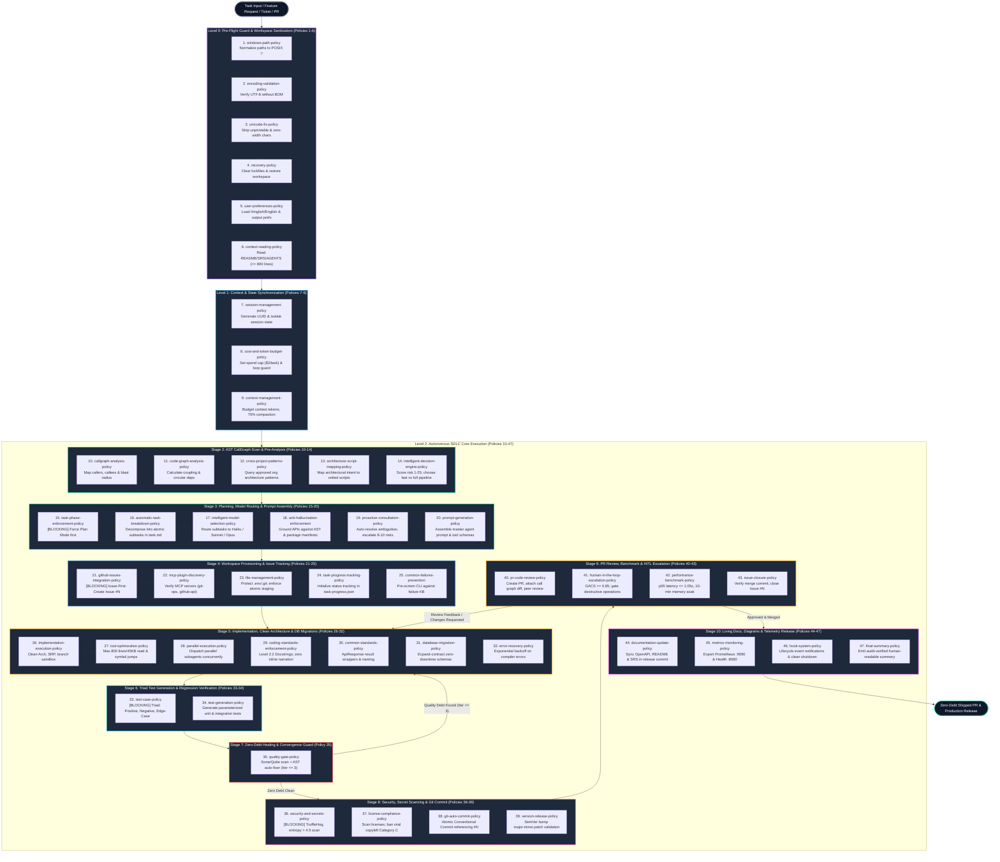

# AI-Native SDLC Engine

> **The Universal, Model-Agnostic Zero-Debt SDLC Automation Framework**
> *Automate the entire software engineering lifecycle — from task planning to merged PR — with continuous technical debt auto-remediation across any AI model, IDE, terminal, or CI/CD pipeline.*

**Version:** 2.1.1 | **Last Updated:** 2026-11-14

[](CHANGELOG.md)
[](https://python.org)
[](https://github.com/langchain-ai/langgraph)
[](https://github.com/techdeveloper-org/ai-native-sdlc-engine/actions/workflows/ci.yml)
[](LICENSE)
[](#the-zero-debt-architecture)
[](#multi-model--multi-platform-execution)
[](#quick-start)

---

## What Is AI-Native SDLC Engine?

**AI-Native SDLC Engine** is an extensible, model-agnostic software development lifecycle automation framework built on LangGraph. Rather than functioning as a narrow conversational assistant or a single-vendor tool, it acts as an **autonomous engineering team in a box** that eliminates technical debt continuously on every single pull request.

Traditional AI coding assistants (Copilot, Cursor) operate line-by-line or function-by-function — they generate code and stop, leaving test suites, impact analysis, PR creation, reviews, documentation, and technical debt accumulation entirely to humans.

The **AI-Native SDLC Engine** automates the entire lifecycle end-to-end:
1. **Pre-Flight Guard**: Validates Unicode, UTF-8 encodings, and environment paths.
2. **Codebase Archaeology & Call Graph Scan**: Scans ASTs across 4 languages (Python, Java, TypeScript, Kotlin) to discover blast radiuses, hot nodes, and danger zones *before* changing code.
3. **Adaptive Planning & Prompt Assembly**: Scores complexity on a 1–25 scale, detects fast-paths, and builds grounded multi-agent execution bundles.
4. **Issue Lifecycle**: Opens tracked GitHub and Jira issues automatically.
5. **Isolated Workspace**: Provisions feature branches (`feature/ISSUE-KEY`).
6. **Strict Standards Enforcement**: Enforces clean architecture, design tokens, and Level 2.2 contract docstrings (zero noisy inline narration).
7. **Triad Test Generation**: Generates positive, negative, and edge-case test suites (JUnit5, Mockito, Pytest).
8. **Continuous Zero-Debt Remediation**: Triggers integrated SonarQube static analysis with an automated multi-turn fix loop (`auto_fixer.py`) before opening a PR.
9. **Autonomous PR & Code Review**: Opens the PR with automated call-graph impact diffs, runs multi-agent peer reviews, and enforces 4 quality gates.
10. **Living Documentation & Diagrams**: Generates 13 UML diagram types (Mermaid + Draw.io) and updates OpenAPI specs and SRS documentation.
11. **Telemetry & Audit Release**: Logs Prometheus metrics, OpenTelemetry distributed traces, append-only JSON audit logs, and closes the ticket.

---

## Capability Comparison Matrix

| Capability | AI-Native SDLC Engine | GitHub Copilot | Cursor | Devin |
|---|:---:|:---:|:---:|:---:|
| **Universal Model Support** | **Claude · OpenAI · Gemini · Ollama** | OpenAI only | Anthropic / OpenAI | Proprietary |
| **Zero-Debt Auto-Remediation Loop** | **Yes (SonarQube + AST Auto-Fixer)** | — | — | — |
| **Pre-Change Call Graph Impact Analysis** | **Yes (Python, Java, TS, Kotlin)** | — | — | — |
| **Breaking Change Detection (Graph Diff)** | **Yes** | — | — | — |
| **Autonomous Issue Lifecycle (GitHub + Jira)** | **Yes (Create → Sync → Close)** | — | — | — |
| **Triad Test Suite Generation (Pos/Neg/Edge)** | **Yes** | — | Partial | — |
| **Automated PR & Multi-Agent Peer Review** | **Yes** | — | — | Partial |
| **13 UML Diagram Types (Mermaid + Draw.io)** | **Yes** | — | — | — |
| **Living Documentation Updates (Step 7)** | **Yes** | — | — | — |
| **SonarQube Quality Gate Auto-Heal Loop** | **Yes** | — | — | — |
| **Extensible Quality Adapter Surface** | **Yes (SonarQube, Snyk, Semgrep)** | — | — | — |
| **Headless CI/CD Automation (Actions/Jenkins)** | **Yes** | — | — | — |
| **Docker & Kubernetes Microservice Ready** | **Yes** | — | — | — |
| **Token Optimization Layer** | **Yes (60–85% Context Savings)** | — | — | — |

---

## The Zero-Debt Architecture



### Why "Zero-Debt by Construction"?
In typical projects, developers write features under time pressure, promising to "clean up technical debt later." The debt never gets resolved until system architecture degrades.

The AI-Native SDLC Engine enforces **Zero-Debt by Construction**:
- **Continuous Remediation on Every PR**: As code is implemented, the SonarQube orchestrator (`sdlc_engine/sonarqube/orchestrator.py`) runs static analysis directly against the modified files.
- **Automated AST-Level Patching**: If cognitive complexity, code duplication, security hotspots, or bugs are flagged, `auto_fixer.py` generates an AST-level refactoring patch, applies it, and re-validates against test suites.
- **Dead Code Pruning**: Step 0 Call Graph scanner identifies unreachable classes, unused exports, and orphan functions, ensuring obsolete code is excised before merge.
- **Extensible Quality Tooling Adapter**: Standardized `QualityGate` interfaces allow plugging in additional linters, security tools, and vulnerability scanners (SonarQube, Semgrep, Snyk, Trivy, CodeQL) without modifying core graph topology.

---

## End-to-End Workflow: Chronological Policy Execution Order

The AI-Native SDLC Engine operates an autonomous, deterministic, policy-governed execution pipeline. Unlike ad-hoc AI coding tools that jump straight into writing unverified code, this engine executes tasks through a strict chronological progression of **3 Structural Execution Levels** (Level 0, Level 1, Level 2) partitioned into **11 Sequential Stages** (Stage 0 to Stage 10), governed by **47 specialized policies**.

Every incoming request passes through this exact chronological sequence to guarantee zero technical debt, complete AST verification, cryptographic secret safety, and total traceability.

---

### Chronological Master Pipeline Architecture



---

### Master Chronological Execution Table (Step 1 to Step 47)

The table below outlines the deterministic lifecycle of a task. Every policy is triggered strictly in sequence; if a blocking policy fails its check, execution halts immediately or triggers its specified healing loop.

| Step # | Stage & Level | Policy Document | Class | Enforcement Trigger | Enforced Invariant & Action | Output Artifact / Handoff |
|:---:|:---|:---|:---:|:---|:---|:---|
| **1** | **Stage 0** (Level 0) | [`policies/windows-path-policy.md`](policies/windows-path-policy.md) | Transformative | Pipeline startup | Normalizes all Windows drive letters and converts backslashes (`\`) to forward slashes (`/`). | Sanitized POSIX paths |
| **2** | **Stage 0** (Level 0) | [`policies/encoding-validation-policy.md`](policies/encoding-validation-policy.md) | Blocking Gate | Pipeline startup | Validates strict UTF-8 without Byte Order Mark (BOM). Rejects hidden `\xef\xbb\xbf` or smart quotes. | Validated UTF-8 files |
| **3** | **Stage 0** (Level 0) | [`policies/unicode-fix-policy.md`](policies/unicode-fix-policy.md) | Transformative | Command ingestion | Strips unprintable Unicode characters, zero-width spaces (`\u200b`), and emojis from CLI commands. | Sanitized command strings |
| **4** | **Stage 0** (Level 0) | [`policies/recovery-policy.md`](policies/recovery-policy.md) | Recovery Ladder | Startup diagnostics | Detects dangling lockfiles, orphaned processes, or aborted runs from prior sessions; auto-recovers clean state. | Clean workspace & lock flags |
| **5** | **Stage 0** (Level 0) | [`policies/user-preferences-policy.md`](policies/user-preferences-policy.md) | Transformative | Session boot | Loads developer persona, language preferences (Hinglish/English), and output formatting requirements. | User profile context |
| **6** | **Stage 0** (Level 0) | [`policies/context-reading-policy.md`](policies/context-reading-policy.md) | Guardrail | Initial context ingestion | Mandates reading `README.md`, `SRS.md`, `CLAUDE.md`, and `AGENTS.md` before coding, capped at 800 lines budget. | Project baseline context |
| **7** | **Stage 1** (Level 1) | [`policies/session-management-policy.md`](policies/session-management-policy.md) | Transformative | Level 1 sync | Provisions a unique UUID session ID, establishes isolated memory partition, and initializes SQLite ledger. | `_SESSION_ID`, session ledger |
| **8** | **Stage 1** (Level 1) | [`policies/cost-and-token-budget-policy.md`](policies/cost-and-token-budget-policy.md) | Blocking Guard | Budget initialization | Sets hard spend ceilings ($2/task, $10/session), initializes token tracking, and sets loop thresholds. | Budget limits & token monitors |
| **9** | **Stage 1** (Level 1) | [`policies/context-management-policy.md`](policies/context-management-policy.md) | Guardrail | Context allocation | Measures token headroom across 4 tiers; arms auto-compaction and AST deduplication at 75% capacity. | Context budget window |
| **10** | **Stage 2** (Level 2, Step 0) | [`policies/callgraph-analysis-policy.md`](policies/callgraph-analysis-policy.md) | Transformative | Pre-analysis (Step 0) | Scans multi-language ASTs (Python, Java, TS, Go) to map callers, callees, and complete blast radius. | Call-graph impact matrix |
| **11** | **Stage 2** (Level 2, Step 0) | [`policies/code-graph-analysis-policy.md`](policies/code-graph-analysis-policy.md) | Guardrail | Graph synthesis (Step 0) | Computes afferent/efferent coupling metrics and flags circular dependencies before code is touched. | Structural dependency graph |
| **12** | **Stage 2** (Level 2, Step 0) | [`policies/cross-project-patterns-policy.md`](policies/cross-project-patterns-policy.md) | Transformative | Pattern retrieval (Step 0) | Scans sibling repositories for approved organizational patterns (JWT auth, error wrappers, DTO patterns). | Proven pattern snippets |
| **13** | **Stage 2** (Level 2, Step 0) | [`policies/architecture-script-mapping-policy.md`](policies/architecture-script-mapping-policy.md) | Transformative | Script resolution (Step 0) | Maps architectural intent deterministically to vetted automation scripts (e.g., Flyway, Liquibase, OpenAPI gen). | Resolved executable scripts |
| **14** | **Stage 2** (Level 2, Step 0) | [`policies/intelligent-decision-engine-policy.md`](policies/intelligent-decision-engine-policy.md) | Decision Router | Pre-planning (Step 0) | Evaluates task risk and complexity [1-25] to select fast-path vs full 10-stage governance pipeline. | Pipeline execution routing |
| **15** | **Stage 3** (Level 2, Step 1) | [`policies/task-phase-enforcement-policy.md`](policies/task-phase-enforcement-policy.md) | **BLOCKING GATE** | Planning start (Step 1) | **STRICT PLAN MODE**: Forbids all write actions, file edits, or commits until explicit plan approval. | Plan Mode active flag |
| **16** | **Stage 3** (Level 2, Step 1) | [`policies/automatic-task-breakdown-policy.md`](policies/automatic-task-breakdown-policy.md) | Transformative | Plan synthesis (Step 1) | Deconstructs incoming objectives into sequential, atomic sub-phases with verifiable acceptance criteria. | `task.md` / `task-breakdown.json` |
| **17** | **Stage 3** (Level 2, Step 1) | [`policies/intelligent-model-selection-policy.md`](policies/intelligent-model-selection-policy.md) | Optimization | Model routing (Step 1) | Routes subtasks to the optimal model tier: Haiku/Flash (fast parsing), Sonnet (coding), Opus (architecture). | Model-to-subtask mapping |
| **18** | **Stage 3** (Level 2, Step 1) | [`policies/anti-hallucination-enforcement.md`](policies/anti-hallucination-enforcement.md) | Blocking Guard | Pre-code grounding (Step 1) | Verifies that all referenced packages, classes, and APIs exist in the repository AST or declared dependencies. | AST grounding verification |
| **19** | **Stage 3** (Level 2, Step 1) | [`policies/proactive-consultation-policy.md`](policies/proactive-consultation-policy.md) | Decision Matrix | Risk assessment (Step 1) | Scores ambiguity [1-10]: applies conservative defaults for Low [1-3], consults rules for Med [4-7], escalates High [8-10]. | Risk resolution ledger |
| **20** | **Stage 3** (Level 2, Step 1) | [`policies/prompt-generation-policy.md`](policies/prompt-generation-policy.md) | Transformative | Agent prompt prep (Step 1) | Constructs master system prompts with anti-drift rules, tool schemas, and domain skills; isolates prompt budget. | Master execution prompt |
| **21** | **Stage 4** (Level 2, Steps 2-3) | [`policies/github-issues-integration-policy.md`](policies/github-issues-integration-policy.md) | **BLOCKING GATE** | Workspace setup (Step 2) | **ISSUE-FIRST MANDATE**: Automatically provisions or links a GitHub/Jira issue `#N` before touching any code. | GitHub Issue `#N` & tracking URL |
| **22** | **Stage 4** (Level 2, Steps 2-3) | [`policies/mcp-plugin-discovery-policy.md`](policies/mcp-plugin-discovery-policy.md) | Pre-Flight Guard | Tooling discovery (Step 2) | Discovers and verifies health and permissions of required MCP servers (`git-ops`, `github-api`, `uml-diagram`). | Verified MCP connection pool |
| **23** | **Stage 4** (Level 2, Steps 2-3) | [`policies/file-management-policy.md`](policies/file-management-policy.md) | Guardrail | File operations (Step 3) | Protects `.git`, `.env`, and credential stores; mandates atomic staging via swap files to prevent corruption. | File sandbox boundary |
| **24** | **Stage 4** (Level 2, Steps 2-3) | [`policies/task-progress-tracking-policy.md`](policies/task-progress-tracking-policy.md) | Telemetry | Work tracking (Step 3) | Initializes granular milestone checkpoints in `task-progress.json` and updates live checkboxes in `task.md`. | `task-progress.json` baseline |
| **25** | **Stage 4** (Level 2, Steps 2-3) | [`policies/common-failures-prevention.md`](policies/common-failures-prevention.md) | Guardrail | Command pre-check (Step 3) | Pre-screens CLI commands against a failure knowledge base (e.g., PowerShell `;` vs Bash `&&`, line prefixes). | Validated command pipeline |
| **26** | **Stage 5** (Level 2, Step 4) | [`policies/implementation-execution-policy.md`](policies/implementation-execution-policy.md) | Architectural Guard | Implementation start (Step 4) | Enforces Hexagonal / Clean Architecture, Single Responsibility Principle, and code modifications in isolated branch. | Decoupled business logic |
| **27** | **Stage 5** (Level 2, Step 4) | [`policies/tool-optimization-policy.md`](policies/tool-optimization-policy.md) | Optimization | File reads & searches (Step 4) | Enforces chunked reads (max 800 lines/45KB), AST symbol jumps, and 50-item grep caps to save 60-85% token waste. | Optimized tool invocation |
| **28** | **Stage 5** (Level 2, Step 4) | [`policies/parallel-execution-policy.md`](policies/parallel-execution-policy.md) | Orchestration | Parallel work (Step 4) | Dispatches independent sub-agent tasks concurrently across isolated branch sandboxes and merges results cleanly. | Concurrently created components |
| **29** | **Stage 5** (Level 2, Step 4) | [`policies/coding-standards-enforcement-policy.md`](policies/coding-standards-enforcement-policy.md) | Code Quality | Code authoring (Step 4) | Enforces strict Level 2.2 Docstrings (JavaDoc/JSDoc/Docstrings); strictly bans line-by-line narration comments. | Clean, contract-documented code |
| **30** | **Stage 5** (Level 2, Step 4) | [`policies/common-standards-policy.md`](policies/common-standards-policy.md) | Code Quality | Code authoring (Step 4) | Enforces uniform naming conventions, centralized error hierarchy, and `ApiResponse<T>` / `Result<T>` wrappers. | Standardized interfaces & DTOs |
| **31** | **Stage 5** (Level 2, Step 4) | [`policies/database-migration-policy.md`](policies/database-migration-policy.md) | Safety Guard | Database schema (Step 4) | Enforces Expand-Contract zero-downtime evolution, batch-throttled backfills ($\le 1,000$ rows), and rollback scripts. | Non-locking migration scripts |
| **32** | **Stage 5** (Level 2, Step 4) | [`policies/error-recovery-policy.md`](policies/error-recovery-policy.md) | Recovery Guard | Code compilation (Step 4) | Catches transient syntax errors and compilation failures; applies exponential backoff and localized fixes. | Self-healed syntax patches |
| **33** | **Stage 6** (Level 2, Step 4b) | [`policies/test-case-policy.md`](policies/test-case-policy.md) | **BLOCKING GATE** | Test authoring (Step 4b) | **MANDATORY TRIAD TESTING**: Enforces comprehensive coverage: Positive (happy path), Negative (errors), Edge-cases. | Triad test requirements |
| **34** | **Stage 6** (Level 2, Step 4b) | [`policies/test-generation-policy.md`](policies/test-generation-policy.md) | Transformative | Test generation (Step 4b) | Generates parameterized, mock-isolated unit and integration tests (JUnit 5, PyTest, Jasmine/Karma). | Verified test suite execution |
| **35** | **Stage 7** (Level 2, Step 4c) | [`policies/quality-gate-policy.md`](policies/quality-gate-policy.md) | **REMEDIATION LOOP** | Post-implementation (Step 4c) | Scans code via SonarQube. If smells/bugs exist, triggers `auto_fixer.py` (loops back to Stage 5, max 3 iterations). | Zero-debt verified code |
| **36** | **Stage 8** (Level 2, Step 4d) | [`policies/security-and-secrets-policy.md`](policies/security-and-secrets-policy.md) | **BLOCKING GATE** | Pre-commit gate (Step 4d) | Deep secret scan: TruffleHog regex + Shannon entropy ($H \ge 4.5$) + CVSS $\ge 7.0$ CVE blocker. Blocks commit on leaks. | Secret-free staging area |
| **37** | **Stage 8** (Level 2, Step 4d) | [`policies/license-compliance-policy.md`](policies/license-compliance-policy.md) | Blocking Guard | Pre-commit gate (Step 4d) | Scans all dependencies; bans viral copyleft Category C licenses (GPL-3.0, AGPL) in permissive repos; builds SBOM. | CycloneDX / SPDX SBOM |
| **38** | **Stage 8** (Level 2, Step 4d) | [`policies/git-auto-commit-policy.md`](policies/git-auto-commit-policy.md) | Transformative | Commit milestone (Step 4d) | Assembles atomic Conventional Commit referencing Issue `#N` (`feat(auth): implement token rotation (#335)`). | Signed Git commit |
| **39** | **Stage 8** (Level 2, Step 4d) | [`policies/version-release-policy.md`](policies/version-release-policy.md) | Guardrail | Version milestone (Step 4d) | Validates SemVer 2.0 bump rules (`major.minor.patch`) and updates `CHANGELOG.md` under `[Unreleased]`. | Bumped version manifest |
| **40** | **Stage 9** (Level 2, Steps 5-6) | [`policies/pr-code-review-policy.md`](policies/pr-code-review-policy.md) | Orchestration | PR creation (Step 5) | Opens GitHub PR from `feature/ISSUE-N`, attaches AST call-graph diffs, and conducts automated peer code review. | Pull Request with graph diff |
| **41** | **Stage 9** (Level 2, Steps 5-6) | [`policies/human-in-the-loop-escalation-policy.md`](policies/human-in-the-loop-escalation-policy.md) | **BLOCKING GATE** | Gate evaluation (Step 5) | Evaluates GACS confidence ($\ge 0.85$); halts for explicit human approval on destructive DDL or production deployment. | HITL approval record |
| **42** | **Stage 9** (Level 2, Steps 5-6) | [`policies/performance-benchmark-policy.md`](policies/performance-benchmark-policy.md) | Quality Gate | Benchmark validation (Step 6) | Enforces latency budgets (p95 latency $\le 1.05\times$ baseline), 10-minute memory soak tests, and complexity limits. | Benchmark latency report |
| **43** | **Stage 9** (Level 2, Steps 5-6) | [`policies/issue-closure-policy.md`](policies/issue-closure-policy.md) | Transformative | PR merge (Step 6) | Verifies merge commit SHA, validates acceptance checklist against AST, and transitions GitHub/Jira ticket to Closed. | Closed ticket with proofs |
| **44** | **Stage 10** (Level 2, Steps 7-8) | [`policies/documentation-update-policy.md`](policies/documentation-update-policy.md) | Transformative | Documentation sync (Step 7) | Updates OpenAPI 3.0 specs, `README.md`, and SRS living documents in synchronization with modified code. | Synchronized living docs |
| **45** | **Stage 10** (Level 2, Steps 7-8) | [`policies/metrics-monitoring-policy.md`](policies/metrics-monitoring-policy.md) | Telemetry | Observability export (Step 8) | Exports Prometheus metrics on port `9090` (`GET /metrics`) and liveness/readiness probes on port `8080`. | Prometheus & health endpoints |
| **46** | **Stage 10** (Level 2, Steps 7-8) | [`policies/hook-system-policy.md`](policies/hook-system-policy.md) | Lifecycle | Pipeline finalization (Step 8) | Dispatches post-pipeline lifecycle notifications, trace spans, and executes safe multi-terminal resource cleanup. | Clean process termination |
| **47** | **Stage 10** (Level 2, Steps 7-8) | [`policies/final-summary-policy.md`](policies/final-summary-policy.md) | Telemetry | Final response (Step 8) | Generates structured, human-readable execution summary with audit proofs, commit SHAs, and test metrics. | User-facing completion summary |

---

### Detailed Chronological Stage-by-Stage Walkthrough

The following sections explain the exact chronological execution order across each stage, describing why the stage runs at its specific point, the causal chain of policy invocations, and the exit/loopback criteria.

#### Stage 0: Pre-Flight Guard & Environment Sanitization (Level 0)
* **Chronological Position**: **First Step (T = 0)**. Executes immediately upon receiving any command or task prompt, before any context is hydrated or files are touched.
* **Why this order?**: If file paths have Windows backslash issues, file encodings contain hidden BOM marks, or previous runs left dangling lockfiles, downstream AST parsers and Python/Java runtimes will crash silently. Sanitization must precede all processing.
* **Execution Sequence**:
  1. [`policies/windows-path-policy.md`](policies/windows-path-policy.md) runs first to normalize all incoming paths to POSIX forward slashes (`/`).
  2. [`policies/encoding-validation-policy.md`](policies/encoding-validation-policy.md) inspects project files to guarantee strict UTF-8 without BOM.
  3. [`policies/unicode-fix-policy.md`](policies/unicode-fix-policy.md) strips invisible zero-width spaces (`\u200b`) and emojis from commands.
  4. [`policies/recovery-policy.md`](policies/recovery-policy.md) checks for dangling `.lock` files or crashed runs, recovering the workspace to a pristine state.
  5. [`policies/user-preferences-policy.md`](policies/user-preferences-policy.md) loads developer-specific pair programming styles (e.g. Hinglish tone, detail depth).
  6. [`policies/context-reading-policy.md`](policies/context-reading-policy.md) bounds the reading of baseline project documentation (`README.md`, `SRS.md`, `AGENTS.md`) within an 800-line budget.
* **Gate Exit Criterion**: Environment verified 100% clean, paths normalized, and project baseline understood.

#### Stage 1: Context & State Synchronization (Level 1)
* **Chronological Position**: **Step 2 (T = 1)**. Runs after the environment is sanitized but before codebase exploration.
* **Why this order?**: Execution cannot proceed without a unique tracking identifier, an isolated state partition, and strict cost caps. This prevents infinite token-spending loops and state contamination between multiple terminal tabs.
* **Execution Sequence**:
  1. [`policies/session-management-policy.md`](policies/session-management-policy.md) assigns a unique session UUID (`SESSION-YYYYMMDD-XXXX`) and mounts the persistent SQLite ledger.
  2. [`policies/cost-and-token-budget-policy.md`](policies/cost-and-token-budget-policy.md) sets hard budget ceilings ($2 per task, $10 per batch run) and caps auto-fix iterations to 3.
  3. [`policies/context-management-policy.md`](policies/context-management-policy.md) calculates token headroom across 4 tiers and arms the 75% auto-compaction trigger.
* **Gate Exit Criterion**: Session ledger active, spending caps armed, and context budget allocated.

#### Stage 2: AST CallGraph Scan & Pre-Analysis (Level 2, Step 0)
* **Chronological Position**: **Step 3 (T = 2)**. Pre-code archaeology phase.
* **Why this order?**: An agent must never touch a codebase without understanding the full ripple effect (blast radius) of proposed changes. Pre-analysis computes dependencies before any plan is formulated.
* **Execution Sequence**:
  1. [`policies/callgraph-analysis-policy.md`](policies/callgraph-analysis-policy.md) scans the AST across Python, Java, TypeScript, or Go to identify all callers, callees, and impacted modules.
  2. [`policies/code-graph-analysis-policy.md`](policies/code-graph-analysis-policy.md) constructs dependency graph nodes, checks afferent/efferent coupling metrics, and flags circular packages.
  3. [`policies/cross-project-patterns-policy.md`](policies/cross-project-patterns-policy.md) scans proven architectural patterns in sibling repositories to align with organizational conventions.
  4. [`policies/architecture-script-mapping-policy.md`](policies/architecture-script-mapping-policy.md) maps architectural intents deterministically to validated local scripts.
  5. [`policies/intelligent-decision-engine-policy.md`](policies/intelligent-decision-engine-policy.md) scores task complexity [1-25] and determines whether the task can take a fast path or requires full governance.
* **Gate Exit Criterion**: Blast radius quantified, structural coupling calculated, and pattern alignment established.

#### Stage 3: Task Planning, Model Routing & Prompt Assembly (Level 2, Step 1)
* **Chronological Position**: **Step 4 (T = 3)**. Formal planning and prompt engineering.
* **Why this order?**: Code generation without structured planning leads to architectural drift and unmaintainable technical debt. Plan Mode must be enforced, hallucinated libraries prevented, and specialized models routed before any implementation starts.
* **Execution Sequence**:
  1. [`policies/task-phase-enforcement-policy.md`](policies/task-phase-enforcement-policy.md) **BLOCKS** write actions and enforces Plan Mode until the user or policy enforcer approves the plan.
  2. [`policies/automatic-task-breakdown-policy.md`](policies/automatic-task-breakdown-policy.md) breaks the objective into atomic, sequential subtasks with explicit acceptance criteria in `task.md`.
  3. [`policies/intelligent-model-selection-policy.md`](policies/intelligent-model-selection-policy.md) routes each subtask to the optimal model tier (Haiku/Flash for light tasks, Sonnet for coding, Opus for system architecture).
  4. [`policies/anti-hallucination-enforcement.md`](policies/anti-hallucination-enforcement.md) verifies that all classes, packages, and third-party APIs in the plan physically exist in the project AST or dependency manifests.
  5. [`policies/proactive-consultation-policy.md`](policies/proactive-consultation-policy.md) assesses ambiguity; resolves medium risks [4-7] using stored rules and escalates high risks [8-10].
  6. [`policies/prompt-generation-policy.md`](policies/prompt-generation-policy.md) generates the master system prompt enriched with role definitions, tool schemas, and domain skills.
* **Gate Exit Criterion**: Approved implementation plan in place, zero hallucinated imports, and master prompt compiled.

#### Stage 4: Workspace Provisioning & Issue Tracking (Level 2, Steps 2-3)
* **Chronological Position**: **Step 5 (T = 4)**. Workspace setup and issue establishment.
* **Why this order?**: Professional engineering demands an **Issue-First** workflow. Every code change must tie back to a tracked GitHub/Jira ticket and isolated git branch before source files are touched.
* **Execution Sequence**:
  1. [`policies/github-issues-integration-policy.md`](policies/github-issues-integration-policy.md) **BLOCKS** untracked development; automatically creates or links GitHub issue `#N` with classification labels.
  2. [`policies/mcp-plugin-discovery-policy.md`](policies/mcp-plugin-discovery-policy.md) verifies that MCP servers (`git-ops`, `github-api`, `uml-diagram`) are alive and authenticated.
  3. [`policies/file-management-policy.md`](policies/file-management-policy.md) locks protected files (`.env`, `.git/`, credentials) and enforces temporary staging directories.
  4. [`policies/task-progress-tracking-policy.md`](policies/task-progress-tracking-policy.md) records initial baseline progress in `task-progress.json` and updates `task.md`.
  5. [`policies/common-failures-prevention.md`](policies/common-failures-prevention.md) pre-screens environment commands against known failure patterns (PowerShell quote expansion, BOM insertion).
* **Gate Exit Criterion**: GitHub issue linked, isolated feature branch created (`feature/ISSUE-N`), and protected files locked.

#### Stage 5: Implementation, Clean Architecture & Database Migrations (Level 2, Step 4)
* **Chronological Position**: **Step 6 (T = 5)**. Core code construction.
* **Why this order?**: Only after requirements, architecture, issue tracking, and tooling are locked down does code implementation occur.
* **Execution Sequence**:
  1. [`policies/implementation-execution-policy.md`](policies/implementation-execution-policy.md) enforces Hexagonal / Clean Architecture and Single Responsibility Principle in the sandbox branch.
  2. [`policies/tool-optimization-policy.md`](policies/tool-optimization-policy.md) limits file reads to 800 lines/45KB and prioritizes AST symbol jumps, saving context headroom.
  3. [`policies/parallel-execution-policy.md`](policies/parallel-execution-policy.md) coordinates concurrent subagents for independent tasks (e.g. backend DTOs + frontend UI).
  4. [`policies/coding-standards-enforcement-policy.md`](policies/coding-standards-enforcement-policy.md) enforces Level 2.2 Docstrings on all public methods and strictly prohibits line-by-line inline narration comments.
  5. [`policies/common-standards-policy.md`](policies/common-standards-policy.md) guarantees standardized API error wrappers, Result types, and naming conventions.
  6. [`policies/database-migration-policy.md`](policies/database-migration-policy.md) if DB changes occur, enforces Expand-Contract zero-downtime schemas and batch-throttled backfills.
  7. [`policies/error-recovery-policy.md`](policies/error-recovery-policy.md) intercepts compilation or syntax errors with localized retry ladders.
* **Gate Exit Criterion**: Clean code compiled, contract docstrings present, and zero-downtime database schemas validated.

#### Stage 6: Triad Test Generation & Regression Verification (Level 2, Step 4b)
* **Chronological Position**: **Step 7 (T = 6)**. Automated test authoring and verification.
* **Why this order?**: Code without tests is technical debt. Tests must be generated immediately following implementation while the AST context is fresh.
* **Execution Sequence**:
  1. [`policies/test-case-policy.md`](policies/test-case-policy.md) **BLOCKS** progression unless the **Triad Testing Strategy** is met: Positive (happy path), Negative (error handling), and Edge-Case (boundary values).
  2. [`policies/test-generation-policy.md`](policies/test-generation-policy.md) generates mock-isolated, parameterized unit and integration tests (JUnit 5, PyTest, Jasmine/Karma) and executes the suite.
* **Gate Exit Criterion**: 100% of Triad tests passing with zero regressions across the call-graph blast radius.

#### Stage 7: Zero-Debt Healing & Convergence Guard (Level 2, Step 4c)
* **Chronological Position**: **Step 8 (T = 7)**. Static analysis and automated debt remediation.
* **Why this order?**: Static analysis must run after unit tests pass to detect code smells, cognitive complexity spikes, duplication, and maintainability issues before commits are staged.
* **Execution Sequence**:
  1. [`policies/quality-gate-policy.md`](policies/quality-gate-policy.md) triggers SonarQube static analysis against all modified files. If quality smells, security hotspots, or duplication are detected, `auto_fixer.py` generates an AST patch, applies it, and **loops back to Stage 5** for re-verification (capped at 3 iterations via `cost-and-token-budget-policy.md` to prevent runaway loops).
* **Gate Exit Criterion**: SonarQube Quality Gate Status: **PASSED** (Zero technical debt by construction).

#### Stage 8: Security, Secret Scanning & Pre-Commit Gates (Level 2, Step 4d)
* **Chronological Position**: **Step 9 (T = 8)**. Pre-commit security verification and git staging.
* **Why this order?**: Code that passes tests and static analysis must still undergo deep cryptographic secret scanning and license audits before it is committed to git history.
* **Execution Sequence**:
  1. [`policies/security-and-secrets-policy.md`](policies/security-and-secrets-policy.md) **BLOCKS** commit if TruffleHog/Gitleaks regex finds keys, Shannon entropy $H(X) \ge 4.5$, or CVSS $\ge 7.0$ CVEs exist in dependencies.
  2. [`policies/license-compliance-policy.md`](policies/license-compliance-policy.md) checks all transitive dependencies, bans viral copyleft Category C licenses (GPL-3.0/AGPL), and builds the SBOM.
  3. [`policies/git-auto-commit-policy.md`](policies/git-auto-commit-policy.md) creates an atomic Conventional Commit referencing the GitHub Issue (`feat(auth): add token rotation (#335)`).
  4. [`policies/version-release-policy.md`](policies/version-release-policy.md) checks SemVer bump criteria and updates `CHANGELOG.md` under `[Unreleased]`.
* **Gate Exit Criterion**: Zero credentials leaked, licenses compliant, and atomic git commit recorded.

#### Stage 9: PR Review, Performance Benchmarking & HITL Escalation (Level 2, Steps 5-6)
* **Chronological Position**: **Step 10 (T = 9)**. Pull Request creation, peer review, and performance verification.
* **Why this order?**: Once code is safely committed on the feature branch, it must be validated under automated PR review, latency SLA benchmarking, and human escalation gates prior to merge.
* **Execution Sequence**:
  1. [`policies/pr-code-review-policy.md`](policies/pr-code-review-policy.md) pushes the branch, opens a GitHub PR, attaches AST call-graph diffs, and runs automated multi-agent code review. If review comments require modifications, the engine loops back to Stage 5.
  2. [`policies/human-in-the-loop-escalation-policy.md`](policies/human-in-the-loop-escalation-policy.md) computes GACS confidence ($\ge 0.85$); halts for explicit human approval on destructive DDL or production deployment.
  3. [`policies/performance-benchmark-policy.md`](policies/performance-benchmark-policy.md) runs latency benchmark (p95 degradation $\le 1.05\times$), 10-minute memory soak tests, and time complexity checks.
  4. [`policies/issue-closure-policy.md`](policies/issue-closure-policy.md) verifies the merge commit SHA, checks acceptance criteria against AST, and transitions the GitHub issue and Jira ticket to Closed.
* **Gate Exit Criterion**: PR approved, performance SLA met, PR merged, and tracking ticket closed.

#### Stage 10: Living Documentation, Diagrams & Telemetry Release (Level 2, Steps 7-8)
* **Chronological Position**: **Step 11 (T = 10)**. Release synchronization, diagram generation, and observability export.
* **Why this order?**: Living architecture documents, OpenAPI specs, and system telemetry must reflect the final merged state of the system, finalized in the release commit.
* **Execution Sequence**:
  1. [`policies/documentation-update-policy.md`](policies/documentation-update-policy.md) updates OpenAPI 3.0 specs, architecture documentation, and `README.md` to match newly merged code in the same release commit.
  2. [`policies/metrics-monitoring-policy.md`](policies/metrics-monitoring-policy.md) exports pipeline execution metrics to Prometheus on port `9090` (`GET /metrics`) and exposes health probes on port `8080`.
  3. [`policies/hook-system-policy.md`](policies/hook-system-policy.md) dispatches post-pipeline lifecycle hooks, closes OpenTelemetry trace spans, and executes safe session shutdown.
  4. [`policies/final-summary-policy.md`](policies/final-summary-policy.md) generates a comprehensive, human-readable execution summary with audit proofs, commit SHAs, and test metrics.
* **Gate Exit Criterion**: Living documentation synchronized, telemetry active, and pipeline safely finalized.

---
---

## Multi-Model & Multi-Platform Execution

The engine is built to run everywhere — with any model, in any environment:

```
                      ┌────────────────────────────────────────┐
                      │          AI-Native SDLC Engine         │
                      └───────────────────┬────────────────────┘
                                          │
        ┌───────────────────┬─────────────┴───────┬───────────────────┐
        ▼                   ▼                     ▼                   ▼
┌───────────────┐   ┌───────────────┐     ┌───────────────┐   ┌───────────────┐
│ Direct CLI    │   │ Docker / K8s  │     │ CI/CD Runner  │   │ Claude Plugin │
│ Terminal Tool │   │ Microservice  │     │ Headless Auto │   │ & IDE Surface │
└───────┬───────┘   └───────┬───────┘     └───────┬───────┘   └───────┬───────┘
        │                   │                     │                   │
        └───────────────────┼─────────────────────┴───────────────────┘
                            ▼
              ┌───────────────────────────┐
              │ Dynamic LLM Provider Mesh │
              └─────────────┬─────────────┘
                            │
       ┌──────────────┬─────┴────────┬──────────────┐
       ▼              ▼              ▼              ▼
┌─────────────┐┌─────────────┐┌─────────────┐┌─────────────┐
│  Anthropic  ││   OpenAI    ││   Google    ││ Local GPU / │
│   Claude    ││    GPT-4o   ││ Gemini 2.5  ││   Ollama    │
└─────────────┘└─────────────┘└─────────────┘└─────────────┘
```

---

## Quick Start

### 1. Prerequisites
- **Python**: 3.10+
- **Git**: 2.30+
- **LLM API Key** (choose any provider):
  - Anthropic: `ANTHROPIC_API_KEY`
  - OpenAI: `OPENAI_API_KEY`
  - Gemini: `GEMINI_API_KEY`
  - Local: [Ollama](https://ollama.ai) running locally (zero API key needed)
- **GitHub Token** (optional, for automated issue & PR tracking): `GITHUB_TOKEN`

### 2. Installation
```bash
git clone https://github.com/techdeveloper-org/ai-native-sdlc-engine.git
cd ai-native-sdlc-engine
pip install -r requirements.txt
cp .env.example .env
# Configure your preferred LLM provider key in .env
```

---

### 3. Execution Modalities

#### Modality A: Universal CLI Framework (Local Workstation)
Run tasks directly from your terminal using either the high-level `sdlc` CLI or the direct pipeline runner:

```bash
# 1. High-level CLI: Run an autonomous SDLC task
python scripts/cli.py run "Fix authentication timeout bug in token validator"

# 2. Direct Pipeline Runner: Full autonomous mode (all 9 active steps)
python scripts/3-level-flow.py --invoked-by=run-pipeline \
  --message="Implement tenant isolation middleware"

# 3. Plan & Decompose only (read-only planning, changes nothing)
python scripts/3-level-flow.py --invoked-by=plan \
  --message="Design payment reconciliation service"

# 4. Template Fast-Path (~0s instant planning skip)
python scripts/3-level-flow.py --invoked-by=run-pipeline \
  --message="Add user audit export" \
  --orchestration-template=orchestration_template.example.json
```

#### Modality B: Containerized Microservice (Docker & Kubernetes)
Run the engine inside isolated containers for team or server environments:

```bash
# Docker Compose
docker compose -f docker/docker-compose.yml up

# Single Docker run
docker build -t ai-native-sdlc-engine -f docker/Dockerfile .
docker run --env-file .env ai-native-sdlc-engine \
  python scripts/3-level-flow.py --invoked-by=run-pipeline --message="Your task description"

# Kubernetes Deployment
kubectl apply -f k8s/
```

#### Modality C: Headless CI/CD Automation (GitHub Actions / Jenkins)
Run the engine as an autonomous QA/review agent on every push or pull request:

```yaml
# .github/workflows/ai-sdlc.yml
name: AI-Native SDLC Review & Debt Guard
on: [pull_request]
jobs:
  review:
    runs-on: ubuntu-latest
    steps:
      - uses: actions/checkout@v4
      - uses: actions/setup-python@v5
        with: { python-version: "3.11" }
      - run: pip install -r requirements.txt
      - env:
          ANTHROPIC_API_KEY: ${{ secrets.ANTHROPIC_API_KEY }}
          GITHUB_TOKEN: ${{ secrets.GITHUB_TOKEN }}
        run: |
          python scripts/3-level-flow.py --invoked-by=review --message="Automated PR Review and Debt Guard"
```

#### Modality D: Claude Code Plugin Integration
If using the Claude Code CLI, install the plugin package for native slash commands:

```bash
/plugin marketplace add techdeveloper-org/ai-native-sdlc-engine
/plugin install ai-native-sdlc-engine@techdeveloper-org

# Available slash commands:
/ai-native-sdlc-engine:plan          # Steps 0-1  — Analyse and decompose, change nothing
/ai-native-sdlc-engine:implement     # Steps 2-4  — Issue, branch, code
/ai-native-sdlc-engine:review        # Steps 5-6  — PR, automated review, close issue
/ai-native-sdlc-engine:document      # Step 7     — Docs and 13 UML diagrams
/ai-native-sdlc-engine:release       # Step 8     — Telemetry, audit log, release
/ai-native-sdlc-engine:run-pipeline  # Steps 0-8  — Full autonomous SDLC end-to-end
/ai-native-sdlc-engine:doctor        # Environment & MCP diagnostic health check
```

---

## Autonomous SDLC Governance Policies (47 Policies)

The engine operates under **47 autonomous governance policies** housed in [`policies/`](policies/). Rather than relying on fuzzy model intuition, every engineering action — from pre-flight safety checks, secret scans, and AST call-graph impact scans to SonarQube zero-debt quality gates, database migrations, and atomic git commits — is bound by deterministic, enforceable policy contracts across 7 functional domains:

> [!TIP]
> **Looking for the chronological execution order?** See [End-to-End Workflow: Chronological Policy Execution Order](#end-to-end-workflow-chronological-policy-execution-order) and the [Master Chronological Execution Table](#master-chronological-execution-table-step-1-to-step-47) above for the exact sequential progression (Step 1 to Step 47) from task intake to production release. The reference tables below categorize the 47 policies by functional engineering domain.

### 1. Pre-Flight & Execution Safety (7 Policies)

| Policy & Specification | Core Behavioral Rule | Practical Real-World Example |
|---|---|---|
| [`policies/security-and-secrets-policy.md`](policies/security-and-secrets-policy.md) | Enforces zero-tolerance credential hygiene (TruffleHog/Gitleaks regex, Shannon entropy $H(X) \ge 4.5$, Bayesian score $\ge 0.85$, CVSS $\ge 7.0$ CVE blocker). | Pre-commit gate detects a hardcoded Stripe live key or high-risk CVE in `pom.xml`, blocks git staging, and demands environment variables. |
| [`policies/anti-hallucination-enforcement.md`](policies/anti-hallucination-enforcement.md) | Enforces strict grounding and verification against hallucinated packages, APIs, and paths. | If an LLM attempts to import `org.company.auth.SuperSecurity`, the AST grounding gate blocks execution and requires a package declared in `pom.xml` / `requirements.txt`. |
| [`policies/encoding-validation-policy.md`](policies/encoding-validation-policy.md) | Validates source files against invisible non-ASCII bytes and UTF-8 BOM corruptions. | Prevents hidden byte-order marks (`\xef\xbb\xbf`) or Windows smart quotes (`“`, `”`) from breaking Java compilers or Python AST parsers. |
| [`policies/windows-path-policy.md`](policies/windows-path-policy.md) | Enforces normalized forward slashes (`/`) and sanitizes drive letters on Windows workstations. | Automatically normalizes `C:\Users\app\src\main.py` to `C:/Users/app/src/main.py` so cross-platform tools, shell scripts, and Docker containers don't fail on unescaped backslashes. |
| [`policies/context-reading-policy.md`](policies/context-reading-policy.md) | Mandatory pre-flight mandate requiring the agent to read `README.md`, `SRS.md`, and `CLAUDE.md` before coding. | Prevents an agent from rewriting a working authentication module simply because it didn't read the existing architecture spec first. |
| [`policies/recovery-policy.md`](policies/recovery-policy.md) | Emergency Level -1 recovery ladder that executes when environment or pre-flight checks fail. | If a corrupted temporary cache or broken lockfile is detected during startup, auto-recovers the workspace to a clean state before restarting the pipeline. |
| [`policies/error-recovery-policy.md`](policies/error-recovery-policy.md) | Operational error-recovery protocol with retry budgets, fallback ladders, and exponential backoff. | If a rate-limit error (HTTP 429) occurs during an API call, applies an exponential jittered backoff rather than crashing the pipeline. |

### 2. Architecture, Graph & Pattern Intelligence (6 Policies)

| Policy & Specification | Core Behavioral Rule | Practical Real-World Example |
|---|---|---|
| [`policies/database-migration-policy.md`](policies/database-migration-policy.md) | Mandates zero-downtime expand-contract schema evolution, throttled backfills ($\le 1,000$ rows/batch), and companion rollback scripts. | Rejects direct `DROP COLUMN` in production migrations; requires adding new columns as nullable, dual-writing, and dropping old structures in release $N+1$. |
| [`policies/callgraph-analysis-policy.md`](policies/callgraph-analysis-policy.md) | Scans codebase ASTs across 4 languages to compute blast radius before touching code. | When modifying `UserService.authenticate()`, the call graph detects that 14 controllers and 3 batch jobs depend on it, automatically flagging them for regression testing. |
| [`policies/code-graph-analysis-policy.md`](policies/code-graph-analysis-policy.md) | Generates structural knowledge graph nodes, edges, and coupling metrics at Step 3.0.1. | Analyzes coupling metrics (Afferent/Efferent coupling) and identifies circular package dependencies before new classes are committed. |
| [`policies/architecture-script-mapping-policy.md`](policies/architecture-script-mapping-policy.md) | Maps high-level architecture decisions deterministically to runnable scripts. | Ensures that when a task requires a database schema migration, the engine invokes `flyway_migrate.py` rather than improvising manual SQL executions. |
| [`policies/cross-project-patterns-policy.md`](policies/cross-project-patterns-policy.md) | Scans proven architectural patterns across sibling repositories. | Automatically applies the organization's approved JWT + Refresh Token rotation pattern rather than inventing a custom, untested token approach. |
| [`policies/intelligent-decision-engine-policy.md`](policies/intelligent-decision-engine-policy.md) | Automated decision tree traversal for technology and framework choices. | Given an incoming task for a REST API, evaluates language, throughput, and existing repo stack to select Spring Boot vs FastAPI. |

### 3. Planning, Task Breakdown & Model Routing (7 Policies)

| Policy & Specification | Core Behavioral Rule | Practical Real-World Example |
|---|---|---|
| [`policies/cost-and-token-budget-policy.md`](policies/cost-and-token-budget-policy.md) | Enforces hard spend ceilings ($2/task, $10/session), 3-iteration auto-fix convergence limit, and output token discipline. | Terminates runaway recursive loops if auto-fix fails to converge after 3 attempts, preventing hundreds of dollars in wasted API spend. |
| [`policies/automatic-task-breakdown-policy.md`](policies/automatic-task-breakdown-policy.md) | Mandates structured task decomposition into numbered sub-tasks with status tracking. | A request like "build payment webhook" is decomposed into 4 discrete tasks (DTO validation, HMAC verification, DB persistence, audit event) before any coding starts. |
| [`policies/task-phase-enforcement-policy.md`](policies/task-phase-enforcement-policy.md) | Mandatory blocking policy enforcing phase transitions and stop conditions. | Blocks the engine from advancing to "Step 5: PR Review" if "Step 4: Implementation" has failing tests or unaddressed compilation errors. |
| [`policies/task-progress-tracking-policy.md`](policies/task-progress-tracking-policy.md) | Mandates real-time tracking of tasks and status updates in `task.md`. | Updates `task.md` with checkboxes `[x]` as each sub-task finishes, giving developers live visibility into execution progress. |
| [`policies/prompt-generation-policy.md`](policies/prompt-generation-policy.md) | Enforces strict prompt composition, role constraints, and context isolation. | Packages task instructions with exact file paths, constraints, and acceptance criteria while excluding noisy conversational chat history. |
| [`policies/intelligent-model-selection-policy.md`](policies/intelligent-model-selection-policy.md) | Dynamically routes tasks to the optimal model (Claude, GPT, Gemini, Ollama) based on complexity and cost. | Routes trivial typo fixes to Haiku/Flash to minimize cost and latency, while routing complex multi-file architectural refactoring to Claude Opus or GPT-4o. |
| [`policies/proactive-consultation-policy.md`](policies/proactive-consultation-policy.md) | Automated risk evaluation matrix [1-10] and fallback ladders replacing non-interactive prompts. | Replaces headless CI blocking prompts with automated risk-based routing: Low [1-3] auto-executes, Medium [4-7] queries rules, High [8-10] triggers escalation. |

### 4. Clean Architecture, Quality Gates & Coding Standards (7 Policies)

| Policy & Specification | Core Behavioral Rule | Practical Real-World Example |
|---|---|---|
| [`policies/performance-benchmark-policy.md`](policies/performance-benchmark-policy.md) | Enforces SLA regression gates ($p95 \le \text{baseline} \times 1.05$, error rate $\le 0.1\%$, 10-min memory soak stability). | Blocks a PR that replaces an in-memory index with unindexed DB queries, detecting a 400% latency regression before merge. |
| [`policies/coding-standards-enforcement-policy.md`](policies/coding-standards-enforcement-policy.md) | Enforces Level 2.2 microservices standards (clean architecture, strict DTO/Entity separation, docstrings). | Rejects code where a controller directly returns a JPA Entity instead of an immutable Response DTO, preventing accidental schema leakage. |
| [`policies/common-standards-policy.md`](policies/common-standards-policy.md) | Enforces common interface patterns, error wrappers, and result containers across services. | Ensures all API endpoints return `ApiResponse<T>` with standardized timestamp, status, and payload fields across microservices. |
| [`policies/quality-gate-policy.md`](policies/quality-gate-policy.md) | Evaluates SonarQube static analysis, code coverage, and cyclomatic complexity gates. | Fails the build if test coverage drops below 80% or if new security vulnerabilities (e.g., SQL injection risk) are flagged. |
| [`policies/test-case-policy.md`](policies/test-case-policy.md) | Mandates Triad testing (Positive, Negative, Edge-case) for all implementations. | For an email validator, requires tests for valid email (positive), missing `@` (negative), and 255-character length boundary (edge case). |
| [`policies/test-generation-policy.md`](policies/test-generation-policy.md) | Governs automated test suite generation and mocking strategies. | Detects JUnit5 + Mockito in Java projects and generates parameterized tests with isolated mocks and assertions. |
| [`policies/common-failures-prevention.md`](policies/common-failures-prevention.md) | Pre-checks commands and tools against a knowledge base of known failure patterns. | Automatically converts Bash chained `&&` commands to PowerShell `;` chains on Windows to prevent runtime command failures. |
| [`policies/unicode-fix-policy.md`](policies/unicode-fix-policy.md) | Automatically strips non-ASCII corruptions, BOM marks, and invalid unicode encodings. | Replaces corrupted characters like `\u200b` (zero-width space) with valid ASCII before compiling code. |

### 5. Issue Lifecycle, PR & Git Governance (6 Policies)

| Policy & Specification | Core Behavioral Rule | Practical Real-World Example |
|---|---|---|
| [`policies/license-compliance-policy.md`](policies/license-compliance-policy.md) | Governs open-source license compatibility (permissive whitelist vs copyleft ban) and automated SBOM generation. | Detects and blocks dependencies licensed under viral GPL-3.0 in commercial/MIT repositories, proposing Apache 2.0 alternatives. |
| [`policies/github-issues-integration-policy.md`](policies/github-issues-integration-policy.md) | Mandates Issue-First workflow: a tracked issue must exist before touching code. | Automatically creates GitHub issue `#335` with task description, acceptance criteria, and labels before creating a git branch. |
| [`policies/pr-code-review-policy.md`](policies/pr-code-review-policy.md) | Governs branch management, PR creation, and automated multi-agent peer review. | Automatically provisions branch `feature/335-auth`, opens a PR, attaches call graph diffs, and runs automated code review. |
| [`policies/issue-closure-policy.md`](policies/issue-closure-policy.md) | Mandates verification checklist and commit linkage before closing issues. | Prevents closing an issue until the merge commit hash is verified and all acceptance criteria pass validation. |
| [`policies/git-auto-commit-policy.md`](policies/git-auto-commit-policy.md) | Enforces atomic commits at each completed milestone with descriptive messages. | Auto-commits after unit test generation with message `test: add triad test coverage for auth service (#335)`. |
| [`policies/version-release-policy.md`](policies/version-release-policy.md) | Governs semantic versioning (SemVer) and release notes generation. | Bumps `2.1.1` to `2.1.2` for bug fixes or `2.2.0` for features, and updates `CHANGELOG.md` under `[Unreleased]`. |

### 6. Execution Engine, Tool Optimization & Concurrency (7 Policies)

| Policy & Specification | Core Behavioral Rule | Practical Real-World Example |
|---|---|---|
| [`policies/human-in-the-loop-escalation-policy.md`](policies/human-in-the-loop-escalation-policy.md) | GACS confidence calibration ($GACS \ge 0.85$), hard escalation triggers for destructive DDL/deploys, and headless CI deterministic abort. | Freezes execution and demands human confirmation before dropping tables; in headless CI, fails safely with exit code 1 after timeout. |
| [`policies/implementation-execution-policy.md`](policies/implementation-execution-policy.md) | Governs safe code execution in isolated workspaces and branches. | Ensures code modifications occur in a separate feature branch or sandbox without corrupting the main working branch. |
| [`policies/parallel-execution-policy.md`](policies/parallel-execution-policy.md) | Governs parallel execution of independent sub-tasks using parallel subagents. | Concurrently runs frontend UI layout and backend DTO creation across two isolated subagents, merging results cleanly. |
| [`policies/tool-optimization-policy.md`](policies/tool-optimization-policy.md) | Unified tool execution limits (max 800 lines/45KB read cap, 50 grep matches, AST symbol lookup prioritization). | Enforces chunked reads and AST symbol jumps, reducing overall context token waste by 60% to 85%. |
| [`policies/mcp-plugin-discovery-policy.md`](policies/mcp-plugin-discovery-policy.md) | Governs discovery, health checks, and permissions for MCP servers and tools. | Verifies that `git-ops` or `figma-api` MCP server is alive and authenticated before dispatching tool calls. |
| [`policies/hook-system-policy.md`](policies/hook-system-policy.md) | Universal Pipeline Execution Lifecycle governing LangGraph state graph transitions, node interceptors, and error boundaries. | Defines how state nodes validate preflight constraints, mediate tools, and verify zero-debt gates across CLI, Docker, and CI/CD. |
| [`policies/file-management-policy.md`](policies/file-management-policy.md) | Enforces atomic file writes, temporary file placement, and protected file paths. | Prevents overwriting `.git`, `.env`, or credential files, and requires atomic writes using temporary swap files. |

### 7. Session, Context & Telemetry Governance (6 Policies)

| Policy & Specification | Core Behavioral Rule | Practical Real-World Example |
|---|---|---|
| [`policies/session-management-policy.md`](policies/session-management-policy.md) | Multi-window session isolation, session ID tracking, and state persistence. | Isolates session states between multiple terminal tabs using unique session IDs (`SESSION-20261113-...`). |
| [`policies/context-management-policy.md`](policies/context-management-policy.md) | Context budgeting, token limits, and compaction triggers. | Automatically triggers context summarization when token usage reaches 75% of model capacity. |
| [`policies/metrics-monitoring-policy.md`](policies/metrics-monitoring-policy.md) | Telemetry, Prometheus metric exports, and execution latency tracking. | Exports `pipeline_runs_total` and `step_duration_seconds` to Prometheus on port 9090 for observability dashboards. |
| [`policies/documentation-update-policy.md`](policies/documentation-update-policy.md) | Step 13 policy mandating synchronized documentation updates after any code modification. | If an API parameter is added to a controller, Step 13 updates OpenAPI specs and `README.md` in the same commit. |
| [`policies/final-summary-policy.md`](policies/final-summary-policy.md) | Step 14 policy for delivering structured final summaries upon completion. | Prints a structured summary of files changed, tests passed, PR links, and open items at task close. |
| [`policies/user-preferences-policy.md`](policies/user-preferences-policy.md) | Global user communication preferences governance (Hinglish tone, detail level, verification). | Adapts output language to Hinglish and respects user's preference for detailed explanations with concrete examples. |

---

## 13 Automated UML Diagram Types

Every execution of Step 7 automatically regenerates living architectural diagrams from AST scans into both **Mermaid** and editable **Draw.io (`.drawio`)** formats:

| Category | Diagram Types Generated | Output Formats |
|---|---|---|
| **Structural** | Class Diagram, Package Diagram, Component Diagram, Object Diagram, Deployment Diagram, Composite Structure | `.md` (Mermaid) + `.drawio` |
| **Behavioral** | Activity Diagram, State Diagram, Use Case Diagram | `.md` (Mermaid) + `.drawio` |
| **Interaction** | Sequence Diagram, Communication Diagram, Interaction Overview, Call Graph Diagram | `.md` (Mermaid) + `.drawio` |

---

## Extensible MCP Tool Ecosystem

The engine coordinates with 13 modular Model Context Protocol (MCP) servers providing 295+ specialized engineering tools:

| MCP Server | Domain / Capabilities |
|---|---|
| **`git-ops`** | Local Git operations (commit, branch, rebase, diff, stash, log) |
| **`github-api`** | GitHub platform operations (issues, PRs, code reviews, labels, milestones) |
| **`jira-api`** | Enterprise issue tracking, sprint planning, backlog refinement |
| **`uml-diagram`** | Multi-language AST-to-Mermaid diagram synthesis |
| **`drawio-diagram`** | Headless conversion of Mermaid diagrams into native `.drawio` XML |
| **`token-optimizer`** | Intelligent context budgeting, AST navigation, and deduplication (60–85% token reduction) |
| **`session-mgr`** | Persistent cross-session memory, accumulators, and tag search |
| **`policy-enforcement`**| Compliance verification, system health, and rule enforcement |
| **`figma-api` / `figma`**| Design token extraction, component mapping, and accessibility scanning |
| **`jenkins-ci`** | Build triggering, log watching, and CI pipeline validation |
| **`llm-router` / `provider`** | Dynamic multi-model routing across Anthropic, OpenAI, Gemini, and Ollama |

---

## Production Observability & Health

- **Liveness & Readiness**: `GET /health` and `GET /readiness` on port `8080` (OpenAPI 3.0 specification in `docs/api/OPENAPI_SPEC.yaml`).
- **Prometheus Metrics**: `GET /metrics` on port `9090` exposes 9 core telemetry metrics:
  - `pipeline_runs_total` (labels: `mode`, `status`)
  - `step_duration_seconds` (histogram across steps 0–8)
  - `verification_violations_total` (labels: `level`, `node`)
  - `active_sessions_count`
- **OpenTelemetry Tracing**: Distributed spans covering `@verify_node`, pipeline steps, and tool dispatches.
- **Audit Ledger**: Append-only JSON audit logs with daily rotation for regulatory compliance.

---

## Directory Structure

```
ai-native-sdlc-engine/
├── sdlc_engine/                  # Core Engine & Pipeline StateGraph (unified package)
│   ├── pipeline/                 # Main pipeline orchestrator, builder, runner, checkpoints
│   ├── nodes/                    # SDLC Step execution nodes (0-8)
│   ├── routing/                  # StateGraph routing, FlowState, step keys, reducers
│   ├── agents/                   # Agent & skill selection, catalogue, loader, explainability
│   ├── analysis/                 # Call graph, complexity, coverage, AST parsers
│   ├── quality/                  # Quality gates, test generator, contracts, review criteria
│   ├── sonarqube/                # SonarQube Scanner, auto-fixer, orchestrator
│   ├── integrations/             # Vendor adapters: GitHub, Jira, Figma, Jenkins, Claude
│   ├── mcp/                      # FastMCP servers, session hooks, push gate
│   ├── security/                 # Pre-flight guard, secrets manager, audit logger
│   ├── diagrams/                 # UML diagram generators + draw.io converter
│   ├── metrics/                  # Observability, Prometheus exporter, tracing, liveness
│   ├── context/                  # Session & context sync, cache, dedup, complexity
│   ├── llm/                      # Hybrid LLM provider calls, model fallback, tokens
│   ├── standards/                # Standards integration, selector, library adapter
│   ├── session/                  # Session manager, backup, cache, git operations
│   ├── adapters/                 # CLI entry points (main, cli_handler, pipeline_invocation)
│   └── shared/                   # Cross-cutting logging, config, utils, errors, decorators
├── docker/                       # Dedicated Containerization Package
│   ├── Dockerfile                # Multi-stage lean build
│   ├── docker-compose.yml        # Multi-container orchestration
│   └── .dockerignore             # Container build exclusion rules
├── policies/                     # 47 Autonomous SDLC Governance Policy Specifications
├── uml/                          # 19 Architectural UML Diagram Specifications (Mermaid)
├── k8s/                          # Kubernetes Manifests (Deployment, Service, ConfigMap, HPA)
├── plugin/                       # Claude Code & IDE Extension Packaging
│   ├── .claude-plugin/           # Plugin manifest & identity
│   ├── commands/                 # Slash command implementations
│   └── scripts/                  # MCP registration & pipeline bridges
├── scripts/                      # Framework CLI & Operational Utilities
│   ├── 3-level-flow.py           # Direct pipeline entry point
│   ├── cli.py                    # Unified framework CLI
│   └── bin/                      # Background daemon scripts
├── src/                          # Supporting services & shared utilities
└── tests/                        # Comprehensive Triad Test Suites (Unit, Integration, E2E)
```

---

## Contributing & Community

- **Contribution Guide**: [`docs/contributing/contributing-guide.md`](docs/contributing/contributing-guide.md)
- **Code of Conduct**: [`docs/contributing/code-of-conduct.md`](docs/contributing/code-of-conduct.md)
- **Documentation Index**: [`docs/README.md`](docs/README.md)
- **Issues & Defects**: [GitHub Issues](https://github.com/techdeveloper-org/ai-native-sdlc-engine/issues)
- **Discussions & Architecture Ideas**: [GitHub Discussions](https://github.com/techdeveloper-org/ai-native-sdlc-engine/discussions)
- **Security Disclosures**: Open a private advisory under the Security tab.

---

## License

Distributed under the **MIT License**. See [`LICENSE`](LICENSE) for details.
