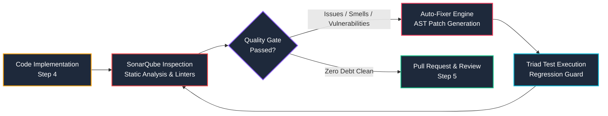

# AI-Native SDLC Engine

> **The Universal, Model-Agnostic Zero-Debt SDLC Automation Framework**  
> *Automate the entire software engineering lifecycle — from task planning to merged PR — with continuous technical debt auto-remediation across any AI model, IDE, terminal, or CI/CD pipeline.*

[](CHANGELOG.md)
[](https://python.org)
[](https://github.com/langchain-ai/langgraph)
[](https://github.com/techdeveloper-org/ai-native-sdlc-engine/actions/workflows/ci.yml)
[](LICENSE)
[](#the-zero-debt-architecture)
[](#multi-model--multi-platform-execution)
[](#quick-start)

---

## What Is AI-Native SDLC Engine?

**AI-Native SDLC Engine** is an extensible, model-agnostic software development lifecycle automation framework built on LangGraph. Rather than functioning as a narrow conversational assistant or a single-vendor tool, it acts as an **autonomous engineering team in a box** that eliminates technical debt continuously on every single pull request.

Traditional AI coding assistants (Copilot, Cursor) operate line-by-line or function-by-function — they generate code and stop, leaving test suites, impact analysis, PR creation, reviews, documentation, and technical debt accumulation entirely to humans.

The **AI-Native SDLC Engine** automates the entire lifecycle end-to-end:
1. **Pre-Flight Guard**: Validates Unicode, UTF-8 encodings, and environment paths.
2. **Codebase Archaeology & Call Graph Scan**: Scans ASTs across 4 languages (Python, Java, TypeScript, Kotlin) to discover blast radiuses, hot nodes, and danger zones *before* changing code.
3. **Adaptive Planning & Prompt Assembly**: Scores complexity on a 1–25 scale, detects fast-paths, and builds grounded multi-agent execution bundles.
4. **Issue Lifecycle**: Opens tracked GitHub and Jira issues automatically.
5. **Isolated Workspace**: Provisions feature branches (`feature/ISSUE-KEY`).
6. **Strict Standards Enforcement**: Enforces clean architecture, design tokens, and Level 2.2 contract docstrings (zero noisy inline narration).
7. **Triad Test Generation**: Generates positive, negative, and edge-case test suites (JUnit5, Mockito, Pytest).
8. **Continuous Zero-Debt Remediation**: Triggers integrated SonarQube static analysis with an automated multi-turn fix loop (`auto_fixer.py`) before opening a PR.
9. **Autonomous PR & Code Review**: Opens the PR with automated call-graph impact diffs, runs multi-agent peer reviews, and enforces 4 quality gates.
10. **Living Documentation & Diagrams**: Generates 13 UML diagram types (Mermaid + Draw.io) and updates OpenAPI specs and SRS documentation.
11. **Telemetry & Audit Release**: Logs Prometheus metrics, OpenTelemetry distributed traces, append-only JSON audit logs, and closes the ticket.

---

## Capability Comparison Matrix

| Capability | AI-Native SDLC Engine | GitHub Copilot | Cursor | Devin |
|---|:---:|:---:|:---:|:---:|
| **Universal Model Support** | **Claude · OpenAI · Gemini · Ollama** | OpenAI only | Anthropic / OpenAI | Proprietary |
| **Zero-Debt Auto-Remediation Loop** | **Yes (SonarQube + AST Auto-Fixer)** | — | — | — |
| **Pre-Change Call Graph Impact Analysis** | **Yes (Python, Java, TS, Kotlin)** | — | — | — |
| **Breaking Change Detection (Graph Diff)** | **Yes** | — | — | — |
| **Autonomous Issue Lifecycle (GitHub + Jira)** | **Yes (Create → Sync → Close)** | — | — | — |
| **Triad Test Suite Generation (Pos/Neg/Edge)** | **Yes** | — | Partial | — |
| **Automated PR & Multi-Agent Peer Review** | **Yes** | — | — | Partial |
| **13 UML Diagram Types (Mermaid + Draw.io)** | **Yes** | — | — | — |
| **Living Documentation Updates (Step 7)** | **Yes** | — | — | — |
| **SonarQube Quality Gate Auto-Heal Loop** | **Yes** | — | — | — |
| **Extensible Quality Adapter Surface** | **Yes (SonarQube, Snyk, Semgrep)** | — | — | — |
| **Headless CI/CD Automation (Actions/Jenkins)** | **Yes** | — | — | — |
| **Docker & Kubernetes Microservice Ready** | **Yes** | — | — | — |
| **Token Optimization Layer** | **Yes (60–85% Context Savings)** | — | — | — |

---

## The Zero-Debt Architecture



### Why "Zero-Debt by Construction"?
In typical projects, developers write features under time pressure, promising to "clean up technical debt later." The debt never gets resolved until system architecture degrades.

The AI-Native SDLC Engine enforces **Zero-Debt by Construction**:
- **Continuous Remediation on Every PR**: As code is implemented, the SonarQube orchestrator (`langgraph_engine/sdlc_pipeline/sonarqube/orchestrator.py`) runs static analysis directly against the modified files.
- **Automated AST-Level Patching**: If cognitive complexity, code duplication, security hotspots, or bugs are flagged, `auto_fixer.py` generates an AST-level refactoring patch, applies it, and re-validates against test suites.
- **Dead Code Pruning**: Step 0 Call Graph scanner identifies unreachable classes, unused exports, and orphan functions, ensuring obsolete code is excised before merge.
- **Extensible Quality Tooling Adapter**: Standardized `QualityGate` interfaces allow plugging in additional linters, security tools, and vulnerability scanners (SonarQube, Semgrep, Snyk, Trivy, CodeQL) without modifying core graph topology.

---

## End-to-End Workflow

```mermaid
flowchart TD
    IN(["Task Input"])

    L0["Level 0: Pre-Flight Guard\nUnicode check · encoding fix · path normalization"]
    L1["Level 1: Context & Session Sync\nParallel complexity [1-25] and context extraction"]
    ST["Standards & Policies\nLoaded from disk dynamically — zero overhead"]
    
    subgraph L2["Level 2: SDLC Execution Core (9 Active Steps)"]
        direction TB
        S0["Step 0: CallGraph Scan & Pre-Analysis\nHot nodes · danger zones · blast radius · template fast-path"]
        S1["Step 1: Task Orchestration & Planning\nMaster template prompt assembly · dynamic agent routing"]
        S2["Step 2: Issue Lifecycle\nGitHub Issue created · Jira ticket synced"]
        S3["Step 3: Branch Provisioning\nfeature/PROJ-123 or issue branch"]
        S4["Step 4: Implementation & Standards Enforcement\nClean architecture · Level 2.2 docstrings · zero inline narration"]
        S4_TEST["Step 4b: Triad Test Generation\nPositive · Negative · Edge-case test suites"]
        S4_DEBT["Step 4c: Zero-Debt Healing Loop\nSonarQube scan + AST auto-fixer"]
        S5["Step 5: Pull Request & Automated Code Review\nPR opened · Call graph diff review · Quality gates"]
        S6["Step 6: Issue & Ticket Closure\nGitHub + Jira closed · notification dispatched"]
        S7["Step 7: Living Documentation & Diagrams\n13 UML diagram types (Mermaid + Draw.io) · API spec update"]
        S8["Step 8: Final Telemetry & Audit Release\nPrometheus metrics · OTel spans · JSON audit log · voice alert"]
        
        S0 --> S1 --> S2 --> S3 --> S4 --> S4_TEST --> S4_DEBT --> S5 --> S6 --> S7 --> S8
    end

    OUT(["Zero-Debt Shipped PR"])

    IN --> L0 --> L1 --> ST --> L2 --> OUT

    style IN fill:#0f172a,stroke:#64748b,stroke-width:2px,color:#ffffff
    style OUT fill:#0f172a,stroke:#10b981,stroke-width:2px,color:#ffffff
    style L0 fill:#1e293b,stroke:#a855f7,stroke-width:2px,color:#ffffff
    style L1 fill:#1e293b,stroke:#0284c7,stroke-width:2px,color:#ffffff
    style ST fill:#1e293b,stroke:#eab308,stroke-width:2px,color:#ffffff
    style S0 fill:#1e293b,stroke:#10b981,stroke-width:2px,color:#ffffff
    style S1 fill:#1e293b,stroke:#10b981,stroke-width:2px,color:#ffffff
    style S2 fill:#1e293b,stroke:#3b82f6,stroke-width:2px,color:#ffffff
    style S3 fill:#1e293b,stroke:#3b82f6,stroke-width:2px,color:#ffffff
    style S4 fill:#1e293b,stroke:#f59e0b,stroke-width:2px,color:#ffffff
    style S4_TEST fill:#1e293b,stroke:#06b6d4,stroke-width:2px,color:#ffffff
    style S4_DEBT fill:#1e293b,stroke:#ef4444,stroke-width:2px,color:#ffffff
    style S5 fill:#1e293b,stroke:#f59e0b,stroke-width:2px,color:#ffffff
    style S6 fill:#1e293b,stroke:#10b981,stroke-width:2px,color:#ffffff
    style S7 fill:#1e293b,stroke:#10b981,stroke-width:2px,color:#ffffff
    style S8 fill:#1e293b,stroke:#d946ef,stroke-width:2px,color:#ffffff
```



---

## Multi-Model & Multi-Platform Execution

The engine is built to run everywhere — with any model, in any environment:

```
                      ┌────────────────────────────────────────┐
                      │          AI-Native SDLC Engine         │
                      └───────────────────┬────────────────────┘
                                          │
        ┌───────────────────┬─────────────┴───────┬───────────────────┐
        ▼                   ▼                     ▼                   ▼
┌───────────────┐   ┌───────────────┐     ┌───────────────┐   ┌───────────────┐
│ Direct CLI    │   │ Docker / K8s  │     │ CI/CD Runner  │   │ Claude Plugin │
│ Terminal Tool │   │ Microservice  │     │ Headless Auto │   │ & IDE Surface │
└───────┬───────┘   └───────┬───────┘     └───────┬───────┘   └───────┬───────┘
        │                   │                     │                   │
        └───────────────────┼─────────────────────┴───────────────────┘
                            ▼
              ┌───────────────────────────┐
              │ Dynamic LLM Provider Mesh │
              └─────────────┬─────────────┘
                            │
       ┌──────────────┬─────┴────────┬──────────────┐
       ▼              ▼              ▼              ▼
┌─────────────┐┌─────────────┐┌─────────────┐┌─────────────┐
│  Anthropic  ││   OpenAI    ││   Google    ││ Local GPU / │
│   Claude    ││    GPT-4o   ││ Gemini 2.5  ││   Ollama    │
└─────────────┘└─────────────┘└─────────────┘└─────────────┘
```

---

## Quick Start

### 1. Prerequisites
- **Python**: 3.10+
- **Git**: 2.30+
- **LLM API Key** (choose any provider):
  - Anthropic: `ANTHROPIC_API_KEY`
  - OpenAI: `OPENAI_API_KEY`
  - Gemini: `GEMINI_API_KEY`
  - Local: [Ollama](https://ollama.ai) running locally (zero API key needed)
- **GitHub Token** (optional, for automated issue & PR tracking): `GITHUB_TOKEN`

### 2. Installation
```bash
git clone https://github.com/techdeveloper-org/ai-native-sdlc-engine.git
cd ai-native-sdlc-engine
pip install -r requirements.txt
cp .env.example .env
# Configure your preferred LLM provider key in .env
```

---

### 3. Execution Modalities

#### Modality A: Universal CLI Framework (Local Workstation)
Run tasks directly from your terminal using either the high-level `sdlc` CLI or the direct pipeline runner:

```bash
# 1. High-level CLI: Run an autonomous SDLC task
python scripts/cli.py run "Fix authentication timeout bug in token validator"

# 2. Direct Pipeline Runner: Full autonomous mode (all 9 active steps)
python scripts/3-level-flow.py --invoked-by=run-pipeline \
  --message="Implement tenant isolation middleware"

# 3. Plan & Decompose only (read-only planning, changes nothing)
python scripts/3-level-flow.py --invoked-by=plan \
  --message="Design payment reconciliation service"

# 4. Template Fast-Path (~0s instant planning skip)
python scripts/3-level-flow.py --invoked-by=run-pipeline \
  --message="Add user audit export" \
  --orchestration-template=orchestration_template.example.json
```

#### Modality B: Containerized Microservice (Docker & Kubernetes)
Run the engine inside isolated containers for team or server environments:

```bash
# Docker Compose
docker compose -f docker/docker-compose.yml up

# Single Docker run
docker build -t ai-native-sdlc-engine -f docker/Dockerfile .
docker run --env-file .env ai-native-sdlc-engine \
  python scripts/3-level-flow.py --invoked-by=run-pipeline --message="Your task description"

# Kubernetes Deployment
kubectl apply -f k8s/
```

#### Modality C: Headless CI/CD Automation (GitHub Actions / Jenkins)
Run the engine as an autonomous QA/review agent on every push or pull request:

```yaml
# .github/workflows/ai-sdlc.yml
name: AI-Native SDLC Review & Debt Guard
on: [pull_request]
jobs:
  review:
    runs-on: ubuntu-latest
    steps:
      - uses: actions/checkout@v4
      - uses: actions/setup-python@v5
        with: { python-version: "3.11" }
      - run: pip install -r requirements.txt
      - env:
          ANTHROPIC_API_KEY: ${{ secrets.ANTHROPIC_API_KEY }}
          GITHUB_TOKEN: ${{ secrets.GITHUB_TOKEN }}
        run: |
          python scripts/3-level-flow.py --invoked-by=review --message="Automated PR Review and Debt Guard"
```

#### Modality D: Claude Code Plugin Integration
If using the Claude Code CLI, install the plugin package for native slash commands:

```bash
/plugin marketplace add techdeveloper-org/ai-native-sdlc-engine
/plugin install ai-native-sdlc-engine@techdeveloper-org

# Available slash commands:
/ai-native-sdlc-engine:plan          # Steps 0-1  — Analyse and decompose, change nothing
/ai-native-sdlc-engine:implement     # Steps 2-4  — Issue, branch, code
/ai-native-sdlc-engine:review        # Steps 5-6  — PR, automated review, close issue
/ai-native-sdlc-engine:document      # Step 7     — Docs and 13 UML diagrams
/ai-native-sdlc-engine:release       # Step 8     — Telemetry, audit log, release
/ai-native-sdlc-engine:run-pipeline  # Steps 0-8  — Full autonomous SDLC end-to-end
/ai-native-sdlc-engine:doctor        # Environment & MCP diagnostic health check
```

---

## Autonomous SDLC Governance Policies (42 Policies)

The engine operates under **42 autonomous governance policies** housed in [`policies/`](policies/). Rather than relying on fuzzy model intuition, every engineering action — from pre-flight safety checks and AST call-graph impact scans to SonarQube zero-debt quality gates and atomic git commits — is bound by deterministic, enforceable policy contracts across 7 functional domains:

### 1. Pre-Flight & Execution Safety (6 Policies)

| Policy & Specification | Core Behavioral Rule | Practical Real-World Example |
|---|---|---|
| [`policies/anti-hallucination-enforcement.md`](policies/anti-hallucination-enforcement.md) | Enforces strict grounding and verification against hallucinated packages, APIs, and paths. | If an LLM attempts to import `org.company.auth.SuperSecurity`, the AST grounding gate blocks execution and requires a package declared in `pom.xml` / `requirements.txt`. |
| [`policies/encoding-validation-policy.md`](policies/encoding-validation-policy.md) | Validates source files against invisible non-ASCII bytes and UTF-8 BOM corruptions. | Prevents hidden byte-order marks (`\xef\xbb\xbf`) or Windows smart quotes (`“`, `”`) from breaking Java compilers or Python AST parsers. |
| [`policies/windows-path-policy.md`](policies/windows-path-policy.md) | Enforces normalized forward slashes (`/`) and sanitizes drive letters on Windows workstations. | Automatically normalizes `C:\Users\app\src\main.py` to `C:/Users/app/src/main.py` so cross-platform tools, shell scripts, and Docker containers don't fail on unescaped backslashes. |
| [`policies/context-reading-policy.md`](policies/context-reading-policy.md) | Mandatory pre-flight mandate requiring the agent to read `README.md`, `SRS.md`, and `CLAUDE.md` before coding. | Prevents an agent from rewriting a working authentication module simply because it didn't read the existing architecture spec first. |
| [`policies/recovery-policy.md`](policies/recovery-policy.md) | Emergency Level -1 recovery ladder that executes when environment or pre-flight checks fail. | If a corrupted temporary cache or broken lockfile is detected during startup, auto-recovers the workspace to a clean state before restarting the pipeline. |
| [`policies/error-recovery-policy.md`](policies/error-recovery-policy.md) | Operational error-recovery protocol with retry budgets, fallback ladders, and exponential backoff. | If a rate-limit error (HTTP 429) occurs during an API call, applies an exponential jittered backoff rather than crashing the pipeline. |

### 2. Architecture, Graph & Pattern Intelligence (5 Policies)

| Policy & Specification | Core Behavioral Rule | Practical Real-World Example |
|---|---|---|
| [`policies/callgraph-analysis-policy.md`](policies/callgraph-analysis-policy.md) | Scans codebase ASTs across 4 languages to compute blast radius before touching code. | When modifying `UserService.authenticate()`, the call graph detects that 14 controllers and 3 batch jobs depend on it, automatically flagging them for regression testing. |
| [`policies/code-graph-analysis-policy.md`](policies/code-graph-analysis-policy.md) | Generates structural knowledge graph nodes, edges, and coupling metrics at Step 3.0.1. | Analyzes coupling metrics (Afferent/Efferent coupling) and identifies circular package dependencies before new classes are committed. |
| [`policies/architecture-script-mapping-policy.md`](policies/architecture-script-mapping-policy.md) | Maps high-level architecture decisions deterministically to runnable scripts. | Ensures that when a task requires a database schema migration, the engine invokes `flyway_migrate.py` rather than improvising manual SQL executions. |
| [`policies/cross-project-patterns-policy.md`](policies/cross-project-patterns-policy.md) | Scans proven architectural patterns across sibling repositories. | Automatically applies the organization's approved JWT + Refresh Token rotation pattern rather than inventing a custom, untested token approach. |
| [`policies/intelligent-decision-engine-policy.md`](policies/intelligent-decision-engine-policy.md) | Automated decision tree traversal for technology and framework choices. | Given an incoming task for a REST API, evaluates language, throughput, and existing repo stack to select Spring Boot vs FastAPI. |

### 3. Planning, Task Breakdown & Model Routing (6 Policies)

| Policy & Specification | Core Behavioral Rule | Practical Real-World Example |
|---|---|---|
| [`policies/automatic-task-breakdown-policy.md`](policies/automatic-task-breakdown-policy.md) | Mandates structured task decomposition into numbered sub-tasks with status tracking. | A request like "build payment webhook" is decomposed into 4 discrete tasks (DTO validation, HMAC verification, DB persistence, audit event) before any coding starts. |
| [`policies/task-phase-enforcement-policy.md`](policies/task-phase-enforcement-policy.md) | Mandatory blocking policy enforcing phase transitions and stop conditions. | Blocks the engine from advancing to "Step 5: PR Review" if "Step 4: Implementation" has failing tests or unaddressed compilation errors. |
| [`policies/task-progress-tracking-policy.md`](policies/task-progress-tracking-policy.md) | Mandates real-time tracking of tasks and status updates in `task.md`. | Updates `task.md` with checkboxes `[x]` as each sub-task finishes, giving developers live visibility into execution progress. |
| [`policies/prompt-generation-policy.md`](policies/prompt-generation-policy.md) | Enforces strict prompt composition, role constraints, and context isolation. | Packages task instructions with exact file paths, constraints, and acceptance criteria while excluding noisy conversational chat history. |
| [`policies/intelligent-model-selection-policy.md`](policies/intelligent-model-selection-policy.md) | Dynamically routes tasks to the optimal model (Claude, GPT, Gemini, Ollama) based on complexity and cost. | Routes trivial typo fixes to Haiku/Flash to minimize cost and latency, while routing complex multi-file architectural refactoring to Claude Opus or GPT-4o. |
| [`policies/proactive-consultation-policy.md`](policies/proactive-consultation-policy.md) | Documents the deprecation of interactive pauses in favor of automated complexity-based routing. | Instead of halting headlessly in CI to ask "Do you want to proceed?", the engine uses automated risk scores to make deterministic choices. |

### 4. Clean Architecture, Quality Gates & Coding Standards (7 Policies)

| Policy & Specification | Core Behavioral Rule | Practical Real-World Example |
|---|---|---|
| [`policies/coding-standards-enforcement-policy.md`](policies/coding-standards-enforcement-policy.md) | Enforces Level 2.2 microservices standards (clean architecture, strict DTO/Entity separation, docstrings). | Rejects code where a controller directly returns a JPA Entity instead of an immutable Response DTO, preventing accidental schema leakage. |
| [`policies/common-standards-policy.md`](policies/common-standards-policy.md) | Enforces common interface patterns, error wrappers, and result containers across services. | Ensures all API endpoints return `ApiResponse<T>` with standardized timestamp, status, and payload fields across microservices. |
| [`policies/quality-gate-policy.md`](policies/quality-gate-policy.md) | Evaluates SonarQube static analysis, code coverage, and cyclomatic complexity gates. | Fails the build if test coverage drops below 80% or if new security vulnerabilities (e.g., SQL injection risk) are flagged. |
| [`policies/test-case-policy.md`](policies/test-case-policy.md) | Mandates Triad testing (Positive, Negative, Edge-case) for all implementations. | For an email validator, requires tests for valid email (positive), missing `@` (negative), and 255-character length boundary (edge case). |
| [`policies/test-generation-policy.md`](policies/test-generation-policy.md) | Governs automated test suite generation and mocking strategies. | Detects JUnit5 + Mockito in Java projects and generates parameterized tests with isolated mocks and assertions. |
| [`policies/common-failures-prevention.md`](policies/common-failures-prevention.md) | Pre-checks commands and tools against a knowledge base of known failure patterns. | Automatically converts Bash chained `&&` commands to PowerShell `;` chains on Windows to prevent runtime command failures. |
| [`policies/unicode-fix-policy.md`](policies/unicode-fix-policy.md) | Automatically strips non-ASCII corruptions, BOM marks, and invalid unicode encodings. | Replaces corrupted characters like `\u200b` (zero-width space) with valid ASCII before compiling code. |

### 5. Issue Lifecycle, PR & Git Governance (5 Policies)

| Policy & Specification | Core Behavioral Rule | Practical Real-World Example |
|---|---|---|
| [`policies/github-issues-integration-policy.md`](policies/github-issues-integration-policy.md) | Mandates Issue-First workflow: a tracked issue must exist before touching code. | Automatically creates GitHub issue `#335` with task description, acceptance criteria, and labels before creating a git branch. |
| [`policies/pr-code-review-policy.md`](policies/pr-code-review-policy.md) | Governs branch management, PR creation, and automated multi-agent peer review. | Automatically provisions branch `feature/335-auth`, opens a PR, attaches call graph diffs, and runs automated code review. |
| [`policies/issue-closure-policy.md`](policies/issue-closure-policy.md) | Mandates verification checklist and commit linkage before closing issues. | Prevents closing an issue until the merge commit hash is verified and all acceptance criteria pass validation. |
| [`policies/git-auto-commit-policy.md`](policies/git-auto-commit-policy.md) | Enforces atomic commits at each completed milestone with descriptive messages. | Auto-commits after unit test generation with message `test: add triad test coverage for auth service (#335)`. |
| [`policies/version-release-policy.md`](policies/version-release-policy.md) | Governs semantic versioning (SemVer) and release notes generation. | Bumps `2.1.1` to `2.1.2` for bug fixes or `2.2.0` for features, and updates `CHANGELOG.md` under `[Unreleased]`. |

### 6. Execution Engine, Tool Optimization & Concurrency (7 Policies)

| Policy & Specification | Core Behavioral Rule | Practical Real-World Example |
|---|---|---|
| [`policies/implementation-execution-policy.md`](policies/implementation-execution-policy.md) | Governs safe code execution in isolated workspaces and branches. | Ensures code modifications occur in a separate feature branch or sandbox without corrupting the main working branch. |
| [`policies/parallel-execution-policy.md`](policies/parallel-execution-policy.md) | Governs parallel execution of independent sub-tasks using parallel subagents. | Concurrently runs frontend UI layout and backend DTO creation across two isolated subagents, merging results cleanly. |
| [`policies/tool-optimization-policy.md`](policies/tool-optimization-policy.md) | Optimizes tool invocations, token limits, and response caching. | Restricts file reads to 800 lines/45KB chunks to prevent context window overflow when inspecting large files. |
| [`policies/tool-usage-optimization-policy.md`](policies/tool-usage-optimization-policy.md) | Governs tool selection and prevents redundant reads and greps. | Uses AST symbol lookups instead of full-text grep scans across 10,000 files to save up to 85% of context tokens. |
| [`policies/mcp-plugin-discovery-policy.md`](policies/mcp-plugin-discovery-policy.md) | Governs discovery, health checks, and permissions for MCP servers and tools. | Verifies that `git-ops` or `figma-api` MCP server is alive and authenticated before dispatching tool calls. |
| [`policies/hook-system-policy.md`](policies/hook-system-policy.md) | Documents hook lifecycle, safety guards, and stop conditions. | Defines how Stop hooks and Notification hooks verify workspace cleanliness before completing a turn. |
| [`policies/file-management-policy.md`](policies/file-management-policy.md) | Enforces atomic file writes, temporary file placement, and protected file paths. | Prevents overwriting `.git`, `.env`, or credential files, and requires atomic writes using temporary swap files. |

### 7. Session, Context & Telemetry Governance (6 Policies)

| Policy & Specification | Core Behavioral Rule | Practical Real-World Example |
|---|---|---|
| [`policies/session-management-policy.md`](policies/session-management-policy.md) | Multi-window session isolation, session ID tracking, and state persistence. | Isolates session states between multiple terminal tabs using unique session IDs (`SESSION-20261113-...`). |
| [`policies/context-management-policy.md`](policies/context-management-policy.md) | Context budgeting, token limits, and compaction triggers. | Automatically triggers context summarization when token usage reaches 75% of model capacity. |
| [`policies/metrics-monitoring-policy.md`](policies/metrics-monitoring-policy.md) | Telemetry, Prometheus metric exports, and execution latency tracking. | Exports `pipeline_runs_total` and `step_duration_seconds` to Prometheus on port 9090 for observability dashboards. |
| [`policies/documentation-update-policy.md`](policies/documentation-update-policy.md) | Step 13 policy mandating synchronized documentation updates after any code modification. | If an API parameter is added to a controller, Step 13 updates OpenAPI specs and `README.md` in the same commit. |
| [`policies/final-summary-policy.md`](policies/final-summary-policy.md) | Step 14 policy for delivering structured final summaries upon completion. | Prints a structured summary of files changed, tests passed, PR links, and open items at task close. |
| [`policies/user-preferences-policy.md`](policies/user-preferences-policy.md) | Global user communication preferences governance (Hinglish tone, detail level, verification). | Adapts output language to Hinglish and respects user's preference for detailed explanations with concrete examples. |

---

## 13 Automated UML Diagram Types

Every execution of Step 7 automatically regenerates living architectural diagrams from AST scans into both **Mermaid** and editable **Draw.io (`.drawio`)** formats:

| Category | Diagram Types Generated | Output Formats |
|---|---|---|
| **Structural** | Class Diagram, Package Diagram, Component Diagram, Object Diagram, Deployment Diagram, Composite Structure | `.md` (Mermaid) + `.drawio` |
| **Behavioral** | Activity Diagram, State Diagram, Use Case Diagram | `.md` (Mermaid) + `.drawio` |
| **Interaction** | Sequence Diagram, Communication Diagram, Interaction Overview, Call Graph Diagram | `.md` (Mermaid) + `.drawio` |

---

## Extensible MCP Tool Ecosystem

The engine coordinates with 13 modular Model Context Protocol (MCP) servers providing 295+ specialized engineering tools:

| MCP Server | Domain / Capabilities |
|---|---|
| **`git-ops`** | Local Git operations (commit, branch, rebase, diff, stash, log) |
| **`github-api`** | GitHub platform operations (issues, PRs, code reviews, labels, milestones) |
| **`jira-api`** | Enterprise issue tracking, sprint planning, backlog refinement |
| **`uml-diagram`** | Multi-language AST-to-Mermaid diagram synthesis |
| **`drawio-diagram`** | Headless conversion of Mermaid diagrams into native `.drawio` XML |
| **`token-optimizer`** | Intelligent context budgeting, AST navigation, and deduplication (60–85% token reduction) |
| **`session-mgr`** | Persistent cross-session memory, accumulators, and tag search |
| **`policy-enforcement`**| Compliance verification, system health, and rule enforcement |
| **`figma-api` / `figma`**| Design token extraction, component mapping, and accessibility scanning |
| **`jenkins-ci`** | Build triggering, log watching, and CI pipeline validation |
| **`llm-router` / `provider`** | Dynamic multi-model routing across Anthropic, OpenAI, Gemini, and Ollama |

---

## Production Observability & Health

- **Liveness & Readiness**: `GET /health` and `GET /readiness` on port `8080` (OpenAPI 3.0 specification in `docs/api/OPENAPI_SPEC.yaml`).
- **Prometheus Metrics**: `GET /metrics` on port `9090` exposes 9 core telemetry metrics:
  - `pipeline_runs_total` (labels: `mode`, `status`)
  - `step_duration_seconds` (histogram across steps 0–8)
  - `verification_violations_total` (labels: `level`, `node`)
  - `active_sessions_count`
- **OpenTelemetry Tracing**: Distributed spans covering `@verify_node`, pipeline steps, and tool dispatches.
- **Audit Ledger**: Append-only JSON audit logs with daily rotation for regulatory compliance.

---

## Directory Structure

```
ai-native-sdlc-engine/
├── langgraph_engine/             # Core Engine & LangGraph Pipeline StateGraph
│   ├── orchestrator.py           # Main pipeline definition & wiring
│   ├── core/                     # Cross-cutting: LazyLoader, ErrorHandler, logger
│   ├── state/                    # FlowState, StepKeys, WorkflowContextOptimizer
│   ├── routing/                  # Conditional edge transition logic
│   ├── sdlc_pipeline/            # Level 2 SDLC Execution Core (Steps 0-8)
│   │   ├── nodes/                # Step implementation facades
│   │   ├── sonarqube/            # SonarQube Facade & Automated Refactoring Loop
│   │   └── architecture/         # Prompt generation & task breakdown helpers
│   ├── diagrams/                 # 13 UML diagram generators + Draw.io converter
│   ├── parsers/                  # Multi-language AST parsers (Python, Java, TS, Kotlin)
│   ├── library/                  # Sibling resource resolver
│   └── engine_logging/           # OpenTelemetry tracing, Prometheus exporter, error logger
├── docker/                       # Dedicated Containerization Package
│   ├── Dockerfile                # Multi-stage lean build
│   ├── docker-compose.yml        # Multi-container orchestration
│   └── .dockerignore             # Container build exclusion rules
├── policies/                     # 42 Autonomous SDLC Governance Policy Specifications
├── uml/                          # 19 Architectural UML Diagram Specifications (Mermaid)
├── k8s/                          # Kubernetes Manifests (Deployment, Service, ConfigMap, HPA)
├── plugin/                       # Claude Code & IDE Extension Packaging
│   ├── .claude-plugin/           # Plugin manifest & identity
│   ├── commands/                 # Slash command implementations
│   └── scripts/                  # MCP registration & pipeline bridges
├── scripts/                      # Framework CLI & Operational Utilities
│   ├── 3-level-flow.py           # Direct pipeline entry point
│   ├── cli.py                    # Unified framework CLI
│   └── bin/                      # Background daemon scripts
├── src/                          # Supporting services & shared utilities
└── tests/                        # Comprehensive Triad Test Suites (Unit, Integration, E2E)
```

---

## Contributing & Community

- **Issues & Defects**: [GitHub Issues](https://github.com/techdeveloper-org/ai-native-sdlc-engine/issues)
- **Discussions & Architecture Ideas**: [GitHub Discussions](https://github.com/techdeveloper-org/ai-native-sdlc-engine/discussions)
- **Security Disclosures**: Open a private advisory under the Security tab.

---

## License

Distributed under the **MIT License**. See [`LICENSE`](LICENSE) for details.
