<!-- Generated by pipeline Step 13 -- do not edit manually -->

# Activity Diagram

Source: direct AST/source read of the single canonical graph factory,
`create_flow_graph(hook_mode)` in `langgraph_engine/orchestrator.py:650-843`. Every
activity node below is one `graph.add_node(...)` call and every arrow is one
`graph.add_edge(...)` or one branch of a `graph.add_conditional_edges(...)` mapping.

Selection criterion: the complete compiled pipeline. 27 activity nodes, 5 decision
nodes, START and END = 34 nodes. Complete, not truncated.

```mermaid
flowchart TD
    START([START]) --> PU["preflight_guard_unicode<br/>node_unicode_fix"]
    PU --> PE["preflight_guard_encoding<br/>node_encoding_validation"]
    PE --> PW["preflight_guard_windows<br/>node_windows_path_check"]
    PW --> PM["preflight_guard_merge"]

    PM --> D1{"route_after_preflight_guard"}
    D1 -->|blocked| ASK["ask_preflight_guard_fix"]
    D1 -->|ok| L1S

    ASK --> D2{"route_after_preflight_guard<br/>_user_choice"}
    D2 -->|auto-fix| FIX["fix_preflight_guard"]
    D2 -->|skip / force_continue| L1S
    FIX --> PU

    L1S["level1_session<br/>node_session_loader"]
    L1S --> L1CX["level1_complexity"]
    L1S --> L1CT["level1_context"]
    L1CX --> L1M["level1_merge"]
    L1CT --> L1M
    L1M --> L1C["level1_cleanup"]

    L1C --> INIT["sdlc_init"]
    INIT --> S0["sdlc_step0_pre_analysis<br/>CallGraph scan"]

    S0 --> D3{"route_pre_analysis"}
    D3 -->|template fast-path| S2
    D3 -->|normal| S0PC["sdlc_step0_project_context"]

    S0PC --> S0CG["sdlc_step0_callgraph_snapshot"]
    S0CG --> S1["sdlc_step1_task_orchestration<br/>prompt_gen -> decompose -> execute"]
    S1 --> S2["sdlc_step2_issue_tracking<br/>GitHub issue"]
    S2 --> S3["sdlc_step3_branch_setup"]

    S3 --> D4{"hook_mode?"}
    D4 -->|"hook_mode=True"| OUT
    D4 -->|"hook_mode=False"| S4["sdlc_step4_implementation"]

    S4 --> SH4["sdlc_standards_hook_step4<br/>apply_integration_step10"]
    SH4 --> S5["sdlc_step5_pr_review"]

    S5 --> D5{"route_after_step5_review"}
    D5 -->|review failed<br/>retries remain| RETRY["sdlc_step5_retry"]
    D5 -->|passed or<br/>max retries| S6["sdlc_step6_issue_closure"]
    RETRY --> S4

    S6 --> S7["sdlc_step7_documentation"]
    S7 --> SH7["sdlc_standards_hook_step7<br/>apply_integration_step13"]
    SH7 --> S8["sdlc_step8_final_summary"]
    S8 --> OUT["sdlc_output"]
    OUT --> ENDN([END])
```

## Notes on accuracy

- MEASURED: the `hook_mode` gate is not a runtime conditional edge. It is a Python
  `if hook_mode:` at `orchestrator.py:779` that builds a *different graph*: in hook mode
  the nodes for Steps 4 through 8 are never added at all. It is drawn as a decision node
  because that is how it behaves from the caller's view, but the two modes compile to
  two different topologies. The hook-mode graph has 18 nodes; the full-mode graph has 27.
- MEASURED: `fix_preflight_guard` loops unconditionally back to `preflight_guard_unicode`
  (`orchestrator.py:693`). The loop is bounded by `preflight_max_attempts_reached` in
  `FlowState`, not by graph structure.
- MEASURED: `level1_complexity` and `level1_context` both fan out from `level1_session`
  and both fan into `level1_merge`. LangGraph executes these two in parallel; the
  diagram shows the fork and join.
- MEASURED: the template fast-path branch from `sdlc_step0_pre_analysis` jumps directly
  to `sdlc_step2_issue_tracking`, skipping `step0_project_context`,
  `step0_callgraph_snapshot` and `step1_task_orchestration` entirely.
- Node identifiers are the LangGraph node IDs as registered. The comment blocks in
  `orchestrator.py` still use the retired `Level -1 / Level 3 / Steps 8-14` numbering
  while the node IDs use the current `preflight_guard / sdlc_stepN` names. The node IDs
  are authoritative here.
