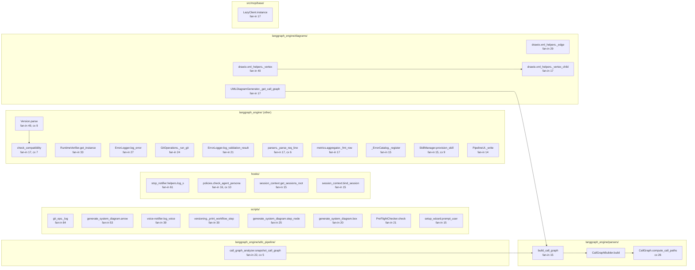

<!-- Generated by pipeline Step 13 -- do not edit manually -->

# Call Graph Diagram

Source: CallGraph (rule 45 section 6, priority 1), file cap lifted.
MEASURED: 411 files, 480 classes, 3506 methods, 1340 standalone functions,
26114 call edges, 75 inheritance edges.

Truncation notice per rule 45 section 4.1 is carried as a Mermaid comment inside the
diagram below so it travels with the rendered artifact.

## Highest cyclomatic complexity (MEASURED, production only)

Fan-in and complexity are different risks. The heaviest methods by cyclomatic
complexity are largely NOT the highest fan-in methods:

| Cyclomatic | Method |
|---|---|
| 63 | `sdlc_pipeline/figma_workflow.py::Level3FigmaWorkflow.step1_extract_design_tokens` |
| 37 | `parsers/call_graph_builder_legacy.py::CallGraphBuilder._analyze_typescript` |
| 34 | `diagrams/ast_analyzer.py::UMLAstAnalyzer.extract_classes` |
| 27 | `diagrams/drawio/converter.py::DrawioConverter._sequence_diagram` |
| 26 | `parsers/graph_model.py::CallGraph.compute_call_paths` |
| 26 | `diagrams/legacy_generator.py::UMLDiagramGenerator.generate_call_graph_diagram` |
| 25 | `sdlc_pipeline/review_criteria.py::ReviewCriteria._evaluate_test_coverage` |
| 25 | `diagrams/legacy_generator.py::UMLDiagramGenerator.generate_all` |
| 23 | `parsers/typescript_parser.py::TypeScriptRegexParser._parse_to_visitor` |
| 23 | `diagrams/drawio/converter.py::DrawioConverter._usecase_diagram` |

Repo-wide MEASURED maximum cyclomatic complexity is 107; mean is 4.43.

## Notes on accuracy

- Edge grading matters more than the ranking. The builder resolves call targets by
  simple name, so unqualified calls to builtin container and string methods bind to
  same-named user methods. Before grading, the apparent top of this chart was
  `JsonlAppender.append` at fan-in 1592 (every `list.append()` in the codebase) and
  `ErrorMessages.format` at 756 (every `str.format()`). Both are artefacts. The
  MEASURED breakdown of all 26114 call edges is:

  | Class | Count |
  |---|---|
  | unresolved (target not a known project method) | 18608 |
  | dropped: target name collides with a builtin method name | 2853 |
  | dropped: multiple same-name candidates, cross-file | 433 |
  | high-confidence, used for all diagrams here | 4220 |

- 76 production methods have a high-confidence fan-in of 10 or more. This chart shows
  the top 30 of those. The cut is by rank, so a method at fan-in 14 is included and
  another at fan-in 14 may not be; ties were broken by the underlying ordering.
- The 6 drawn edges are a connected spine among the shown nodes, not the full edge set
  between them. Showing all inter-node edges among 30 hubs would be unreadable and the
  50-node cap governs nodes, not edges; the spine was chosen to make the CallGraph
  bootstrap path visible.
- The three highest-fan-in entries (`_log`, `log_s`, `arrow`) are logging and
  string-building helpers, not architectural hubs. High fan-in here measures utility
  reuse, not importance.
- `_analyze_typescript` (cx 37), `_analyze_java` (cx 21) and `_analyze_kotlin` (cx 19)
  are among the most complex methods in the repository and never execute against it:
  all 411 source files are `.py`. That is 77 points of cyclomatic complexity carried for
  languages this codebase does not contain.
