<!-- Generated by pipeline Step 13 -- do not edit manually -->

# Class Diagram

Source: CallGraph (rule 45 section 6, priority 1), built with the file cap lifted.
MEASURED totals: 411 files, 480 classes, 3506 methods. All 411 source files are `.py`.

Selection criterion: every class that participates in a project-internal inheritance
hierarchy rooted at an abstract base or at `Exception`. 42 nodes = 40 project classes
plus the two external roots `ABC` and `Exception`. Nothing was dropped to fit the
50-node cap.

MEASURED scope accounting: of 480 project classes, exactly 75 participate in any
inheritance edge (27 test classes, 48 production). 405 have no base class at all and
are out of scope for this diagram by construction, not by truncation. Of the 48
production participants, 40 are drawn; the 8 omitted are single-child hierarchies
rooted outside the project and are listed in the notes below.

Methods are shown on abstract bases only, to keep the hierarchy legible. Concrete
subclass method counts appear in `call_graph_diagram.md`.

```mermaid
classDiagram
    class ABC {
        <<abstract>>
    }
    class Exception {
        <<external>>
    }

    class LLMProvider {
        <<abstract>>
        +call(prompt, model, temperature, timeout)
        +is_available()
        +name()
    }
    class ClaudeCLIProvider
    class AnthropicProvider

    class LazyClient {
        <<abstract>>
        +instance()
        +get()
        +get_or_raise()
        +available()
        +health_check()
        +reset_all()
    }
    class GitRepoClient
    class GitHubApiClient

    class AbstractDiagramGenerator {
        <<abstract>>
        +diagram_type()
        +generate(analysis_data, format)
        +render_to_svg(markup)
    }
    class ActivityDiagramGenerator
    class ClassDiagramGenerator
    class CommunicationDiagramGenerator
    class ComponentDiagramGenerator
    class CompositeDiagramGenerator
    class DeploymentDiagramGenerator
    class InteractionDiagramGenerator
    class ObjectDiagramGenerator
    class PackageDiagramGenerator
    class SequenceDiagramGenerator
    class StateDiagramGenerator
    class UsecaseDiagramGenerator

    class AbstractLanguageParser {
        <<abstract>>
        +language()
        +file_extensions()
        +parse_file(file_path, content)
        +extract_classes(content, file_path)
        +extract_methods(content, file_path)
    }
    class PythonASTParser
    class JavaRegexParser
    class TypeScriptRegexParser
    class KotlinRegexParser

    class AbstractIntegration {
        <<abstract>>
        +name()
        +is_enabled()
        +state()
        +artifact_id()
        +create(context)
        +on_branch(branch_name, context)
        +update(context)
        +on_review(pr_data, context)
        +close(context)
    }
    class GitHubIntegration
    class JiraIntegration
    class JenkinsIntegration
    class FigmaIntegration
    class IntegrationState {
        <<enumeration>>
        DISABLED
        READY
        CREATED
        IN_PROGRESS
        IN_REVIEW
        DONE
        ERROR
    }

    class WorkflowEngineError
    class PolicyExecutionError
    class SessionNotFoundError
    class GitOperationError
    class GitHubAPIError
    class ConfigurationError
    class StepExecutionError
    class BudgetExceededError
    class LibrarySetupError
    class SecretsMissingError

    ABC <|-- LLMProvider
    ABC <|-- LazyClient
    ABC <|-- AbstractDiagramGenerator
    ABC <|-- AbstractLanguageParser
    ABC <|-- AbstractIntegration

    LLMProvider <|-- ClaudeCLIProvider
    LLMProvider <|-- AnthropicProvider

    LazyClient <|-- GitRepoClient
    LazyClient <|-- GitHubApiClient

    AbstractDiagramGenerator <|-- ActivityDiagramGenerator
    AbstractDiagramGenerator <|-- ClassDiagramGenerator
    AbstractDiagramGenerator <|-- CommunicationDiagramGenerator
    AbstractDiagramGenerator <|-- ComponentDiagramGenerator
    AbstractDiagramGenerator <|-- CompositeDiagramGenerator
    AbstractDiagramGenerator <|-- DeploymentDiagramGenerator
    AbstractDiagramGenerator <|-- InteractionDiagramGenerator
    AbstractDiagramGenerator <|-- ObjectDiagramGenerator
    AbstractDiagramGenerator <|-- PackageDiagramGenerator
    AbstractDiagramGenerator <|-- SequenceDiagramGenerator
    AbstractDiagramGenerator <|-- StateDiagramGenerator
    AbstractDiagramGenerator <|-- UsecaseDiagramGenerator

    AbstractLanguageParser <|-- PythonASTParser
    AbstractLanguageParser <|-- JavaRegexParser
    AbstractLanguageParser <|-- TypeScriptRegexParser
    AbstractLanguageParser <|-- KotlinRegexParser

    AbstractIntegration <|-- GitHubIntegration
    AbstractIntegration <|-- JiraIntegration
    AbstractIntegration <|-- JenkinsIntegration
    AbstractIntegration <|-- FigmaIntegration
    AbstractIntegration ..> IntegrationState : state()

    Exception <|-- WorkflowEngineError
    Exception <|-- BudgetExceededError
    Exception <|-- LibrarySetupError
    Exception <|-- SecretsMissingError
    WorkflowEngineError <|-- PolicyExecutionError
    WorkflowEngineError <|-- SessionNotFoundError
    WorkflowEngineError <|-- GitOperationError
    WorkflowEngineError <|-- GitHubAPIError
    WorkflowEngineError <|-- ConfigurationError
    WorkflowEngineError <|-- StepExecutionError
```

## Notes on accuracy

- MEASURED: 75 inheritance edges exist in the full graph. 27 belong to test classes -
  25 deriving from `unittest.TestCase`, 1 from `logging.Handler`, 1 from `Exception` -
  all excluded here as test scaffolding.
- The 8 omitted production participants, each a lone child of a base outside the
  project, are: `_HealthHandler` (BaseHTTPRequestHandler), `TokenBucket`,
  `_RegexVisitor` and `PolicyRegistry` (all `object`), `ResourceResolver` (Protocol),
  `_CallGraphVisitor` (ast.NodeVisitor), `FlowState` (TypedDict), and `DrawioConverter`
  (`_BaseDrawioConverter`). None forms a hierarchy; each would render as an isolated
  pair.
- MEASURED: `AbstractDiagramGenerator` has exactly 12 concrete subclasses. Rule 45
  mandates 13 diagram types. There is no `CallGraphDiagramGenerator` subclass; the
  call-graph type is produced by `UMLDiagramGenerator.generate_call_graph_diagram()`
  in `diagrams/legacy_generator.py`, which is not part of this hierarchy. This gap is
  real, not a rendering omission.
- MEASURED: `AbstractLanguageParser` has 4 concrete subclasses for Python, Java,
  TypeScript and Kotlin. The parsers exist; the repository contains zero `.java`,
  `.ts`, `.tsx` and `.kt` files, so `JavaRegexParser`, `TypeScriptRegexParser` and
  `KotlinRegexParser` never execute against this codebase. Capability is not coverage.
