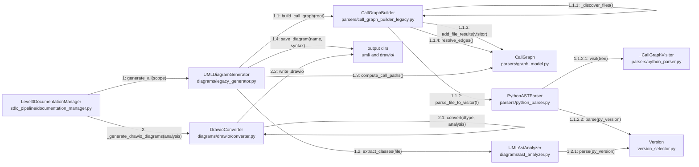

<!-- Generated by pipeline Step 13 -- do not edit manually -->

# Communication Diagram

Source: CallGraph high-confidence class-to-class call edges (rule 45 section 6,
priority 1), cross-checked against source.

Scenario: the same Step 7 documentation and diagram collaboration shown in
`sequence_diagram.md`. A communication diagram and a sequence diagram of the same
interaction are two views of one model; keeping them on the same scenario is
deliberate. This view emphasises which objects are linked; the sequence view
emphasises ordering.

Selection criterion: every class reachable in the measured collaboration rooted at
`Level3DocumentationManager`, following high-confidence edges only. 10 nodes.
Complete for this collaboration, not truncated.

Message numbers are Dewey-decimal nesting, matching the call depth.

## Link provenance

| Link | Measured edge weight | Source |
|---|---|---|
| DM to UG | 14 | `documentation_manager.py:150-153`, `:238-240` |
| UG to AA | 7 | `legacy_generator.py` `_classes_from_call_graph` |
| UG to CG | 3 | `legacy_generator.py:93` region |
| UG to CGB | 1 | `legacy_generator.py:90-93` |
| CGB to CG | 17 (file-level) | `call_graph_builder_legacy.py:88-96` |
| PP to VIS | 4 | `python_parser.py` |
| PP to VER | 4 | `python_parser.py` |
| AA to VER | 4 | `ast_analyzer.py` |
| CGB to _RegexVisitor | 3 | not drawn - dead path, see notes |
| DM to DC | not in graph | `documentation_manager.py:310` (lazy import inside method) |

## Notes on accuracy

- MEASURED: `CallGraphBuilder` also has 3 call edges to `_RegexVisitor`, the visitor
  shape used by the Java, TypeScript and Kotlin regex parsers. That link is omitted from
  the diagram because those parsers never fire against this repository: all 411 source
  files are `.py`. The link exists in code; it carries no traffic here.
- The `DM to DC` link does NOT appear in the CallGraph. `_generate_drawio_diagrams()`
  imports `DrawioConverter` lazily inside the method body
  (`documentation_manager.py:310`), and the AST-based builder does not resolve calls
  through function-local imports. It is drawn here because it was confirmed by direct
  source read, and it is flagged so the gap in the graph is visible rather than silently
  patched.
- MEASURED: `DrawioConverter.SUPPORTED_TYPES` has 12 entries
  (`class, sequence, activity, state, component, package, deployment, usecase, object,
  communication, composite, interaction`). Rule 45 section 5 names 13 draw.io files.
  There is no `call_graph` draw.io type. Message 2.1 therefore runs 12 times, not 13.
- Message numbering is nesting depth, not wall-clock order across the two top-level
  messages. Message 2 runs after message 1 completes.
