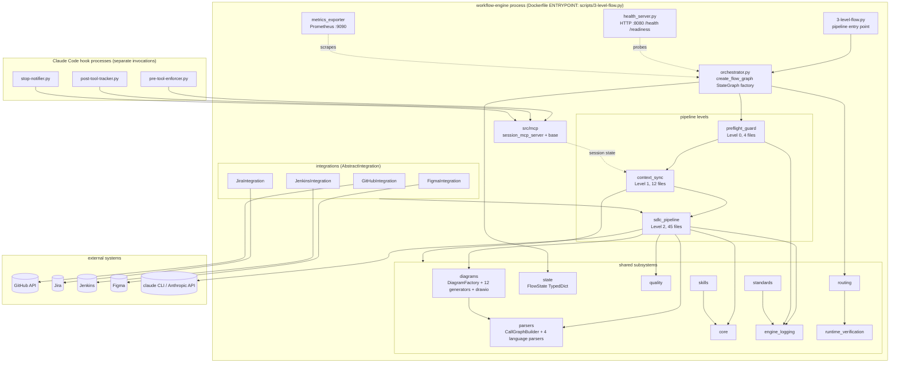

<!-- Generated by pipeline Step 13 -- do not edit manually -->

# Component Diagram

Source: CallGraph package structure (rule 45 section 6, priority 1) for in-repo
components; `Dockerfile`, `docker-compose.yml` and `k8s/` for the process boundary;
`langgraph_engine/integrations/` and `langgraph_engine/llm_call.py` for the external
interfaces. All components shown correspond to directories or files that exist on disk.

Node count: 32 components plus 6 grouping containers = 38. Not truncated.

## Notes on accuracy

- MEASURED: `langgraph_engine/integrations/` contains exactly 4 concrete
  `AbstractIntegration` subclasses (GitHub, Jira, Jenkins, Figma). Each is gated by an
  environment flag (`ENABLE_JIRA`, `ENABLE_JENKINS`, `ENABLE_FIGMA`) that defaults to
  off, so in a default run only the GitHub path is live.
- MEASURED: `src/mcp/` contains 5 modules plus a `base/` package. It is the only MCP
  server present in this repository. `CLAUDE.md` documents 13 MCP servers; the other 12
  live in separate repositories that are not on this filesystem and were NOT verified.
  They are deliberately absent from this diagram rather than drawn on documentation
  alone.
- MEASURED: the three hook scripts in `hooks/` are thin shims over the
  `pre_tool_enforcer/` (21 files), `post_tool_tracker/` (12 files) and `stop_notifier/`
  (5 files) packages. They run as separate Claude Code invocations, not inside the
  engine process, which is why they are drawn outside the process boundary.
- INFERRED (not measured): the dotted `MCPSRV -.session state.-> L1` relation reflects
  session-file coupling described in project docs. It is not backed by a resolved call
  edge in the graph.
- `metrics_exporter` and `health_server` are drawn as components because the Dockerfile
  exposes ports 8080 and 9090 and `k8s/deployment.yaml` probes `/health` and
  `/readiness` on 8080. Both are gated by `ENABLE_HEALTH_SERVER` / `ENABLE_METRICS`,
  default off.
