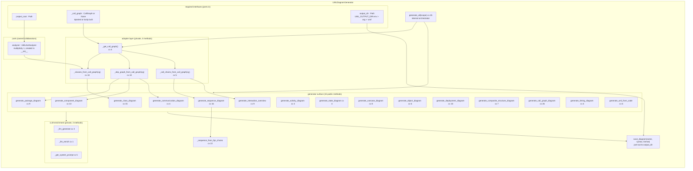

<!-- Generated by pipeline Step 13 -- do not edit manually -->

# Composite Structure Diagram

Source: CallGraph (rule 45 section 6, priority 1) for the method inventory and outgoing
call edges, plus a direct read of `__init__` for the part multiplicities.

Subject: `UMLDiagramGenerator` in `langgraph_engine/diagrams/legacy_generator.py`.
Selection criterion: the largest production class by method count in the MEASURED graph
(26 methods; next largest is `Level3GitHubWorkflow` at 25). It is also the class that
implements rule 45, which makes its internal structure the most load-bearing in this
directory.

Node count: 31 parts and ports plus 6 grouping containers = 37. Complete for this
class, not truncated.

## Notes on accuracy

- MEASURED: 26 methods total = 15 public `generate_*` + `generate_all` + `save_diagram`
  + 4 CallGraph adapters + 3 LLM helpers + `_sequence_from_fqn_chains` + `__init__`.
  That is 26. Every method in the class is represented; the grouping into "adapter
  layer", "generator surface" and "LLM enrichment" is my organisation of a flat class,
  not a structure declared in the code.
- MEASURED: the class exposes 15 `generate_*` methods but rule 45 mandates 13 diagram
  types. `generate_timing_diagram` and `generate_uml_from_code` are extra surface with
  no rule-45 file name. Conversely `generate_all` only calls 13 of the 15.
- MEASURED cyclomatic complexity is shown per method. The three heaviest are
  `generate_call_graph_diagram` (26), `generate_all` (25) and
  `_sequence_from_fqn_chains` (22). Repo-wide maximum is 107, so this class is complex
  but not the worst offender.
- `analyzer : UMLAstAnalyzer` is the only true part: it is constructed in `__init__` and
  owned for the lifetime of the generator. `_call_graph` is a reference, optionally
  injected by the caller and otherwise built lazily, so it is drawn as a required
  interface rather than as an owned part.
- The `GENS --> LLMP` and `GENS --> SINK` arrows are group-level aggregations of many
  individual method calls, drawn once to keep the node count meaningful.
