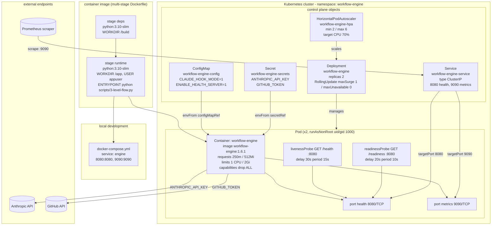

<!-- Generated by pipeline Step 13 -- do not edit manually -->

# Deployment Diagram

Source: infrastructure manifests on disk (rule 45 section 6 does not route deployment
through the CallGraph; the graph carries no deployment facts). Files read:
`Dockerfile`, `docker-compose.yml`, `k8s/deployment.yaml`, `k8s/service.yaml`,
`k8s/hpa.yaml`, `k8s/configmap.yaml`, `k8s/secret.yaml`.

Selection criterion: every node, artifact and external endpoint declared in those seven
files. 17 nodes plus 6 grouping containers = 23. Complete, not truncated.

## Notes on accuracy

- MEASURED version skew, worth flagging: `k8s/deployment.yaml` pins
  `image: workflow-engine:1.6.1` and labels the pod `version: "1.6.1"`, while
  `CLAUDE.md` declares the project at version 1.21.4. The manifests have not been
  re-pinned since 1.6.1. The image tag is drawn as it is written, not as it "should" be.
- MEASURED: `k8s/configmap.yaml` sets `CLAUDE_HOOK_MODE: "1"`. The deployed pod
  therefore runs the 18-node hook-mode graph, not the 27-node full-mode graph. See
  `activity_diagram.md`.
- MEASURED: `k8s/secret.yaml` ships placeholder values (`REPLACE_WITH_BASE64_VALUE`)
  for both keys. It is a template, not a populated secret.
- The Prometheus scraper is drawn because `k8s/service.yaml` carries a
  `prometheus.io/port: "9090"` annotation. No Prometheus deployment exists in this
  repository; the scraper is external and assumed, which is why it is drawn outside the
  cluster boundary as an endpoint rather than as a workload.
- No Ingress, NetworkPolicy, PersistentVolume, ServiceAccount or RBAC manifest exists in
  `k8s/`. Their absence is real; nothing was omitted for space.
