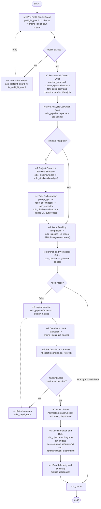

<!-- Generated by pipeline Step 13 -- do not edit manually -->

# Interaction Overview Diagram

Source: `create_flow_graph()` topology in `langgraph_engine/orchestrator.py:650-843`
for the control flow, and CallGraph high-confidence cross-package edges for the
subsystem each interaction fragment engages.

An interaction overview is a control-flow diagram whose activity nodes are references
to other interactions. Each `ref` node below names the subsystem the fragment drives;
the two fragments with dedicated diagrams in this directory are marked.

Selection criterion: one fragment per pipeline phase in the compiled full-mode graph,
plus the decision nodes that route between them. 22 nodes (15 fragments, 4 decisions,
START, END, sdlc_output). Complete, not truncated.

## Fragment to subsystem mapping

| Fragment | Pipeline nodes | Primary package | MEASURED cross-package edges |
|---|---|---|---|
| F1 | `preflight_guard_unicode/encoding/windows/merge` | `preflight_guard` (4 files) | to `engine_logging` 26, to `langgraph_engine` root 5 |
| F2 | `ask_preflight_guard_fix`, `fix_preflight_guard` | `preflight_guard` | same as F1 |
| F3 | `level1_session/complexity/context/merge/cleanup` | `context_sync` (12 files) | to `context_sync/architecture` 5, to `hooks` 4, to `analysis` 1 |
| F4 | `sdlc_step0_pre_analysis` | `sdlc_pipeline` | to `parsers` 15 |
| F5 | `sdlc_step0_project_context/callgraph_snapshot` | `sdlc_pipeline/nodes` (10 files) | to `sdlc_pipeline` 24, to `engine_logging` 7 |
| F6 | `sdlc_step1_task_orchestration` | `sdlc_pipeline/architecture` (4 files) | to `runtime_verification` 2 |
| F7 | `sdlc_step2_issue_tracking` | `integrations` (7 files) | to `sdlc_pipeline` 13, to `core` 1 |
| F8 | `sdlc_step3_branch_setup` | `sdlc_pipeline` | to `github` 6 |
| F9 | `sdlc_step4_implementation` | `sdlc_pipeline/nodes` | to `quality` 2, to `metrics` 4 |
| F10 | `sdlc_standards_hook_step4` | `standards` (4 files) | to `engine_logging` 9, to `library` 2 |
| F11 | `sdlc_step5_pr_review` | `sdlc_pipeline` + `integrations` | to `github` 6 |
| F12 | `sdlc_step5_retry` | `sdlc_pipeline` | none of its own |
| F13 | `sdlc_step6_issue_closure` | `integrations` | to `sdlc_pipeline` 13 (shared with F7) |
| F14 | `sdlc_step7_documentation`, `sdlc_standards_hook_step7` | `sdlc_pipeline` | to `diagrams` 16, to `parsers` 15 |
| F15 | `sdlc_step8_final_summary` | `metrics` (5 files) | `runtime_verification` to `metrics` 2 |

## Notes on accuracy

- The edge counts in the table are MEASURED cross-package high-confidence call edges,
  attributed to the fragment whose package they originate from. They are a proxy for
  coupling, not a count of runtime messages within that fragment.
- F12 has no cross-package edges of its own: `sdlc_step5_retry` is a state-increment
  node. That is why its cell reads "none of its own" rather than being padded.
- The `hook_mode=True` branch at D3 is a build-time branch, not a runtime one. See the
  note in `activity_diagram.md`.
- Fragments F1 through F15 are 15 of the 27 compiled graph nodes; several nodes are
  grouped into one fragment (for example F1 covers four preflight nodes). No pipeline
  node is unrepresented.
