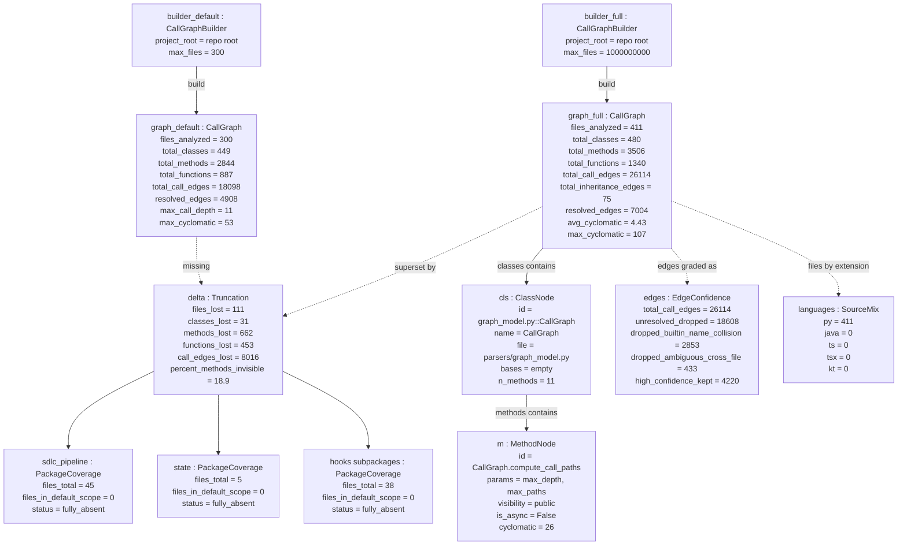

<!-- Generated by pipeline Step 13 -- do not edit manually -->

# Object Diagram

Source: MEASURED runtime instance snapshot. The `CallGraphBuilder` was instantiated
in-process against this project root and `build()` was called, twice: once at the
shipping default cap and once with `CallGraphBuilder.__init__.__defaults__` patched to
lift it. Every slot value below is an observed value from `get_stats()`, not a modelled
one. No source file was modified.

Selection criterion: the two builder instances and the object graph each one produced,
plus one representative class node and method node from the complete run.
12 nodes. Complete, not truncated.

## Notes on accuracy

- Both builder instances and both graphs are MEASURED. The run that produced
  `graph_full` is the same run that produced every other diagram in this directory.
- `max_call_depth` differs between this run and the original coverage probe (11 vs 7)
  because `compute_call_paths()` is bounded by `CLAUDE_CG_MAX_PATHS`, which this run
  raised to 200000. Depth is a function of how many paths were enumerated, not of the
  file set alone. The three figures used for verification against the probe
  (411 files, 480 classes, 3506 methods) matched exactly.
- `edges : EdgeConfidence` records a grading applied on top of the builder's own output.
  The builder resolves call targets by simple name, so an unqualified `list.append()`
  binds to any user method also called `append`. 2853 edges were dropped on that basis
  (worst single case: `JsonlAppender.append` with a fan-in of 1592) and 433 more for
  multi-candidate cross-file ambiguity. Every diagram in this directory that shows call
  relationships uses the 4220 surviving edges.
- `languages : SourceMix` is MEASURED by extension over all 411 discovered files. The
  repository is Python-only. Project documentation describing the CallGraph as covering
  "4 languages (Python/Java/TS/Kotlin)" describes parser capability, not graph content.
- `graph_default` is what the shipping pipeline actually sees. `graph_full` is what
  exists. The `delta` object is the gap between the two, and the three
  `PackageCoverage` objects name the largest fully-invisible subtrees.
