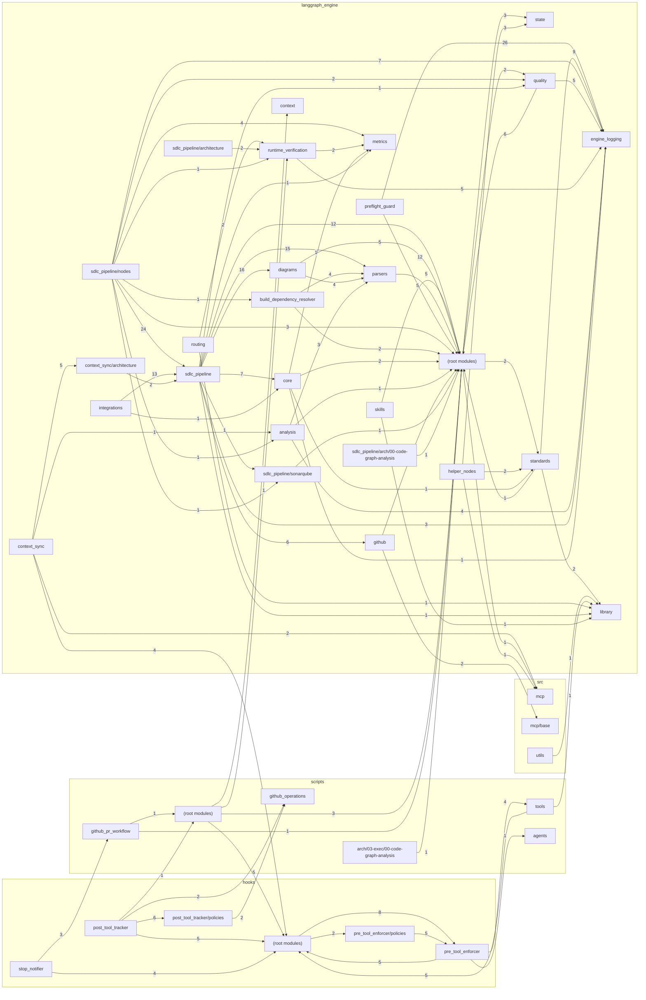

<!-- Generated by pipeline Step 13 -- do not edit manually -->

# Package Diagram

Source: CallGraph (rule 45 section 6, priority 1), file cap lifted.
MEASURED: 411 `.py` files in 57 directories - 53 production packages (336 files),
4 test packages (75 files).

Selection criterion: the 42 production packages that participate in at least one
MEASURED cross-package high-confidence call edge. Test packages are excluded (they
call into nearly everything and would obscure the production topology). 11 production
packages are omitted because they have zero measured cross-package call edges;
that is an absence of evidence, not a truncation.

Edge weight = number of high-confidence resolved call edges crossing the package
boundary. 42 package nodes plus 4 grouping containers = 46 nodes; 86 edges are drawn.

## Notes on accuracy

- MEASURED file counts per drawn package (largest first): `langgraph_engine` root 55,
  `sdlc_pipeline` 19, `diagrams` 19, `pre_tool_enforcer/policies` 15,
  `sdlc_pipeline/nodes` 10, `parsers` 9, `scripts/tools` 9, `core` 9, `context_sync` 8,
  `scripts` root 8, `runtime_verification` 8.
- `langgraph_engine` root is a 55-module catch-all, not a cohesive package. It has the
  highest in-degree in the diagram for that reason. Treating it as one node overstates
  its cohesion; it is drawn as one node because the directory is one directory.
- `langgraph_engine/sdlc_pipeline` and its subpackages are fully represented here. Under
  the shipping 300-file cap all 45 of these files are invisible to the CallGraph, so a
  default-configuration run of this generator would have drawn an empty Level 2 core.
- Edge direction is caller to callee. Weights are call-edge counts, not import counts.
