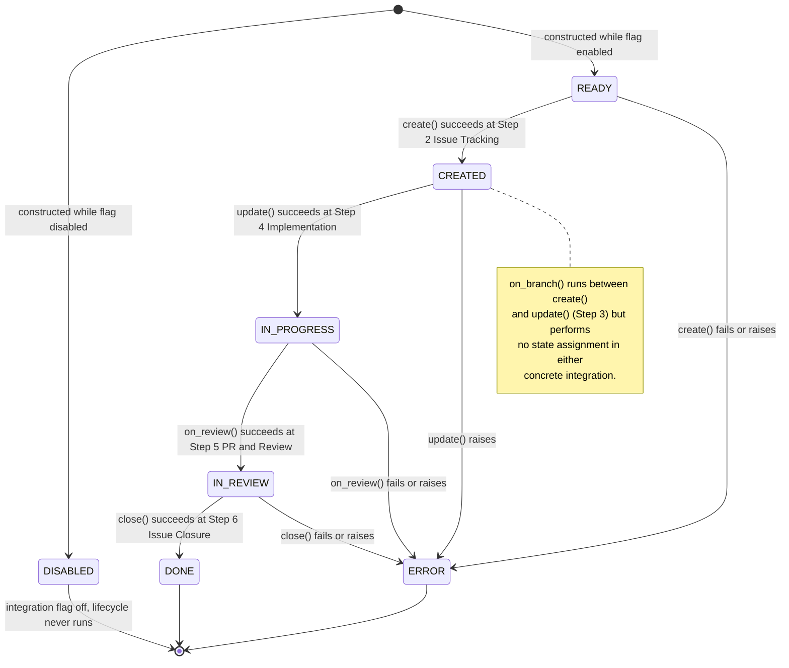

<!-- Generated by pipeline Step 13 -- do not edit manually -->

# State Diagram

Source: AST-measured enum and assignment sites (rule 45 section 6). This is the only
explicit, enumerated state machine in the codebase:
`IntegrationState` in `langgraph_engine/integrations/base.py:15-24`, driven by the
`AbstractIntegration` lifecycle methods.

Selection criterion: all 7 enum members and every measured assignment to `self._state`
across the concrete integrations. 7 states plus the initial/final pseudostate = 8
nodes. Complete, not truncated.

## Transition provenance

Every transition below is a MEASURED assignment site, not an inferred one.

| From | To | Trigger | GitHub | Jira |
|---|---|---|---|---|
| initial | DISABLED | `AbstractIntegration.__init__` | `base.py:52` | `base.py:52` |
| initial | READY | subclass `__init__`, flag enabled | `github_integration.py:42` | `jira_integration.py:37` |
| READY | CREATED | `create()` | `:115` | `:110` |
| READY | ERROR | `create()` failure | `:117`, `:121` | `:112`, `:116` |
| CREATED | IN_PROGRESS | `update()` | `:165` | `:190` |
| IN_PROGRESS | IN_REVIEW | `on_review()` | `:195` | `:229` |
| IN_PROGRESS | ERROR | `on_review()` failure | `:199` | `:233` |
| IN_REVIEW | DONE | `close()` | `:227` | `:272` |
| IN_REVIEW | ERROR | `close()` failure | `:231` | `:276` |

## Notes on accuracy

- MEASURED: `on_branch()` is declared on `AbstractIntegration` and implemented by both
  concrete integrations, but neither assigns `self._state`. The lifecycle therefore has
  a step (Step 3, branch setup) with no corresponding state transition. That gap is
  real and is annotated in the diagram rather than papered over with an invented
  self-transition.
- MEASURED: `JenkinsIntegration` and `FigmaIntegration` are also `AbstractIntegration`
  subclasses but contain zero `self._state` assignments of their own. They inherit the
  base initialisation to `DISABLED` and never advance. This diagram reflects the
  GitHub and Jira implementations, which are the only two that drive the machine.
- There is no `ERROR` recovery edge in any implementation: once `ERROR` is assigned,
  no measured code path assigns another state on the same instance.
- The LangGraph pipeline's own retry loop (Step 5 review failure back to Step 4) is
  control flow over `FlowState`, not an enumerated state machine. It is drawn in
  `activity_diagram.md` where it belongs.
