# Call Graph Diagram

> Auto-generated by AI-Native SDLC Engine | Last updated: 2026-08-09

```mermaid
flowchart LR
    subgraph standalone_group[Functions]
        hooks_ide_paths_py__create_necessary_dirs["create_necessary_dirs()"]
        hooks_ide_paths_py__get_install_base["get_install_base()"]
        hooks_ide_paths_py__get_data_base["get_data_base()"]
        hooks_ide_paths_py__is_ide_mode["is_ide_mode()"]
        hooks_policy_tracking_helper_py___session_dirname["_session_dirname(session_id)"]
        hooks_policy_tracking_helper_py__get_session_id["get_session_id()"]
        hooks_policy_tracking_helper_py__record_policy_execution["record_policy_execution(session_id, policy_name, policy_script)"]
        hooks_policy_tracking_helper_py__record_sub_operation["record_sub_operation(session_id, policy_name, operation_name)"]
        hooks_policy_tracking_helper_py___create_empty_flow_trace["_create_empty_flow_trace(session_id)"]
        hooks_policy_tracking_helper_py__get_flow_trace_summary["get_flow_trace_summary(session_id)"]
        hooks_post_tool_tracker_py__main["main()"]
        hooks_post_tool_tracker_py__load_session_progress["load_session_progress()"]
        hooks_post_tool_tracker_py__save_session_progress["save_session_progress(state)"]
        hooks_post_tool_tracker_py__log_tool_entry["log_tool_entry(entry)"]
        hooks_post_tool_tracker_py___clear_session_flags["_clear_session_flags(pattern_prefix, session_id)"]
        hooks_post_tool_tracker_py___detect_result_failure["_detect_result_failure(tool_response)"]
        hooks_pre_tool_enforcer_py__check_checkpoint_pending["check_checkpoint_pending(tool_name)"]
        hooks_pre_tool_enforcer_py__check_task_breakdown_pending["check_task_breakdown_pending(tool_name)"]
        hooks_pre_tool_enforcer_py__check_skill_selection_pending["check_skill_selection_pending(tool_name)"]
        hooks_pre_tool_enforcer_py__check_context_read_complete["check_context_read_complete(tool_name)"]
        hooks_pre_tool_enforcer_py__check_level1_sync_complete["check_level1_sync_complete(tool_name)"]
        hooks_pre_tool_enforcer_py__check_bash["check_bash(command)"]
        hooks_pre_tool_enforcer_py__check_python_unicode["check_python_unicode(content)"]
        hooks_pre_tool_enforcer_py__check_grep["check_grep(tool_input)"]
        hooks_pre_tool_enforcer_py__check_read["check_read(tool_input)"]
        hooks_pre_tool_enforcer_py__check_write_edit["check_write_edit(tool_name, tool_input)"]
        hooks_pre_tool_enforcer_py__check_dynamic_skill_context["check_dynamic_skill_context(tool_name, tool_input, trace_context)"]
        hooks_pre_tool_enforcer_py__check_failure_kb_hints["check_failure_kb_hints(tool_name, tool_input)"]
        hooks_pre_tool_enforcer_py___run_via_daemon_or_fallback["_run_via_daemon_or_fallback()"]
        hooks_project_session_py__get_project_session_file["get_project_session_file()"]
        hooks_project_session_py__get_legacy_session_file["get_legacy_session_file()"]
        hooks_project_session_py__read_session_id["read_session_id()"]
        hooks_session_context_py__get_memory_base["get_memory_base()"]
        hooks_session_context_py__get_sessions_root["get_sessions_root()"]
        hooks_session_context_py__get_pointer_file["get_pointer_file()"]
        hooks_session_context_py__get_legacy_progress_file["get_legacy_progress_file()"]
        hooks_session_context_py__normalize_session_id["normalize_session_id(raw)"]
        hooks_session_context_py__bind_session["bind_session(payload)"]
        hooks_session_context_py__resolve_session_id["resolve_session_id(default)"]
        hooks_session_context_py__read_session_pointer["read_session_pointer()"]
    end
    hooks_policy_tracking_helper_py__record_policy_execution --> hooks_session_context_py__get_sessions_root
    hooks_policy_tracking_helper_py__record_policy_execution --> hooks_policy_tracking_helper_py___session_dirname
    hooks_policy_tracking_helper_py__record_policy_execution --> hooks_policy_tracking_helper_py___create_empty_flow_trace
    hooks_policy_tracking_helper_py__record_policy_execution --> hooks_policy_tracking_helper_py___create_empty_flow_trace
    hooks_policy_tracking_helper_py__get_flow_trace_summary --> hooks_session_context_py__get_sessions_root
    hooks_policy_tracking_helper_py__get_flow_trace_summary --> hooks_policy_tracking_helper_py___session_dirname
    hooks_pre_tool_enforcer_py__check_write_edit --> hooks_pre_tool_enforcer_py__check_python_unicode
    hooks_pre_tool_enforcer_py___run_via_daemon_or_fallback --> hooks_session_context_py__bind_session
    hooks_project_session_py__get_project_session_file --> hooks_session_context_py__get_pointer_file
    hooks_project_session_py__get_legacy_session_file --> hooks_session_context_py__get_pointer_file
    hooks_project_session_py__read_session_id --> hooks_session_context_py__resolve_session_id
    hooks_session_context_py__get_sessions_root --> hooks_session_context_py__get_memory_base
    hooks_session_context_py__get_pointer_file --> hooks_session_context_py__get_memory_base
    hooks_session_context_py__get_legacy_progress_file --> hooks_session_context_py__get_memory_base
    hooks_session_context_py__bind_session --> hooks_session_context_py__normalize_session_id
    hooks_session_context_py__resolve_session_id --> hooks_session_context_py__normalize_session_id
    hooks_session_context_py__resolve_session_id --> hooks_session_context_py__read_session_pointer
    hooks_session_context_py__resolve_session_id --> hooks_session_context_py__get_legacy_progress_file
    hooks_session_context_py__resolve_session_id --> hooks_session_context_py__normalize_session_id
    hooks_session_context_py__read_session_pointer --> hooks_session_context_py__get_pointer_file
    hooks_session_context_py__read_session_pointer --> hooks_session_context_py__normalize_session_id
    style hooks_ide_paths_py__create_necessary_dirs stroke-width:3px
    style hooks_policy_tracking_helper_py__get_session_id stroke-width:3px
    style hooks_policy_tracking_helper_py__record_policy_execution stroke-width:3px,fill:#ff6666
    style hooks_policy_tracking_helper_py__record_sub_operation stroke-width:3px
    style hooks_policy_tracking_helper_py__get_flow_trace_summary stroke-width:3px,fill:#ff6666
    style hooks_post_tool_tracker_py__main stroke-width:3px
    style hooks_post_tool_tracker_py__load_session_progress stroke-width:3px
    style hooks_post_tool_tracker_py__save_session_progress stroke-width:3px
    style hooks_post_tool_tracker_py__log_tool_entry stroke-width:3px
    style hooks_pre_tool_enforcer_py__check_checkpoint_pending stroke-width:3px,fill:#ff6666
    style hooks_pre_tool_enforcer_py__check_task_breakdown_pending stroke-width:3px
    style hooks_pre_tool_enforcer_py__check_skill_selection_pending stroke-width:3px
    style hooks_pre_tool_enforcer_py__check_context_read_complete stroke-width:3px,fill:#ff6666
    style hooks_pre_tool_enforcer_py__check_level1_sync_complete stroke-width:3px,fill:#ff6666
    style hooks_pre_tool_enforcer_py__check_grep stroke-width:3px
    style hooks_pre_tool_enforcer_py__check_read stroke-width:3px
    style hooks_pre_tool_enforcer_py__check_write_edit stroke-width:3px,fill:#ff6666
    style hooks_pre_tool_enforcer_py__check_dynamic_skill_context stroke-width:3px
    style hooks_pre_tool_enforcer_py__check_failure_kb_hints stroke-width:3px
    style hooks_pre_tool_enforcer_py___run_via_daemon_or_fallback fill:#ff6666
    style hooks_project_session_py__get_legacy_session_file stroke-width:3px
    style hooks_session_context_py__normalize_session_id fill:#ff6666
    style hooks_session_context_py__bind_session fill:#ff6666
    style hooks_session_context_py__resolve_session_id fill:#ff6666
```

## Notes

- Generated from: C:\Users\techd\Documents\workspace-spring-tool-suite-4-4.27.0-new\ai-native-sdlc-engine
- Scope: Full project
