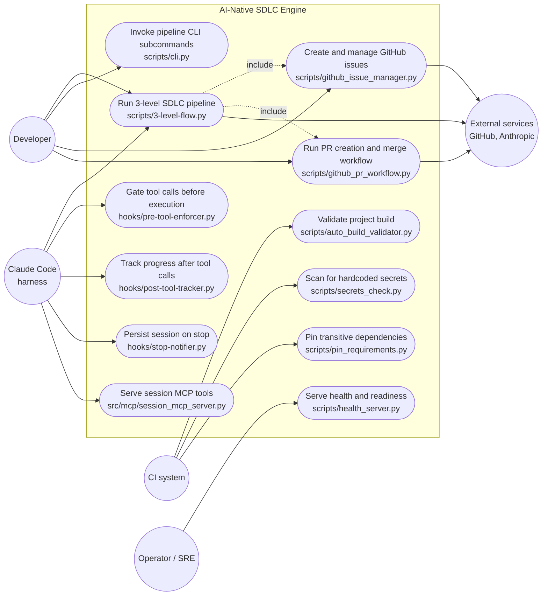

<!-- Generated by pipeline Step 13 -- do not edit manually -->

# Use Case Diagram

Source: MEASURED entry points (executable modules with a `__main__` guard or an
argparse surface) plus the hook and MCP registration points. Rule 45 section 6 permits
LLM enrichment for use case diagrams; it was not used here. Every use case below maps
to a named file, and actor-to-use-case associations are derived from how each entry
point is invoked, which is stated per row in the provenance table.

Selection criterion: all 12 measured executable entry points in `scripts/`, `hooks/`
and `src/mcp/`, grouped into use cases. 5 actors + 12 use cases + 1 system boundary
= 18 nodes. Complete, not truncated.

## Provenance and confidence

| Use case | Entry point | Evidence | Actor binding |
|---|---|---|---|
| UC1 | `scripts/3-level-flow.py` | MEASURED `__main__` guard; `Dockerfile:78` ENTRYPOINT | MEASURED for Claude Code (documented UserPromptSubmit hook); Developer binding INFERRED from CLI usability |
| UC2 | `scripts/cli.py` | MEASURED 8 argparse/`__main__` hits | INFERRED (argparse surface implies human CLI use) |
| UC3 | `scripts/github_issue_manager.py` | MEASURED module exists; no `__main__` guard found | INFERRED - imported, not run standalone |
| UC4 | `scripts/github_pr_workflow.py` | MEASURED `__main__` guard | INFERRED |
| UC5 | `scripts/auto_build_validator.py` | MEASURED `__main__` guard, docstring "run compile/build validation" | INFERRED CI |
| UC6 | `scripts/secrets_check.py` | MEASURED `__main__` + argparse; CLAUDE.md documents it as a CI gate | MEASURED-BY-DOC |
| UC7 | `scripts/pin_requirements.py` | MEASURED `__main__` + argparse | INFERRED CI |
| UC8 | `scripts/health_server.py` | MEASURED no `__main__`; started in-process, probed by k8s | MEASURED via `k8s/deployment.yaml` probes |
| UC9-11 | `hooks/*.py` | MEASURED shim files; hook registration lives in `~/.claude/settings.json`, outside this repo | MEASURED-BY-DOC |
| UC12 | `src/mcp/session_mcp_server.py` | MEASURED module exists | MEASURED-BY-DOC |

## Notes on accuracy

- Actor bindings are the weakest data in this diagram. Which human or machine invokes a
  script is not recoverable from the AST. Every binding above is labelled MEASURED,
  MEASURED-BY-DOC (asserted in `CLAUDE.md` or a manifest, not in code) or INFERRED. Do
  not read the arrows as measured facts.
- `scripts/github_issue_manager.py` and `scripts/health_server.py` have no `__main__`
  guard. They are libraries invoked in-process, not standalone commands. They are drawn
  as use cases because they represent distinct system capabilities, but they are not
  separately executable.
- The hook registration that binds UC9-UC11 to the Claude Code harness lives in
  `~/.claude/settings.json`, which is outside this repository. It was not read and not
  verified.
- No authentication, authorisation or multi-tenant actor exists in this system. The
  actors are process-level, not identity-level.
